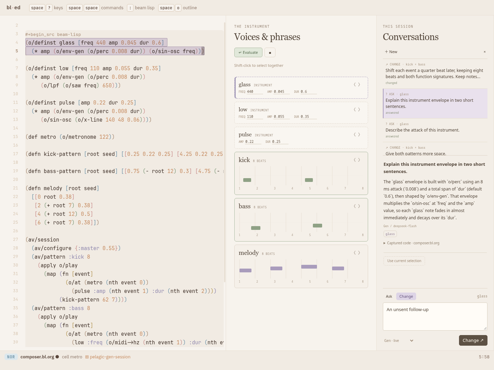
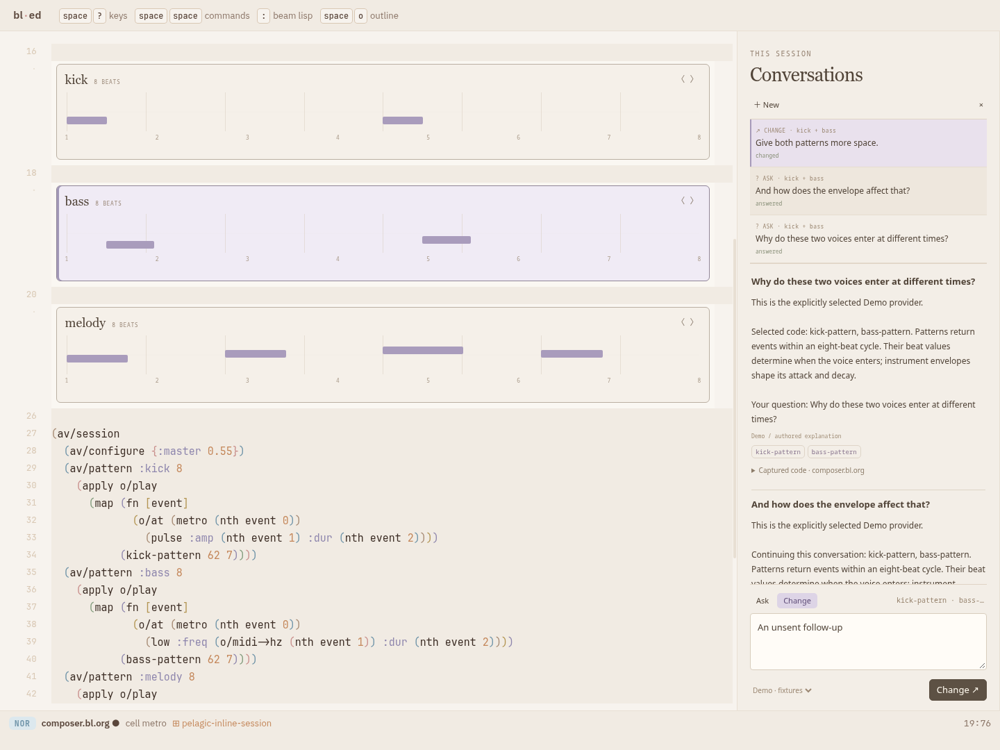
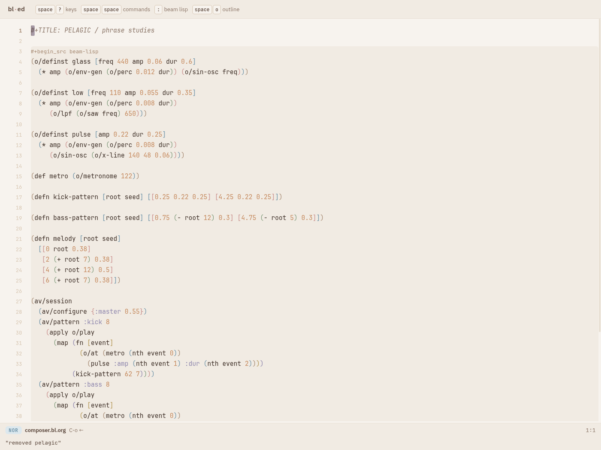

#+TITLE: Pelagic / local editing, component presentations and session conversations
#+DATE: 2026-10-21
#+STATE: DONE / VERIFIED
#+BASIS: Approved interaction direction, plus required recent-session questions/history sidebar

* Approved outcome
One real bl-ed workspace in which source and musical components refer to the
same objects. Select one or several objects, ask a question or request a change,
receive the result locally, and continue editing. Switch between components at
source positions and source/components side by side. Keep recent questions,
answers and changes in a collapsible Session sidebar.

The user approved this scope and implementation order with "Let's go for it."
Implementation is complete; acceptance boxes record the contracts and browser
scenarios verified below.

Interaction design: [[file:../../research/pelagic-gen/experience.bl.org][ordinary editing and local generation]].
Advanced evidence integration stays in [[file:../../research/pelagic-gen/evidence-follow-up.bl.org][the deferred evidence follow-up]].
PLAN-023 remains the record of the two completed earlier prototype slices.

* What the experience will do
** Shared selection
- Click a component or select a form using the existing syntax-tree motions.
- Shift-click components to add/remove targets; provide a keyboard mark command
  for adding/removing the current form. Use one command vocabulary in both views.
- A request can mix component and code targets. Deduplicate the same source
  object; normalize selected ancestors/children to nonoverlapping ranges.
- Show lavender outlines and compact target names at the local prompt.

** Local Ask and Change
- g a opens the prompt at the focused selection, with an explicit Ask / Change
  control. Inline starts in Change; sidebar starts in Ask. Keep the action visible.
- Enter submits, Shift-Enter inserts a line, Escape dismisses. Preserve native
  composition/IME behavior and ordinary typing inside inputs.
- Ask explains captured code and conversation context without editing source,
  saving, evaluating, staging audio or publishing a revision.
- Change temporarily occupies the selected area, retaining subdued previous
  content. On completion, replace the selected draft ranges and update components
  in place. Apply all targets in one undoable edit; preserve unselected source.
- Keep the existing musical performance running while generating. Ordinary live
  evaluation publishes the edited document at a musical boundary; ordinary save
  writes the source. Do not add mandatory audition or evidence review steps.
- Record both request kinds in the same Session history. A question can become
  a follow-up Change through the explicit mode control.

** Inline and split presentations
- Inline: recognized musical components occupy their source forms' positions
  in the document. Unrecognized forms, prose and surrounding code remain visible.
- Split: editable source at left, associated components at right, with shared
  target identity, selection and reveal commands.
- Toggle layouts while keeping the source editor, caret, undo, prompt draft,
  session history and selected object. Anchor the view to that object.
- Peek source expands editable code at a component's position, in either layout,
  and folds back without losing the target. Allow editing and prompting within
  the peek. Provide a visible code toggle and a keyboard command.

** Required Session sidebar
- A compact chronological list groups conversations. Each entry shows request
  kind, prompt, target labels and status; opening it shows the answer or change
  summary, with before/after source available for changes.
- Inline requests enter the sidebar automatically. Opening history never replays
  a model call, restores code, saves or changes playback.
- Reply in place to an existing conversation. Retain its visible targets unless
  Use current selection is chosen. Capture current code for a new Change; old
  source snapshots remain conversation context, not replacement instructions.
- Without selected targets, Ask uses the current buffer and shows that scope.
  Change requires explicit supported targets.
- Source references reveal an existing target. Historical code remains viewable
  even if the target no longer resolves. Do not silently jump to unrelated code.
- Keep the last 100 requests in memory for the workspace/tab session, including
  layout switches, sidebar closure and document visits within that workspace.
  Reload/unuse ends this session. Conversation content never enters source files.
- Keep unsent local and sidebar prompts while navigating entries or layouts.
- Use a collapsible right sidebar on desktop and a drawer/focused temporary
  view on narrow screens. Preserve the selected object's return location.

* Initial generation scope
Build a small three-track example: kick, bass and melody. Give each track an
explicit source-backed identity and render its phrase/pattern and instrument.
Reuse the existing browser audio DSL, evaluator and scheduler.

Supported Change targets in this iteration:
- Finite phrase/pattern functions and their contained event/scalar forms.
- Instrument definitions built from the browser's existing supported synthesis
  vocabulary, including parameter defaults and selected synthesis expressions.
- Any nonoverlapping combination of those targets in the current document.

Generalize the current single named melody profile into explicit target profiles
with actual signatures, expression vocabulary and event shape. Do not force
drum amplitudes into a MIDI-note shape. Resolve allowed calls against the pinned
browser evaluator's real exports/macros; do not invent a second language/runtime.
Preserve existing function signatures and surrounding session/scheduling wiring.
New dependencies and whole-program rewrites are outside this iteration.

Ask can discuss arbitrary selected code or the current buffer; its usefulness
does not depend on whether that code is supported as a Change target.

* Commands
- Keep g a as the local prompt command.
- Evolve g v into the inline/split toggle for this workspace.
- Proposed new normal-mode bindings: g m marks/unmarks a target, g c peeks
  source, and g q toggles Session. These sequences are free in the inspected
  core/Pelagic maps; verify composed package maps during integration.
- Add named commands for target marking, source peek and Session sidebar toggle,
  all available through the command palette and visible controls.
- Prefer available normal-mode sequences for new bindings after auditing actual
  package/core maps. The earlier Space suggestion must not consume the editor's
  existing space-prefix window commands. Do not override g h (line-start).
- Respect user command/key precedence and ordinary input focus. No shortcut
  should turn letters typed in a prompt into editor commands.

* Architecture and ownership
Extend the existing pelagic bl-package. Keep domain data and pure event reducers
under [:pkg-state "pelagic" ...]; never write user-commands/user-keys or mutate
shared tables. One retained source-editor state owns the session; sidebar and
component panes are projections, not independent authorities.

Use :provides layouts for inline/split variants with and without Session. Retain
the source pane via frame-layout :keep so source, undo and package state survive.
Use package views for sidebar/components. Follow the existing presentation
pipeline for source-backed marks, screen/source mapping and editable peek rows.
Extend generic editor/host seams only where genuinely missing; no Pelagic or
Omega policy goes into vendor/bl-ed/ed/*. Do not make a private editor/render loop.

The existing presentation spike has useful source-backed mark/slot machinery,
but inline component painting and interaction must be established in the actual
editor. Verify this seam early, rather than assuming a design doc is shipped API.
Reuse the implementation where possible; any needed host mount/hit-testing hook
must be generic, inactive without the package and recorded in VENDOR.md.

IO remains host effects: model transport, compilation and audio scheduling.
Generation/analysis never runs in the audio callback or scheduling deadline.
Unload removes views, layouts, observers, pending work and package state from
every pane, restoring the ordinary editor contract.

* Expected code surfaces
- spikes/pelagic/pelagic/composer.bl: request ownership and Ask/Change flow.
- New small pelagic targets/session/presentation modules: pure target sets,
  coordinated edits, conversations and source-backed presentation data.
- spikes/pelagic/pelagic/melody.bl or extracted profile module: generalize finite
  melody checks into explicit track/instrument profiles while retaining tests.
- spikes/pelagic/pelagic/main.bl: package commands, keys, views and layouts.
- spikes/pelagic/host/composer.mjs and CSS: local prompt/result and shared host
  plumbing; new small component/session painters as needed, without duplicating
  document state or creating an independent render loop.
- spikes/pelagic/host/host.mjs: bind existing evaluator/audio actions to the new
  presentation views and request effects.
- src/omega/music_gen.bl: separate explanation and structured multi-target Change
  transport; src/omega/ed/main.bl only for registering additional intent routes.
- spikes/pelagic/composer.bl.org: the three-track editable example.
- packages/pelagic.edn and existing build/loader tasks: include new modules and
  package assets. Extend vendored generic presentation hooks only as needed and
  document them in vendor/bl-ed/VENDOR.md.
- Focused BL/JS contracts, existing browser driver or its successor, and spike
  documentation/proof assets covering the actual new experience.

* Request and conversation data
Use plain maps with stable IDs:
- Target: document identity, definition/object identity, syntax path, exact span,
  captured text, kind/profile and captured revision.
- Request: ID, conversation ID, Ask/Change, prompt, target set, source basis,
  bounded context and provider. Capture once at submission; moving selection
  cannot retarget an in-flight reply.
- Ask reply: answer text plus optional references to captured targets. It is a
  different result type from generated replacement edits.
- Change reply: target-ID-keyed replacement forms, provider metadata and a short
  summary. No model-supplied document offsets or implicit extra edits.
- Session entry: request/answer or change receipt, status, source excerpts and
  before/after edits. Keep context bounded and share snapshots by revision where
  possible rather than copying a whole document per view/turn.

Use separate Ask and Change transport entry points over the configured Gen
provider. Ask uses an explanatory prompt; Change uses profile-aware structured
edits. Model text in an Ask reply is never compiled or executed.
Build follow-up context from the selected conversation and captured code, not
the entire sidebar. Retain the existing clearly labeled Demo provider for tests;
real-model failures never silently become Demo responses.

Use the existing reader and browser compile/graph checks behind Change. Bound
repair attempts and request duration. Match results to request/source identity,
ignore cancelled replies, and do not overwrite a source edited during generation.
Keep these protections unobtrusive; advanced proof UI remains deferred.

* Implementation order and deliverables
** 1. Source targets, transaction model and presentation seam
- [X] Record baseline/build identity and preserve existing unrelated changes.
- [X] Extract target discovery/normalization from current melody-only selection.
- [X] Add mixed target sets, structural marking and exact source-backed IDs.
- [X] Exercise the real-editor inline mark/peek seam with one component, including
  caret/click mapping and returning to unchanged plain-editor rendering.
- [X] Implement coordinated replacements using the existing core apply-edits
  transaction so disjoint edits produce one undo step.
Deliver: real-editor selectable component/source proof and pure target/edit tests.

** 2. Three-track example and generation profiles
- [X] Add a readable kick/bass/melody source document and matching components.
- [X] Generalize finite event profiles and supported instrument expression scopes.
- [X] Extend Change transport to bounded target-ID-keyed edit sets.
- [X] Validate assembled draft with the actual browser compiler/audio graph path.
Deliver: real Gen can change one target or several selected tracks together.

** 3. Conversations and Session sidebar
- [X] Implement pure session/conversation reducers and bounded recent history.
- [X] Add Ask transport over the existing configured provider.
- [X] Add package-provided sidebar views/layouts, list, expanded exchange and reply.
- [X] Link answers to source targets; record inline requests in the same session.
- [X] Keep Ask read-only and make Ask/Change explicit in both composers.
Deliver: ask about the example, read the answer, and continue with another question
or an explicit Change without losing the conversation.

** 4. Local prompting and direct replacement
- [X] Mount the local request/answer area at the focused target in both views.
- [X] Implement Enter/Shift-Enter/Escape, pending appearance and focus return.
- [X] Replace accepted generated edits directly in the draft as one transaction.
- [X] Refresh components; allow immediate refinement, manual edits and undo/redo.
- [X] Preserve normal evaluate/save behavior and continuous active playback.
Deliver: select kick+bass, request a coordinated change, continue editing in place.

** 5. Complete inline/split/peek experience
- [X] Render recognized components in document order at their source positions.
- [X] Complete split source/components view and shared select/reveal behavior.
- [X] Implement layout toggle and source peek with retained source editor state.
- [X] Keep Session usable in both layouts and narrow-screen drawer form.
- [X] Apply snow/coffee typography and lavender/sage/butter state roles; provide
  keyboard focus, visible commands and native accessible controls.
Deliver: full editing, asking and multi-target change loop in both presentations.

** 6. Integration proof and documentation
- [X] Rebuild the same package into vendor/bl-ed/web/out with the existing
  web/pkg/pelagic loader; launch through bin/bl pelagic.gen and ?use=pelagic.
- [X] Run the focused contract/integration tests and required editor gates below.
- [X] Capture actual desktop, narrow and post-unuse screenshots; link them in the
  spike walkthrough. Record exact commands, build identity and measured results.
- [X] Document usage, target support and session lifetime; update VENDOR.md for
  every generic vendored change. Do not claim unrun checks passed.

* Acceptance scenarios
- [X] Select source, select its component, add another component and a code form;
  show one consistent target set. Ancestor/child duplicates are normalized.
- [X] Ask Why does this bass feel late? and receive a useful answer. Confirm
  source text, undo history, disk state and audio revision are unchanged.
- [X] Ask a follow-up from Session using retained targets. Explicitly switch to
  Change and apply a modification to current resolved source.
- [X] Ask about an arbitrary non-musical source form; it need not be editable
  through a generation profile. Ask with no selection shows current-buffer scope.
- [X] Change kick+bass together; verify only selected source spans changed and
  a single undo restores both. Redo restores the generated edit.
- [X] Edit generated code manually and ask for another refinement without opening
  a separate review panel. Evaluate once to hear the new revision at a boundary.
- [X] Toggle inline/split repeatedly with an unsaved source and unsent prompt;
  preserve document, undo, selected object, conversation and approximate position.
- [X] Peek a component, edit its code, fold it back and see the updated component.
- [X] Read old exchanges without source restoration, new model calls or audio
  effects. Closing/opening Session retains its draft and recent entries.
- [X] Visit another file in this workspace, ask there and return; retain Session
  and associate exchanges with the correct documents/targets.
- [X] Exercise keyboard-only use, narrow layout, long answers and multiple
  components without hiding essential actions or losing focus/return position.
- [X] Confirm cancel/stale reply does not replace current source and that layout
  changes do not restart requests or duplicate event handlers/audio resources.
- [X] Use/unuse in every layout leaves ordinary editor and panes restored;
  document changes made deliberately remain ordinary user edits.

* Verification environment and required gates
Use an isolated offline memory world only:
  bin/bl-ed --offline --memory --port 8792 --root /tmp/omega-pelagic-editing
Do not write to or use port 8790 for tests.

Focused checks cover target normalization, exact multi-edit/undo, separate Ask
and Change results/effects, session lifetime, follow-up target resolution and
revision-owned replies. Use bounded deterministic fixtures for repeatable cases
and a separately identified real-provider run for Ask and multi-target Change.
Browser proof must drive the actual editor/package, not a private demo page.

Required regressions: Pelagic tests and launcher, relevant Omega request tests,
vendor/bl-ed drive tests, and spikes/present/test/check.mjs unchanged. Broader
tests follow touched surfaces. Capture audio continuity with normal runtime
metrics during requests; this is not a new universal timing guarantee. Report
any baseline failures separately and do not relax gates to conceal them.

* Optional and deferred
Optional after required acceptance: per-object previous/next generation controls.
Required Session history must ship even if source version browsing is omitted.

Deferred: durable/cross-session chat, branching history, response caches, formal
evidence UI, expanded solver integration, universal DOM object presentations,
arbitrary whole-program generation and cross-file coordinated changes.

* Completion and verification
Delivered the same pelagic bl-package in the real editor, with source-backed
instrument/pattern components, mixed structural selection, separate Ask/Change,
one-transaction generation, inline/split/peek layouts and required Session history.
The richer evidence UX and durable/source-version history remain deferred.

Final frontend:
70574f706311edfc8a5f8784de8e9bc60a0c53c4251b4ca7d9df06bfd7f7af95
Compiled graph:
73816a78c76b18c45cfdf1e4f0c3159247957ed44d2a0126ec3958b42ff2e9c6

Verification: 31 Omega test files, 32 BEAM interaction assertions, 39 backend
assertions, 80 Pelagic/package tests, 83 vendored-editor tests and 48 unchanged
default-presentation variants all passed. The final browser run passed 12
scenarios with zero page errors, including real Gen / deepseek-flash Ask and
multi-target Change, manual incomplete-source editing, normal evaluation,
conversation continuity across file visits, narrow layout and package removal.
The editor/equivalence gate used the preceding asset build; its complete out/
tree is byte-identical to the final artifact. Final package/browser checks ran
against the final asset build. All artifact out/ files, package assets and loader
match those installed into vendor/bl-ed/web; unrelated compiled modules remain.

[[file:../../spikes/pelagic/proof/workbench/verification.txt][Commands and measured results]] ·
[[file:../../spikes/pelagic/proof/workbench/proofreport.json][Build/source hashes]] ·
[[file:../../spikes/pelagic/proof/workbench/browser.json][Browser scenario report]] ·
 ·
 ·

Tests used an offline memory world on 8792; no writes to the user's world on
8790. Unrelated working-tree changes were retained. History is memory-only and
bounded to 100 requests. Headless frame intervals were elevated during the
integration run; no interactive frame-rate or physical audio-latency guarantee
is claimed. Performance measurements are retained in the browser report.

* Approval record
The user approved scope and build order with "Let's go for it." Routine
implementation proceeded under that approval; no further approval is pending.

* Responsiveness correction — 2026-10-22
User testing exposed synchronous work on every prompt character and native
inline component remounts on selection styling. Fixed prompt synchronization,
retained mounts, source/model/layout caches and visible-slot reveal. Generation
now shows elapsed time; network/check deadlines and thrown-check error handling
restore usable controls.

Delivery verification: 83 package checks, 87 editor checks, 30 Omega test files,
59 BEAM assertions, 48 unchanged presentation variants and 18 browser scenarios
passed. The exact user polyrhythm request completed through real Gen and browser
validation in about 12 seconds. Thirteen-character entry improved from 5.3 s to
76 ms. Visible selection measured 59–80 ms; source reveals remain 150–271 ms.

[[file:../../spikes/pelagic/proof/workbench/verification.txt][Current delivery verification]] ·
[[file:../../spikes/pelagic/proof/workbench/responsiveness/browser.json][Latency, cancellation and exact-request proof]]

Frontend: f87532fcf3095dfd61095699a01f25ff86100481a7e5c48d072e4758b18c7bd3
Compiled graph: 54bc6319014bc1dd1a848fab4a251e6129ce4c00038ca502b7155e2c1f37ee42
