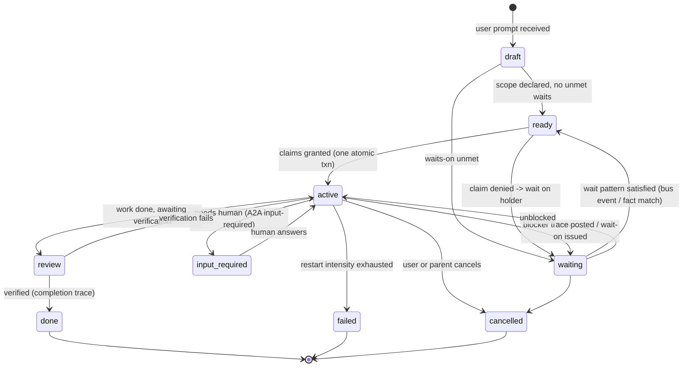

# Stigmergy and tasks — omega's "tasks, not chats" coordination model

Omega treats a user prompt as a **task**: a long-lived, scoped, addressable unit of work that coordinates with other tasks by *leaving traces in a shared environment* (stigmergy) and, sparingly, by direct messages and waits. This note surveys stigmergy (Grassé, Heylighen), tuple spaces and blackboards, and the current crop of LLM-agent systems that rediscovered them (Claude Code agent teams, Beads/Gas Town, A2A, worktree swarms, org-mode trackers). It then proposes: what a task *is*, how tasks discover each other, a trace taxonomy with decay, the message-vs-trace line, `wait-on` semantics, file-conflict avoidance, and how a human sees the whole thing. It closes with a mapping onto beam-lisp's `proc` registry/bus and datom fact store, and numbered open questions. Design code is in `clojure` fences (does not run); the single `beam-lisp` block runs offline.

## 1. Sources

External (**OBS** = I read the text; **SNIP** = only a search-result snippet seen, detail unverified):

- Heylighen, *Stigmergy as a universal coordination mechanism II: Varieties and evolution*, Cognitive Systems Research 38 (2016) 50–59. OBS full text: http://pespmc1.vub.ac.be/Papers/StigmergyIICognSystems.pdf (§2 individual vs collective; §3 sematectonic vs marker-based, incl. Wikipedia "to do" notes and territory markers as property rights; §4 transient vs persistent traces and the dissipation/evaporation/reinforcement passage, extracted text lines ~320-355). Part I: SNIP only, https://www.sciencedirect.com/science/article/pii/S1389041715000376 .
- Grassé 1959 (termites; coined "stigmergy"), Wilson 1975 ("sematectonic"), Parunak 2006 ("marker-based"): OBS only *as cited inside* the Heylighen paper.
- Linda / tuple spaces: Gelernter 1985, "Generative communication in Linda", TOPLAS 7(1) 80-112 — SNIP via https://www.sciencedirect.com/topics/computer-science/tuple-space ("asynchronous, anonymous and content-based communication decoupling … in time, space and flow") and https://github.com/Dev916/mech-crate/blob/main/docs/development/appendix-coordination-models.md . Operation names `out`/`in`/`rd` are from my background knowledge (INFER).
- Blackboard + LLMs: Han & Zhang 2025, https://arxiv.org/abs/2507.01701 (OBS abstract: agents share everything on a blackboard; next actors chosen from blackboard content; repeat until consensus; competitive with SOTA MAS using fewer tokens). Salemi et al., *LLM-based Multi-Agent Blackboard System for Information Discovery in Data Science*, https://arxiv.org/html/2510.01285v1 (SNIP: central agent posts requests, autonomous agents respond; "13–57%" gain is from a secondary summary, https://developer.cloud.tencent.com/article/2708599 — unverified). PatchBoard: https://www.alphaxiv.org/abs/2605.29313v1 (SNIP).
- Claude Code agent teams: https://code.claude.com/docs/en/agent-teams (OBS, lines 1-300 of 487: shared task list with pending/in-progress/completed + dependencies; self-claim under **file locking**; per-agent JSON mailbox `~/.claude/teams/{team}/inboxes/{agent}.json`; task list `~/.claude/tasks/{team}/`; hooks `TaskCreated`/`TaskCompleted`/`TeammateIdle`; "same-file edits … a single session or subagents are more effective").
- Beads: https://raw.githubusercontent.com/steveyegge/beads/main/README.md (OBS: Dolt-backed dependency graph; `bd ready`; atomic `bd update <id> --claim` "sets assignee + in_progress"; hash IDs "prevent merge collisions"; "Compaction: semantic 'memory decay'"; Message issue type with threads and ephemeral lifecycle; links `relates-to`/`duplicates`/`supersedes`/`replies-to`).
- Gas Town (Yegge; layered on Beads, many parallel Claude Code instances): SNIP only — https://rywalker.com/research/gastown , https://tenzinwangdhen.com/posts/gastown-good-bad-ugly/ , https://ascii.co.uk/news/article/news-20260125-f25263de/steve-yegges-gas-town-reveals-agent-orchestration-design-patterns .
- A2A "Life of a Task": https://a2a-protocol.org/latest/topics/life-of-a-task/ (OBS full: Message vs Task; `contextId`; `input-required`/`auth-required`; terminal `completed|canceled|rejected|failed`; **task immutability**; follow-ups are new tasks in the same context with `referenceTaskIds`).
- Worktree swarms: https://github.com/blackwell-systems/polywave ("disjoint file ownership, worktree isolation, human-reviewed plans", SNIP), https://zylos.ai/research/2026-02-22-git-worktree-parallel-ai-development/ (SNIP), https://www.termdock.com/en/blog/git-worktree-conflicts-ai-agents (SNIP: index.lock, stale worktrees), https://auravcs.com/learn/git-worktree-per-agent (SNIP: machine, not git, is the limit).

Local (OBS, read-only):
- `/home/user/code/undefine/beam-lisp--repl/priv/std/proc.bl:1-160` (the door; bundle list; `defserver` re-export).
- `priv/std/proc/reg.bl:1-153` (registry = pid↔attrs relation; verbs `register`/`unregister`/`whereis`/`where` at 150-153; self-retracts on `:DOWN`; "single node … not datalog", header 1-27).
- `priv/std/proc/bus.bl:16-215` (`bus-clause` 158-187, `publish` 189-193; per-subscriber demand and `:block`/`:drop-oldest`/`:detach` policies 35-67).
- `priv/std/proc/fence.bl:1-45` (`fence-fn` → `{:ok|:crash|:timeout}`), `priv/std/proc/table.bl:1-45` (heir-owned ETS so state outlives its owner).
- `priv/lib/datom.bl:1-80,181,263,432-500,749-789` and `priv/lib/datom/conn.bl:786-805,988,1034` (immutable temporal datalog; `transact!`, `register-tx-fn!`, `listen!` delivering `[:datom/tx basis tx-datoms]` with optional `:attrs` filter, `watch`, `as-of`, `since`, `history`).
- `/home/user/code/undefine/beam-lisp--repl/!tasks/reference.org:1-40` (org schema: ITEM/DOING/REVIEW/DONE/BLOCKED/CANCELLED; subdirs `plans bugs features follow-ups evidence artifacts`).
- Spell's `org`, `todo_write`, `memory` tools: OBS of their *descriptions* in this session's tool list, not their source.

## 2. What stigmergy is and how it works

**Definition (OBS, Heylighen 2016 §1):** "a mechanism for the coordination of actions, in which the trace left by an action on some medium stimulates the performance of a subsequent action." Agents need neither plan nor memory: "the present stage of the activity is directly visible in the trace left by the work already done" (§2, the wasp nest). More agents change throughput, not the essence; the new problem is agents "getting in each other's way", solved by a rule like "keep a minimum distance from obstacles — including other agents".

**Sematectonic vs marker-based (§3):**
- *Sematectonic* (Grassé's original; Wilson's word): the work product itself is the stimulus — mud heap, half-built funnel, a Wikipedia paragraph with a visible flaw. In omega: **the code/diff/test state in the repo**.
- *Marker-based* (Parunak): a trace made *expressly as a signal* — pheromone, "to do" note, territory mark. A marker is "an abstract, conventional sign, intentionally representing the work to be done", a *symbol* where a sematectonic trace is an *index*, and it costs extra effort to emit. The territory/fence example is the analogue of **file claims**: it "provides a clearly perceivable signal to others that they should not trespass there, obviating the need for individual communication with each of those others." Most real traces play both roles (the artist's sketch).

**Persistence, decay, reinforcement (§4):** "even a passive medium is subjected to dissipation … structures and markers tend to decay—unless they are actively maintained". Decay is *functional*: a trail to an exhausted source is "not just irrelevant, but misleading". Trails not reinforced "gradually diffuse, and thus lose their attractiveness relative to trails that continue to receive reinforcement" — the same selective forgetting as unreinforced neural links; the rate is a tunable "learning parameter" (fast = adaptive, slow = stable). Design consequence (INFER): **decay must be faster than the world changes**.

**Tuple spaces / Linda (SNIP):** shared associative memory; processes generate and consume tuples, decoupled "in time, space and flow". The message outlives its sender and is found by *content pattern*, not address — stigmergy with the medium made explicit and queryable.

**Blackboard (SNIP + OBS abstract):** knowledge sources watch a shared workspace; a controller picks who acts. LLM versions report competitive accuracy at lower token cost because agents share one context instead of pairwise chatter. Caveat (INFER): both LLM-blackboard papers keep a *central selector* — closer to classic blackboard than to pure stigmergy.

### 2.1 How today's agent systems line up (OBS unless marked)

| system | medium | trace kind | claim mechanism | decay | message channel |
|---|---|---|---|---|---|
| Claude Code teams | `~/.claude/tasks/{team}/` | marker (status, deps) | self-claim under **file lock** | none; retention by `cleanupPeriodDays` | per-agent inbox JSON file |
| Beads | Dolt DB (+ JSONL export) | marker (issue graph) | atomic `--claim` | **compaction** of closed tasks | `message` issue type, threads, ephemeral |
| Gas Town (SNIP) | Beads + git | marker + git state | role hierarchy dispatches | via Beads | mail between roles |
| A2A | server-held Task objects | marker (state + artifacts) | server owns task | immutable after terminal | `Message`, `contextId`, `referenceTaskIds` |
| worktree swarms | git branches/worktrees | **sematectonic** (the diff) | disjoint file ownership in plan (SNIP) | merge or delete branch | none / PR |
| `!tasks/*.org` | repo files | marker (state keyword, notes) | convention only | `archive` of DONE | none |

Pattern: **markers for *what/who/status*; sematectonic (repo state) for *what is true*; messages only for what a trace cannot say.** Every system that scales added an *atomic claim* and a *ready query* (`bd ready`; "a pending task with unresolved dependencies cannot be claimed"), and every one flags **same-file edits** as the conflict hot-spot.

## 3. Omega's model: what a task IS

A task is a **named long-lived process plus an append-only fact stream about it**. The process (a supervised `defserver`) holds the private LLM conversation; the facts are the externally visible trace. Anything another task or a human may need is in the facts; process state is private and rebuildable from them.

```clojure
;; Design sketch — NOT runnable. One entity per task in the shared datom store.
{:task/id        #uuid "…"           ; stable, never reused (A2A immutability; Beads hash ids)
 :task/slug      "fix-reader-hex"    ; human handle, unique among live tasks
 :task/title     "Reader: accept 0x hex literals"
 :task/goal      "…"                 ; the user's prompt, verbatim
 :task/status    :active             ; see lifecycle
 :task/parent    <task-id> | nil     ; spawned-by; NOT ownership
 :task/context   <ctx-id>            ; groups follow-ups (A2A contextId)
 :task/scope     [{:path "priv/boot/reader.bl" :kind :file}
                  {:path "test/bl/reader/"      :kind :dir}
                  {:sym  "reader/read-number"   :kind :symbol}]   ; DECLARED footprint
 :task/worktree  "/…/wt/fix-reader-hex" | nil
 :task/pid       <pid>               ; live only; registry retracts on :DOWN
 :task/waits-on  [<task-id> | <fact-pattern>]
 :task/created   <inst> :task/updated <inst>}
```

### 3.1 Lifecycle

States merge A2A's (`input-required`, terminal immutability), Claude Code's (pending/in-progress/completed + dependencies) and the org set (DOING/REVIEW/BLOCKED/DONE/CANCELLED):



Terminal states are immutable: a follow-up is a **new** task in the same `:task/context` with a `:refines` edge (A2A rationale: clean input→output mapping and traceability).

Rules: (1) `input_required` is first-class, not a chat turn — a marker the UI sorts to the top; (2) `status` is the latest `:task/status` datom, so `history`/`as-of` give the timeline free; (3) a crash restarts the *process* from the fact stream via the supervisor — `failed` only when restart intensity is exhausted.

### 3.2 Discovery: registry + fact store (two media, two jobs)

- **Registry** (`proc.reg`, `(registry (keys :task-id :slug :context))`) answers "which live process is task X?" and self-cleans on death. The *address* medium; ephemeral by construction.
- **Fact store** (datom) answers "what exists / what happened?" — durable, Datalog-queryable, time-travelable. The *environment*. A suspended or finished task is still discoverable here.
- Peers are found by **content, not name**: "who holds a claim overlapping `src/reader/`?", "any open blocker mentioning `reader`?". That is Linda's `rd` with Datalog patterns; `datom.conn/listen!` with an `:attrs` filter is `rd` made reactive.

### 3.3 Trace types

| trace | kind (Heylighen) | emitted when | payload | default decay | reacts |
|---|---|---|---|---|---|
| **claim** | marker (territory) | before first edit of a path/symbol | `{task, paths, mode :write/:read, lease-until}` | lease; must be *reinforced* by heartbeat | pre-edit check of other tasks; scheduler |
| **intent** | marker | after planning, before acting | `{task, "will refactor X to Y", expected diff shape}` | medium (~30 min) | tasks planning adjacent work; human |
| **finding** | marker + information | discovery worth sharing | `{task, subject, text, evidence-ref, confidence}` | slow (days); reinforced when cited | content query by any task; memory distillation |
| **blocker** | marker | cannot progress | `{task, needs :pattern/:human/:task, reason}` | until resolved (then retracted) | owner of `needs`; human UI; waiters |
| **completion** | marker + sematectonic pointer | work verified | `{task, commit/diff ref, summary, artifacts}` | **never** (immutable; compactable) | dependents; humans; ready query |
| **heartbeat** | pure reinforcement | every N s while alive | `{task, t}` | seconds | lease checker; stale-task reaper |
| **the diff** | sematectonic | continuously | repo/worktree state | n/a — it is the world | `git`, LSP diagnostics |

Principle: **few marker types**; the diff is already a trace. Markers exist only where the diff cannot reveal *intent*, *ownership*, or *waiting*. Ideally the **harness emits them as side-effects** (claim on first edit, heartbeat from a `tick`, completion when the verify gate passes) so the model spends no turns on bookkeeping.

### 3.4 Decay — a concrete, runnable model

Heylighen: decay is a feature; unreinforced traces lose weight relative to reinforced ones. Datom is append-only, so decay is a **read-time weight** (pure function of `now`), plus a reaper that *retracts* claims whose owner is dead (retraction keeps history, unlike delete). The block below is the whole idea (verified with `bl run`): per-type half-lives, immortal completions, and a path-prefix overlap test for claim conflicts.

```beam-lisp
(def half-life {:claim 600 :intent 1800 :finding 86400 :blocker 3600 :completion nil})

(defn strength
  "1.0 fresh, 0.5 after one half-life. nil half-life = never decays."
  [tr now]
  (let [hl (get half-life (:type tr))]
    (if (nil? hl)
      1.0
      (/ 1.0 (math/pow 2 (/ (- now (:at tr)) hl))))))

(println "claim after one half-life:" (strength {:type :claim :at 0} 600))
(println "completion after 99999s:  " (strength {:type :completion :at 0} 99999))

(defn overlap?
  "Do two path-sets collide? Equal, or one is a directory-prefix of the other."
  [as bs]
  (some (fn [p]
          (some (fn [q]
                  (or (= p q)
                      (clojure.string/starts-with? p (str q "/"))
                      (clojure.string/starts-with? q (str p "/"))))
                bs))
        as))

(println "src/a vs src/a/b.bl:" (overlap? ["src/a"] ["src/a/b.bl"]))
(println "src/a vs lib/x:     " (overlap? ["src/a"] ["lib/x"]))
```

**Reinforcement:** a new claim/heartbeat datom on the same `[task, path]` resets `:at`. **Reinforcement by use:** a finding another task *cites* (`:finding/cited-by`) gets its `:at` bumped — trails strengthen when followed. Findings nobody reads fade from default queries but stay in `history`; memory distillation can promote survivors.

## 4. Message vs trace

| | trace | message |
|---|---|---|
| addressing | none — found by content | a task id (resolved via registry) |
| reader | any, any time, incl. future tasks and humans | one recipient, now |
| durability | datom facts (weight decays) | mailbox; ephemeral by default |
| use for | status, claims, findings, "I did X" | **questions needing an answer**, live-decision handoff, interrupt/cancel, human prompts |

Rule of thumb: *if the sender wouldn't care who reads it, it is a trace; if it expects a reply or action from a specific party, it is a message.* This is A2A's split: messages "agree on the scope of a task before it commits"; a task is created once there is "committed work to execute and observe" (https://a2a-protocol.org/latest/topics/life-of-a-task/). Claude Code teams default to mailboxes for discussion and a task list for status, and note higher token cost because each teammate is a separate instance (https://code.claude.com/docs/en/agent-teams). A message that matters must **also leave a trace** (`:message/sent` datom with body ref) so the human timeline is complete: mailbox = delivery path, fact = record. Jev (typed decisions; API in sibling note) fits as a *decision-trace emitter*: to choose "wait / proceed / ask human / take over", a task asks Jev for a typed decision and posts it as an `:intent` or `:blocker` with the decision as payload (INFER).

## 5. Waits, claims, conflicts

### 5.1 `wait-on` semantics

A wait is a **subscription to a fact pattern plus a timeout and an on-timeout policy** — never a poll, never a bare pid link.

```clojure
;; Design sketch — NOT runnable.
(wait-on {:task other-id :status #{:done}})                              ; task completion
(wait-on {:pattern '[?e :claim/path "src/reader.bl"] :absent true})      ; claim released
(wait-on {:pattern '[?f :finding/subject :hex-literals]})                ; finding appears
(wait-on {:human "approve migration"})                                   ; input-required
;; options: :timeout-ms 600000
;;          :on-timeout :escalate | :proceed-anyway | :fail
;;          :on-holder-dead :take-over   ; holder's :DOWN retracts claim -> waiter wakes
```

Mechanics (INFER from primitives): the task process `listen!`s with `:attrs` of the pattern, re-evaluates on each `[:datom/tx …]`, and uses `receive … (after ms …)` for the timeout. The wait is also recorded as `:task/waits-on` facts so humans and other tasks see the **wait-for graph**; a Datalog recursive rule flags cycles as a `:blocker` and escalates to the human. A parked wait costs zero LLM tokens (context frozen).

### 5.2 File-conflict avoidance (layered, cheapest first)

1. **Declared scope** at creation (Polywave-style "disjoint file ownership", SNIP) — advisory input to a check at `draft → ready`.
2. **Claim transaction**: one datom transaction guarded by a conflict query (`overlap?` above, in Datalog over live claims); atomic because the store serialises writes (`transact!`, possibly via `register-tx-fn!` — verify in sibling API note). Analogous to Beads' atomic `--claim` and Claude Code's lock-file claim but at path granularity with modes (`:read` coexist, `:write` exclusive). Denied → task goes `waiting` on the holder.
3. **Lease + heartbeat**: claims carry `lease-until`; registry `:DOWN` handling retracts a dead task's claims instantly (via a small bridge); leases cover hung-but-alive. This is evaporation with active reinforcement.
4. **Worktree isolation** for write-heavy/long tasks: conflict moves from edit-time to merge-time. Cost: build/test per worktree.
5. **Sematectonic check at write time**: compare current file hash to the one the task last read (INFER: edit tools already do stale detection). An undeclared touch auto-posts a `:finding` and widens the scope rather than blocking — scope is a hint, the repo is the truth.
6. **Symbol-level claims** are possible because the edit tool addresses `file::Symbol`; risk is semantic coupling across symbols (INFER). Default file-level, opt into symbol-level.

### 5.3 Completion, compaction, memory

Completion traces are immutable. Old ones compact to a summary datom (Beads "memory decay"); distilled lessons go to the memory layer. Heylighen's abstract frames cognition as interiorised stigmergy — an external memory for the agent — which is what project memory is here.

## 6. Critique of the existing media

All are already stigmergic markers; they work, and show where omega should go further.

**`!tasks/*.org` (OBS `reference.org`):** strengths — git-tracked, human-readable, state keywords + notes make a durable diffable marker. Weaknesses: (a) **no atomic claim**: `DOING` is a text edit, two agents race and git merges text; (b) no scope/files field, so conflicts are invisible; (c) **no decay**: a stale `DOING` from a dead session is indistinguishable from a live one (Heylighen's "misleading trail"); (d) no liveness link to a process; (e) sequential IDs (`PLAN-NNN`) collide across branches — Beads' hash IDs are the fix; (f) free-form bodies, so findings/blockers are untyped.

**Spell `todo_write` (tool description):** in-session roster with blocker DAG and `Waves:` — good ready-query ergonomics, and a `verify` gate (completion needs evidence; cf. Claude `TaskCompleted` hook). But it is **session-local and single-writer** — invisible to peers and humans outside the TUI; a scratchpad rather than a medium. `task` delegation sets `delegation` automatically (claim-like), visible only to the parent.

**Spell `org` (description):** durable, with `wave`, `graph`, `dashboard`, `suboutline-add` — closest to Beads. Same gaps as `!tasks/` (claim atomicity, liveness, scope) plus every update is a full tool call by an agent rather than an event.

**Spell `memory` (description):** `note` (episode) vs `save` (concept/playbook/decision) with typed edges and `since` — a good *slow* medium, with the right stance ("memory is heuristic context, never source of truth"). Missing: usage-based reinforcement/decay and push (agents must `search`).

**Common:** pull-only, agent-turn-priced, text-first. Omega's opening: **cheap structured facts emitted by the harness**, and a **push** board (bus/`listen!`) so waiting is free.

## 7. beam-lisp mapping

| need | existing primitive (OBS; paths under `beam-lisp--repl/priv`) | gap / note |
|---|---|---|
| task process | `std/proc/server.bl` `defserver`; `std/proc/super.bl` | conversation server = sibling note |
| find live task by attrs | `std/proc/reg.bl` `register`/`whereis`/`where` (attr-equality only; "not datalog", single node) | richer queries → datom |
| liveness-coupled facts | registry self-retracts on `:DOWN` (reg.bl 59-67) | datom claims need a reaper bridge on `:DOWN` |
| event fan-out | `std/proc/bus.bl` `publish`; `:drop-oldest`/`:detach` policies | choose slow-subscriber policy for TUI/loom |
| durable environment | `lib/datom.bl` `transact!`, `q`, `pull`, `history`, `as-of`, `since` | decay = read-time function; `excise!` only for secrets |
| reactive waits | `lib/datom/conn.bl:786` `listen!`; `datom.bl:483` `watch` | no Linda-`in` (consume); use claim txns |
| atomic claim | serialised `transact!`; `with`, guards (`conn.bl:988,1034`); `register-tx-fn!` (`datom.bl:263`) | semantics to confirm in API sibling |
| timeouts/isolation | `std/proc/fence.bl` `fence-fn`; `std/proc/tick.bl`, `sched.bl` | heartbeat = `tick` clause (NOT read in depth) |
| owed-work queue | `std/proc/queue.bl` (NOT read in depth) | candidate for ready-task dispatch |
| wait-for cycles | Datalog (`lib/datom/datalog.bl`; NOT exercised) | verify recursive rules |

Gaps (INFER): no path-lease library; no TTL in Datalog; no ready-made human timeline (loom/TUI siblings).

## 8. Interactions and observability

**Human:** one **board** over the fact store, three lenses, fed by the same queries plus bus push:
1. *Task list* sorted by attention: `input_required` > blocker > `review` > `active` > `waiting` > done. Row: slug, scope, last-heartbeat age (render `strength` as opacity — Heylighen's decay made visible), who it waits on.
2. *File map*: repo tree coloured by live claims (the medium itself as a heat-map), conflicts flagged.
3. *Timeline / wait-for graph*: `history` per task or global `since`; edges `waits-on`, `refines`.
Human actions are facts/messages: answer `input_required`, cancel, re-scope, force-release a claim, take over a stale task.

**Agent developing omega:** everything is a query from a `bl` REPL; `as-of` replays a coordination failure deterministically; tests seed a store with traces and assert on ready/conflict/decay with a fake clock (`strength` takes `now` for exactly this). Invariant checkable on any basis: "no two live `:write` claims overlap". Waits visible through `:task/waits-on`; bus lag through the bus's `lagged` reporting.

## 9. Take / adapt / drop

- **Take:** sematectonic-first; few marker types; A2A terminal immutability + `input_required`; Beads' atomic claim, ready query, hash IDs, compaction; Claude's dependency auto-unblock and completion veto hook (≈ verify gate); optional worktrees.
- **Adapt:** mailboxes → bus + registry with mandatory trace of messages; org items → datom entities with an `.org` *projection* for git/human legibility (Q1); blackboard central selector → claims + ready query, Jev only as tie-breaker.
- **Drop:** JSON mailbox files and lock files (VM gives atomicity/delivery); model-driven bookkeeping turns; role hierarchies as a *requirement* (allowed as policy); free-text-only status.

## 10. Open questions for discussion

1. **Source of truth: datom vs `!tasks/*.org`.** (a) datom canonical, org exported read-only — atomic, queryable, clean decay; loses edit-a-text-file steering and plain-git review. (b) org canonical, datom a cache — keeps convention and merge-by-git; atomic claims/heartbeats fit text badly. (c) split by field (status/claims in datom, goal/notes in org). Beads chose DB + JSONL export (README) — evidence for (a)/(c).
2. **Claim granularity default.** File, dir, or symbol? Finer = more parallelism, more semantic-coupling risk; coarser = safer, more waiting.
3. **Worktrees: always, never, on-conflict?** Always isolates but costs builds/disk and moves conflict to merge; never needs strict claims; on-conflict is smartest but complex. Who merges — task, merger task, human?
4. **Decay parameters.** Fixed per-type half-lives (§3.4) vs adaptive vs per-project config. Should reads reinforce (cited findings), and is that gameable by a looping agent?
5. **Liveness vs durable facts.** Claims in datom need a `:DOWN` reaper; alternative is keeping live claims only in a registry-like process (self-cleaning, but invisible to history/restart). Which is worse: orphaned claims or lost audit trail?
6. **Message vocabulary.** Only `ask`/`reply`/`interrupt`, or free text? Free text risks chatter/token cost; structured-only risks rigidity. Is the human an actor in the same mailbox system?
7. **Where does Jev decide?** Conflict resolution, re-scoping, relevance triage — each adds latency, cost, nondeterminism; alternative is deterministic rules with Jev only for escalation triage.
8. **Task granularity/follow-ups.** One prompt = one task always? Subtasks first-class? A2A: follow-ups are new tasks in the same context; Beads: hierarchical IDs. Is a long conversation on one topic one task with many turns, or a chain?
9. **Trust via the medium.** Traces from one task are read as instructions by another; Claude Code marks inter-agent messages as non-user input (agent-teams doc). Give findings/intents provenance and lower authority than the human prompt?
10. **Scale target.** Single node, 3–10 tasks (reg.bl assumption) vs multi-machine (Beads syncs via Dolt remotes). Decides whether `listen!` suffices or a replicated log is needed.
