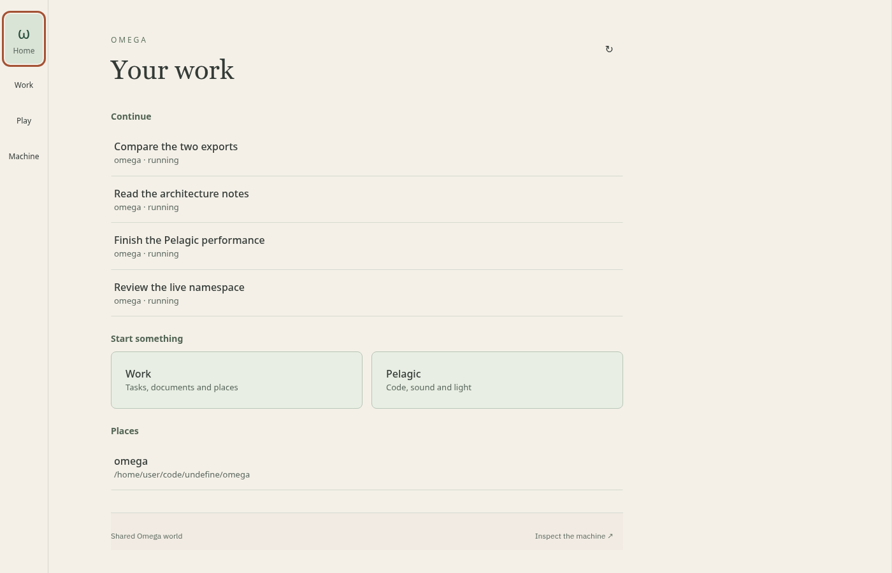
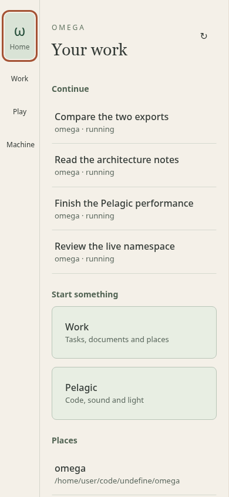
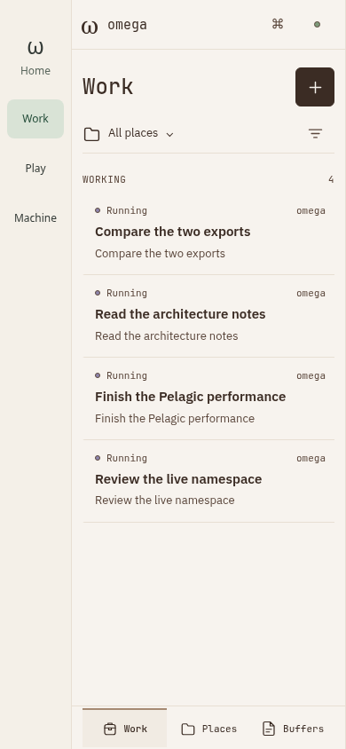
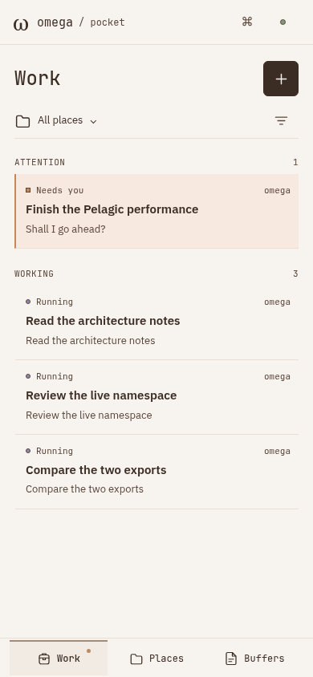
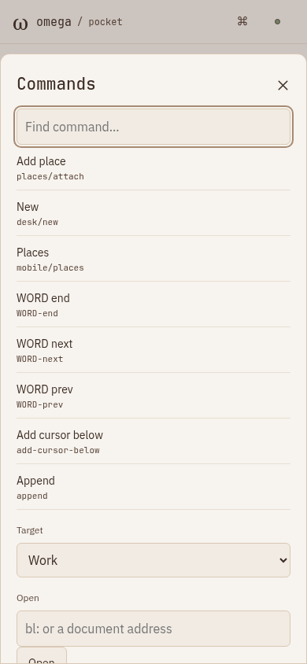
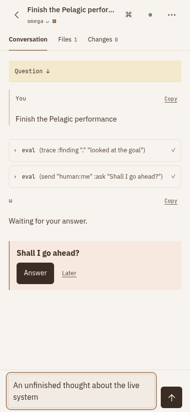
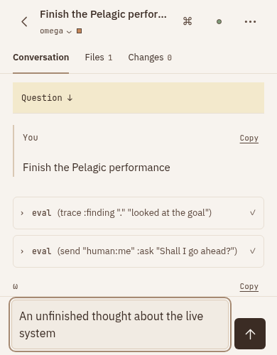
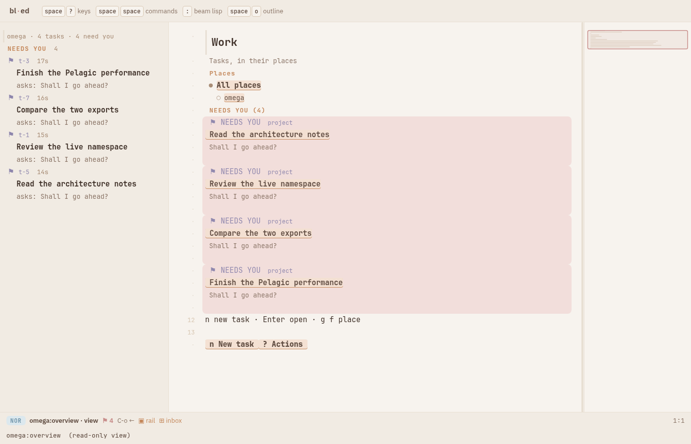
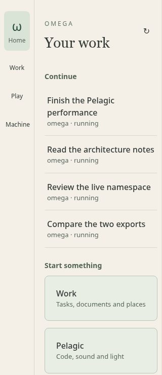

#+title: Home — design correction toward the Omega Lisp machine
#+date: 2026-10-13
#+status: Assessment and proposals; application unchanged

* Assessment
Home adopted a separate visual and interaction language. This was the wrong
direction. The native/runtime integration is useful, but its landing-page
presentation does not follow the approved Pocket workbench or desktop editor.
The correction should recover the existing identity and working model.

The sources already specify warm snow, espresso ink, matte semantic pastels,
shared text/code roles, compact working surfaces, contextual commands and
inspectable buffers. The Lisp-machine quality comes from manipulating live
objects in one workspace. A new launch screen weakens that quality.

* What I drove
A disposable scripted world on random port 35095, isolated runtime/state/store,
using the actual pinned frontend c84abb5fcc5310b95257c7e1b663ad000095cc5e894a3a5d7a151557aee70325.
Opened four tasks, visited Home and its retained Work viewer, direct Pocket,
Commands, a task with an unfinished instruction, a reduced-height composer,
and the existing desktop inbox. Chromium at 1400x900, 390x844, 320x740 and
390x500. Task states progressed during the tour; these are not synchronized
snapshots for comparing backend state correctness.

No live-world writes, no user desktop changes, no application edits. The
private host was stopped and its VM retracted. No JavaScript page errors.
Phone sizes are browser emulation; physical keyboard/selection/safe-area
behavior is not established by this pass. Existing concurrent Pocket/workspace
source edits were preserved and exercised, as in the preceding Home proof.

Evidence: [[file:home-design-review-2026-10-13/audit.json][Measured styles and geometry]].
Reproduce with =python3 research/home-design-review-2026-10-13/drive.py= under
the repository's memory cap. This uses the real private backend, not a UI mock.

* Side-by-side evidence
- .
- .
- .
- .
- .
- .
- .
- .
- .

* Grounded findings
- Home hides the editor titlebar and footer. It supplies no equivalent global
  Commands, buffer identity or Lisp entry control on the Home surface.
- Home declares system-ui body text and a 42px Georgia desktop heading, with
  38px below its header. Pocket uses the shared text face and 24px code-face
  Work heading. Serif prose in a conversation is a separate, deliberate role.
- Home hard-codes green ink/surfaces and its own cream. Pocket inherits the
  actual snow/espresso theme. Home already avoids gradients and shadows;
  adding decoration would not correct the mismatch.
- At 390px, direct Pocket is 390px wide. Inside Home its frame is 308px wide:
  an 82px / 21% loss. The outer Home rail and inner bottom navigation coexist.
- At 320px, Home main starts at x=68 and is 263.1875px wide: its right edge
  exceeds the viewport by 11.1875px. Body scrollWidth remains 320. The pane
  clips this internal overrun, so a body-only overflow test misses it.
- Home's task row supplies a title, place and raw status. Pocket also supplies
  semantic state, a summary/question, group counts and a scope control.
- Source confirms Home projects all tasks into Continue and a subset again
  into Needs you. A pending task can appear in both groups. The prior native
  Home capture shows this; this tour's first Home capture caught running tasks.
- The Home package exposes home/open and its return key, not a list selection,
  preview or contextual object command surface. Tab/Enter accessibility is
  useful, but it does not establish the editor's ordinary interaction model.
- The existing Pocket command sheet already focuses search and exposes actual
  commands, addresses and Lisp. Home should make that capability reachable
  consistently, rather than inventing a second command vocabulary.

* Proposed improvements, in order
O = observed in this drive; S = confirmed by source; P = proposed direction.
P0 = foundation of the correction; P1 = daily-use integration; P2 = refinement.

| ID | Basis | Priority | Change and intended result |
|----+-------+----------+----------------------------|
| 01 | O/S | P0 | Inherit snow, espresso, oat, latte and semantic accent tokens. Theme changes should propagate to Home, Pocket, editor and package chrome. |
| 02 | O | P0 | Use shared text/code font roles; compact technical titles and metadata. Keep the reading face for answers and documents. Remove the Georgia hero heading. |
| 03 | O | P0 | Replace eyebrow, oversized heading gaps and launch tiles with a compact work header, real lists and nearby actions. Preserve matte tone, thin rules and restrained geometry. |
| 04 | O/P | P0 | Adopt one adaptive application chrome: current buffer, place/world context, Commands and compact status. Desktop has a mode-line equivalent; phone has a concise header and contextual controls. |
| 05 | O/P | P0 | Make the entry a live work/buffer surface. Starting software should put useful objects within reach immediately, with New, Open and Resume as direct actions. |
| 06 | O | P0 | Remove simultaneous Home rail and Pocket bottom navigation. One navigation owner should govern the visible workspace while retaining mounted package resources. |
| 07 | O | P0 | Give phone work the full width. Use the existing Work / Places / Buffers touch pattern; make Pelagic and Machine reachable through buffers, commands and optional pins. |
| 08 | O/P | P1 | On desktop, provide list plus following preview where appropriate. Selecting work should expose its conversation/evidence in the same workspace, as the original design specifies. |
| 09 | S | P1 | Make attention, working, answered and recent groupings deliberate and nonduplicating. Preserve backend state semantics; a returned answer is not automatically terminal completion. |
| 10 | O/S | P1 | Reuse task row presentation: useful title, latest question/answer, place, time, state glyph and count. Selection and urgency should be visible through placement, tone and weight. |
| 11 | O | P1 | Bring scope/place selection into the work header. A root path should be inspectable detail; normal navigation should show the place's name. |
| 12 | O | P1 | Expose + / New directly from the entry and current place. Open the existing composer with the selected context, without first entering a launcher destination. |
| 13 | O/P | P1 | Make Buffers first class: tasks, documents, scratch, namespaces, REPL, diffs and Pelagic. Support recent/pinned objects and visibly retain their location and unsent input. |
| 14 | O/S | P1 | Provide global command search and real Lisp access from every surface. Reuse the registry and evaluator; show the evaluation target/world/namespace clearly. |
| 15 | S/P | P1 | Give Home rows the same object selection, Enter, search/filter, back and contextual-command behavior as the editor. Keep key hints scoped to the actual focused pane or composer. |
| 16 | S/P | P1 | Treat visible tasks, files, actors and namespaces as typed objects with Inspect/Open/Source/References actions. The represented object should determine its actions. |
| 17 | O/P | P1 | Make the mode line communicate current buffer, place, mode, modified/offline/attention state. Reveal runtime detail through the existing inspector when requested. |
| 18 | S/P | P1 | Present Pelagic as a working buffer/mode with its own performance controls. Unify Machine/Runtime/REPL vocabulary and routes. Keep the audio engine alive across workspace changes. |
| 19 | O/P | P1 | Reuse structured prose/code/tool presentation and in-context composers. Work should feel like the same editable, inspectable surface as the desktop application. |
| 20 | O | P1 | Correct internal flex sizing at 320px. Check pane, control and sheet bounds, text wrapping and increased text sizes; a nonoverflowing body is insufficient. |
| 21 | O/P | P1 | Validate phone keyboard and safe-area behavior. Preserve 44–48px hit areas while keeping visual density compact; reserve composer space and expose commands without hover. |
| 22 | O/P | P1 | Preserve existing strengths: stable rows, draft/scroll/selection retention, background audio, removable packages and reduced-motion behavior. Navigation changes must retain these contracts. |
| 23 | S/P | P1 | Keep layout, keymaps, buffer actions and presentation policy configurable in BL/package data. Share existing chrome and presenters; JS remains the host boundary. |
| 24 | S/P | P1 | Consolidate generic focus, command and frame behavior in vendored bl-ed where needed; Omega owns work/domain choices and Pocket owns the touch adaptation. No editor reintegration upstream is required for this UI correction. |
| 25 | O/P | P2 | Improve first-launch progress and recovery. This cold audit waited substantially longer than the warm-window proof; measure host admission, frontend readiness and first paint separately before assigning a cause. |
| 26 | P | P1 | Add design acceptance beside functional gates: same objects on desktop/phone, theme inheritance, exact pane bounds, one navigation system, command discoverability and realistic long-content scenarios. |

* Next prototype
One vertical: launch → Work → select task → answer → open a document → switch
buffer → evaluate Lisp → open Pelagic → inspect its runtime → return to the same
work location. Desktop uses the existing editor/workbench language; phone uses
the existing Pocket language. Compare identical task/content fixtures across
both at 1400, 390 and 320px, plus reduced-height and increased-text cases.

Reuse the current canonical host, native display lifetime fix, package contracts,
retained playback and observation cancellation. Correct the composition and
presentation without creating another task engine, reader, editor or theme.
The first pass should reuse the existing reference surfaces closely. Subsequent
refinements need evidence from actual use.

* Sources read
- [[file:pocket-ux-review-2026-10-11.org][Approved Pocket usage/design audit]], especially points 9–16,
  40 and 49–53, and “If Emacs were designed for a phone today”.
- [[file:../!tasks/plans/PLAN-018-pocket-touch-workbench.org][Pocket touch workbench plan and adoption]].
- [[file:domain/interface/providers/README.bl.md][The world as inspectable documents]].
- [[file:domain/interface/scroll-and-type.bl.md][Type, hierarchy, list/preview and contextual keys]].
- [[file:domain/interface/presentation-pipeline.bl.md][Typed objects, presenters and pure layouts]].
- [[file:../vendor/bl-ed/web/theme.css][Existing theme contract]].
- [[file:../spikes/mobile/host/style.css][Current Pocket adaptation]].
- [[file:../spikes/home/host/style.css][Home's separate theme and hidden chrome]].
- [[file:../spikes/home/home/main.bl][Home's current model, layouts and command surface]].
