#+title: Pocket — usage audit and design direction
#+date: 2026-10-11
#+status: Research and proposals; application unchanged

* Finding
The shared world works. Pocket's presentation and interaction continuity are
the weak points. A real response, a realistic prompt, a second repository and
a longer document expose problems that the short scripted scenarios missed.

Pocket should feel like Omega in the hand: warm paper, espresso ink, precise
type, compact working surfaces, visible structure and direct access to the live
machine. The existing snow-and-coffee theme already supplies that identity.
The present green palette, large headings, rounded cards, shadows and gradients
establish a second identity instead.

This is a review, not a redesign implementation. No service was restarted and
no application source was changed. The two audit tasks and the attached Beam
Lisp place remain in the live history so the observations are inspectable.

* What I actually exercised
User-authorized live browser use on port 8812, never port 8790. Chromium touch
emulation at 390×844, plus 320×740 and 390×500; ordinary editor at 1360×960.
The short viewport approximates reduced space, not a real software keyboard.

- Opened existing work, expanded execution details and waited across a probe.
- Added the existing /home/user/code/undefine/beam-lisp checkout through the
  real =places/attach= command and its native prompt. ID =beam-lisp=, name
  =Beam Lisp=. No repository was created or changed by this attachment.
- Started =t-23= through New task in Omega. The live model read =AGENTS.md=
  and returned a heading, two bullets and inline code.
- Started =t-26= through New task in Beam Lisp. Its saved cwd is the Beam Lisp
  checkout; the live model read =env.bl= and identified the project name.
- Both goals explicitly prohibited writes, shell commands and service starts.
  Their recorded steps show file reads. Both returned responses and are =idle=;
  this is not a claim that Omega marked them terminally complete.
- Visited Plan and Changes without editing; observed an unexpected publish
  warning. Inspected the document reader, outline and section navigation.
- Reloaded while reading, tested an unfinished Open address across a probe,
  and tested a new-task draft across reload. Checked modal keyboard focus.
- Inspected the actual desktop presentation and the host/package sources.
- No JavaScript page errors were recorded in these audit browser contexts.

The running frontend is
=848027892cb07ccf1689a5b81dba18ee5346e5deb8a422ef7991c356a18491d5=.
This pass used localhost against the same world served over Tailscale. It did
not test physical iOS/Android keyboards, Safari selection handles, VoiceOver,
TalkBack, push delivery, app suspension or a real mobile-network handover.

** Evidence
Screenshots are in [[file:pocket-ux-review-2026-10-11/]]. Useful comparisons:
The live-task and interaction receipts are in
[[file:pocket-ux-review-2026-10-11/audit.json]].

- 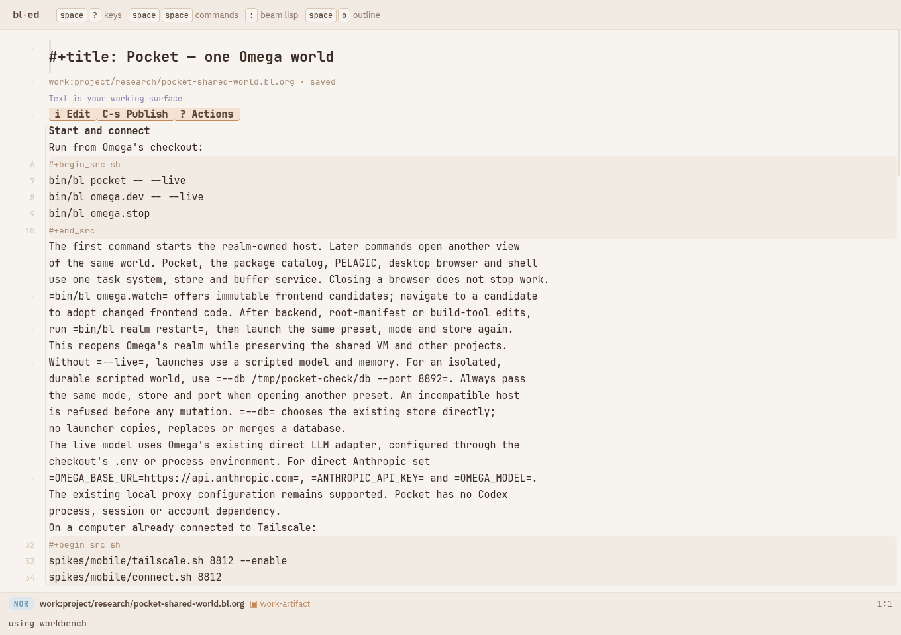 and
  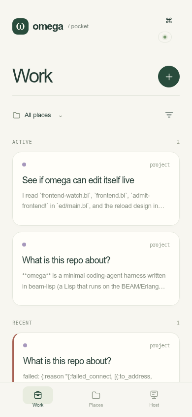.
- 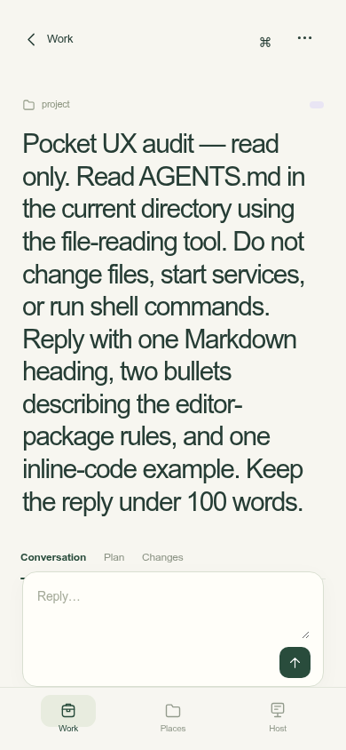.
- 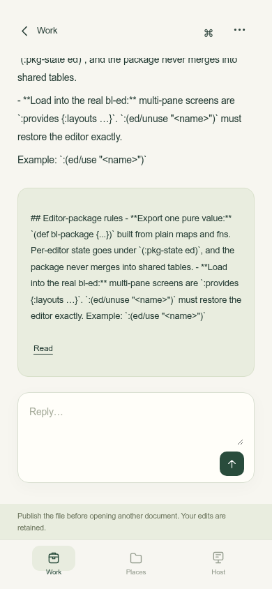.
- 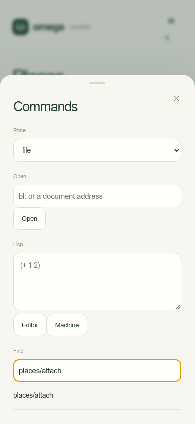 and
  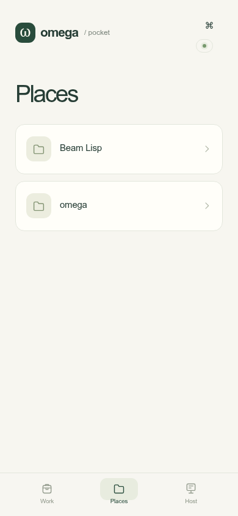.
- 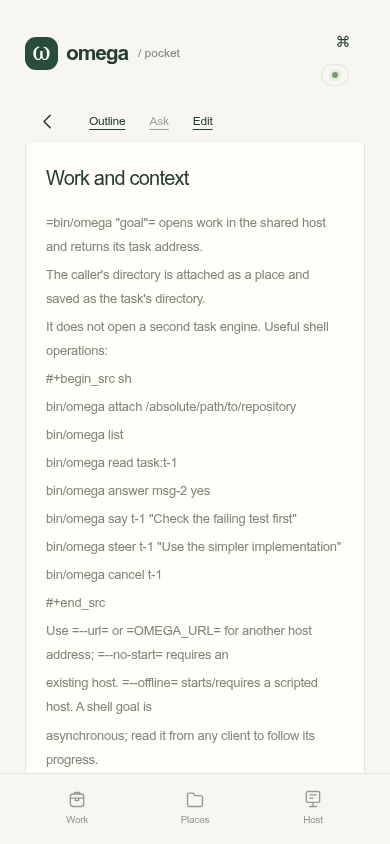.
- 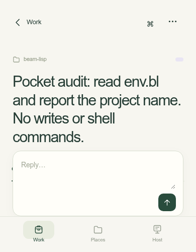.

* Issue inventory
O = observed in the browser or measured from current CSS.
S = source-confirmed capability or implementation gap; not a reproduced device bug.
D = design judgment based on the inspected screens. These are proposals to
evaluate, not claims of broken backend behavior.

P0 = prevents a basic action or loses interaction state. P1 = daily-use quality.
P2 = a subsequent improvement. Priority is a recommendation, not a schedule.

** Interaction continuity
| ID | Evidence | Priority | Problem and direction |
|----+----------+----------+-----------------------|
| 01 | O/S | P0 | Execution disclosure opened, then was closed after a 9.5-second wait. Keep expansion by stable task/step identity across updates. |
| 02 | O/S | P0 | Open address was =work:project/README.md=, then empty after a 9.5-second wait. Preserve unfinished fields; background updates must not replace their editing state. |
| 03 | O | P0 | New-task goal was lost on reload. Give new work the draft protection already provided for task replies. |
| 04 | O | P1 | Reload after an outline jump at scrollTop 1816 returned to Work at scrollTop 0. Restore document, location and view per client. |
| 05 | O/S | P1 | Task and document navigation leave the URL pointing at =workspace:all=. Add addressable navigation and browser-history behavior; a device Back gesture should follow the user's route. |
| 06 | O | P1 | Tab from the last dialog button moved focus outside the modal. Contain focus while open and restore it on close. Touch and external keyboards need the same coherent behavior. |
| 07 | S | P1 | Most updates reconstruct the entire mobile subtree with =innerHTML=. Retain identity for rows, forms and disclosures; existing selection-specific exceptions are insufficient as the general interaction model. |
| 08 | O | P1 | A no-edit Plan/Changes tour produced “Publish the file before opening another document.” Diagnose the source of dirty state before promising a fix. The notice does not itself establish a lost edit. |

** One visual language
| ID | Evidence | Priority | Problem and direction |
|----+----------+----------+-----------------------|
| 09 | O | P1 | Pocket defines independent =--m-*= colors instead of the editor's snow, espresso and pastel tokens. Use shared semantic theme roles. |
| 10 | O | P1 | Task-card corners are 18px and sheets 25px; the editor's base radius is 6px. Use the existing geometry for work surfaces; keep platform-appropriate sheets where useful. |
| 11 | S/D | P1 | Shadows, gradient attention cards and blurred chrome contradict the original theme's explicit matte, no-gradient/no-shadow intent. Separate surfaces through tone, borders and spacing. |
| 12 | O/D | P1 | Large system-sans headings and tight tracking feel different from the editor's technical typography. Share the text/code font roles and a consistent scale. |
| 13 | O | P1 | Small preview and metadata text is faint: card preview 3.26:1, human message 3.43:1, execution label 2.91:1. Darken text roles; color restraint must preserve legibility. |
| 14 | O/D | P1 | Tiny metadata and status pills carry important distinctions weakly. Use placement, a small consistent glyph, weight and accessible names; avoid relying on hue alone. |
| 15 | O/D | P1 | The initial Work screen spends generous space on branding, heading, scope and padded cards. Compress chrome and list rows while keeping finger-sized hit areas. |
| 16 | O/D | P1 | Send is a 35px square while other controls commonly use 44px. Standardize comfortable touch targets independently of the visible icon size. |

Contrast calculations used the CSS foreground/background pairs and the WCAG
relative-luminance formula, rounded here to two decimals. These are individual
text measurements, not a complete accessibility conformance audit. Ordinary
text generally needs 4.5:1; see [[https://www.w3.org/WAI/WCAG22/Understanding/contrast-minimum.html][W3C's explanation]].
At 320px, measured body and Pocket scroll widths both remained 320px. No global
horizontal overflow was observed; that does not establish comfortable reading.

** Task conversations and execution
| ID | Evidence | Priority | Problem and direction |
|----+----------+----------+-----------------------|
| 17 | O/S | P1 | The entire single-line goal becomes the title. The audit heading measured about 439px tall at 390px width. Use a compact editable title and keep the full goal in its own message. |
| 18 | O | P1 | The sticky composer occupies roughly 130px and overlaps the initial view of long titles/content. Reserve its space deliberately and collapse it until needed when reading. |
| 19 | O/D | P1 | The full goal is repeated as the heading and the user message. Keep one compact identity above one readable prompt. |
| 20 | O/S | P1 | The live model's answer appears in the conversation and again in a green result card. Render one canonical answer; use a result affordance only when it opens a distinct artifact. |
| 21 | O/S | P1 | Markdown headings, bold and inline code are shown literally in answers. Render the response's text format faithfully using shared presentation machinery. |
| 22 | O | P1 | Eleven existing tool steps all say “Agent step · execution details.” Show meaningful compact summaries such as =read AGENTS.md=, grouped when useful. |
| 23 | O/S | P1 | Expanded execution is tiny low-contrast source with truncated output markers. Provide legible code, tool outcome, copy and a route to fuller available evidence; never imply truncated data is complete. |
| 24 | O/D | P1 | Both successful response tasks remain under Active because their backend status is idle. Distinguish a working turn, a returned answer and a pending question without redefining backend task completion. |
| 25 | S/D | P1 | Reply behavior differs between idle and terminal tasks, while the screen explains little. Make reply, steering, stopping and starting follow-up work predictable and visibly scoped. |
| 26 | O/S | P1 | Plan for these tasks opens the shared scratch containing other tasks. A source home is not automatically a plan. Offer actual artifacts by role and anchor a home at its task block. |

** Places and starting work
| ID | Evidence | Priority | Problem and direction |
|----+----------+----------+-----------------------|
| 27 | O | P1 | Places has no visible Add action. Put + beside its heading and in the task's place picker. |
| 28 | O | P1 | Attachment requires discovering =places/attach= and typing an EDN map into “place map:”. Offer a native form that invokes this same command/intent. Preserve the Lisp route. |
| 29 | S | P1 | No folder chooser accompanies attachment. Browse existing server directories or paste a path with completion and validation. |
| 30 | O | P1 | Task views display =project= and =beam-lisp= rather than the place's display name. Keep IDs as addresses and show names as navigation. |
| 31 | O/D | P1 | The task's real directory is buried in Actions. Keep the selected place within reach and let it reveal the effective directory before sending. |
| 32 | O/S | P1 | After adding Beam Lisp, the initial All-places new-task form chose it as the first listed place. Use the currently selected place or a deliberate recent default, with an explicit visible choice. |
| 33 | S/D | P2 | The place browser lacks compact recent/pinned access and a normal settings surface. Reuse the existing place hierarchy and config; make adding, navigating and understanding a place direct. |

** Documents and buffers
| ID | Evidence | Priority | Problem and direction |
|----+----------+----------+-----------------------|
| 34 | O/S | P1 | Every physical source line becomes a paragraph. Soft-wrapped prose acquires arbitrary paragraph gaps. Render paragraphs from structure while retaining source mappings for selection. |
| 35 | O/S | P1 | Org source fences and commands become ordinary prose. Render code as code, with reliable wrapping and optional horizontal inspection. |
| 36 | S | P1 | Different heading depths all become h2 in the reader. Preserve hierarchy visually and semantically. |
| 37 | O/D | P1 | Reader content sits inside another bordered card, reducing usable line width. Use the main surface as the reading surface. |
| 38 | O/D | P2 | Find and the full tool strip take space continuously. Make search an invocation and use a small sticky section/location affordance. |
| 39 | S/D | P2 | Find has Next but no visible count or Previous. Make it possible to orient within a long document and move both ways. |
| 40 | O/D | P1 | Documents lack a first-class recent-buffer destination. Work/Places/Host keeps machine connectivity prominent while reading is transient. Make Buffers a direct destination; keep Machine available and pinnable. |

** Context, review and attention
| ID | Evidence | Priority | Problem and direction |
|----+----------+----------+-----------------------|
| 41 | S/D | P1 | New task shows place and goal, but offers no compact inspection of inherited settings and explicit input references. Add a context peek backed by actual data. |
| 42 | O/D | P1 | Ask is disabled until a document selection exists, without a strong contextual selection affordance. Use the platform selection menu or a small nearby action; retain native Copy. |
| 43 | S/D | P1 | References are buried in Actions while home, output and plan meanings overlap. Surface a concise contextual artifact row and keep relationship roles distinct. |
| 44 | S | P1 | Every unresolved question receives hard-coded Yes/No buttons. Render real available choices where represented; otherwise offer an ordinary answer, without inventing semantics. |
| 45 | S/D | P1 | Pending questions are rendered at the top, separate from their chronological location. Provide a compact attention anchor that opens the relevant question and evidence. |
| 46 | S/D | P2 | The Work dot indicates that something asks, but offers no personal read/snooze/triage workflow. Design attention as an actionable queue; extra persisted attention state is a later addition. |
| 47 | S/D | P1 | Changes focuses on one inferred artifact and individual operations. Review should begin with affected files and attribution, then open a readable unified diff. Distinguish buffer history from Git changes. |
| 48 | S/D | P1 | Undo is exposed without a clear surrounding review story. Show the exact operation, author and scope before applying the already guarded undo. |

** Commands and the live machine
| ID | Evidence | Priority | Problem and direction |
|----+----------+----------+-----------------------|
| 49 | O/D | P1 | Commands starts with pane selection, Open and Lisp forms before command search. Make search the first focused control; contextual common commands and recent objects should lead. |
| 50 | O/D | P1 | =rail/task/file= are implementation names exposed as a mandatory choice. Default commands to the current object and offer an optional target chooser when meaningful. |
| 51 | O/D | P1 | Raw command names are the main discovery interface; explanations are desktop hover titles. Use concise action names with technical names available as aliases. |
| 52 | S/D | P2 | Editor and Machine evaluation share a crowded sheet. Give the REPL a real pinnable buffer with namespace/world identity and readable results, retaining direct trusted access. |
| 53 | O/D | P2 | Host tab opens a screen titled Machine with a large connection illustration. Use one vocabulary and compact connection feedback; spend primary navigation space on daily work. |
| 54 | S/D | P2 | The sheet handle implies dragging but no drag interaction is registered in the host. Implement its expected behavior or remove that cue. |

* Prior art I inspected
These are visual/workflow references, not recommendations to integrate their
harnesses. Omega keeps its direct model adapter, authoritative world and Lisp
machine. App-store screenshots are publisher demonstrations, not independent
proof that every shown interaction is reliable in production.

** Happy
Inspected the current publisher's iPhone screenshots, especially the session
list and conversation/model chooser. The list fits several projects on screen;
the conversation uses compact top navigation, readable content and a bottom
composer. The useful lesson is to make frequent work legible and reachable.
Our palette, type and addressable objects should come from Omega.

Source: [[https://apps.apple.com/us/app/happy-codex-claude-code-app/id6748571505][Happy App Store listing]].
Local references: 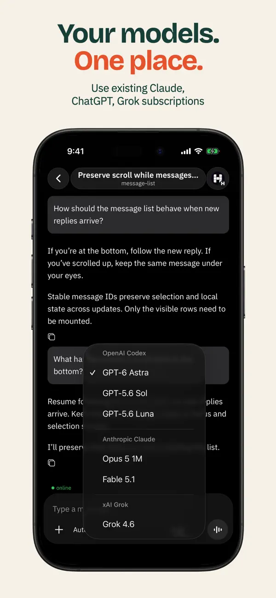 and
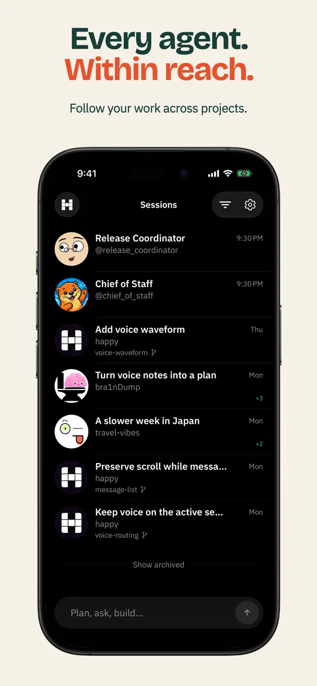.

** HAPI
Inspected frames from the project's linked mobile demo: compact session header,
rendered headings/bullets/code, copyable code blocks and a composer anchored near
the bottom. Its native scrolling policy explicitly treats stable row identities
and reading position as part of behavior. That supports treating Pocket's
disclosure bug as a structural interaction defect, beyond CSS.

Sources: [[https://github.com/tiann/hapi][project and demo]],
[[https://hapi.run/docs/guide/native-apps][native capabilities]],
[[https://github.com/tiann/hapi/blob/main/docs/native-chat-scrolling.md][scrolling policy]].
Local reference: 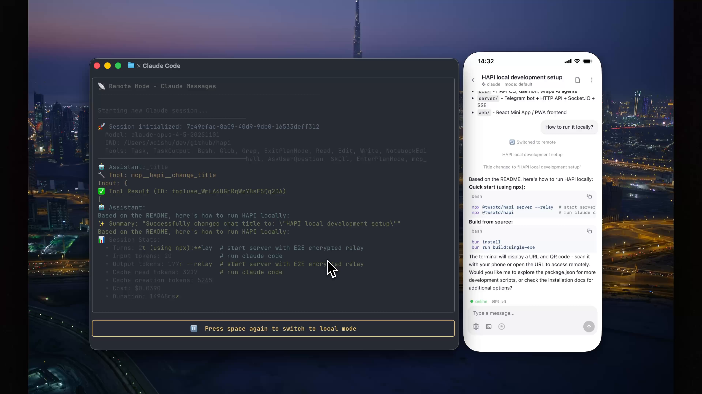.
The demo is a published example, not a test of the latest native client.

** Omnara
Inspected publisher screenshots showing a file-change list with line counts and
change-type glyphs, and a compact composer with adjacent controls. This is useful
for review and composing in context. The surrounding promotional gradients and
dark glass do not define Omega's visual direction. Omnara's current website now
emphasizes an agent platform, so the screenshots are evidence of the listed
mobile product, not proof of its current website's interface.

Source: [[https://apps.apple.com/br/app/omnara-claude-codex-mobile/id6748426727?platform=ipad][publisher's App Store screenshots]].
Local references: 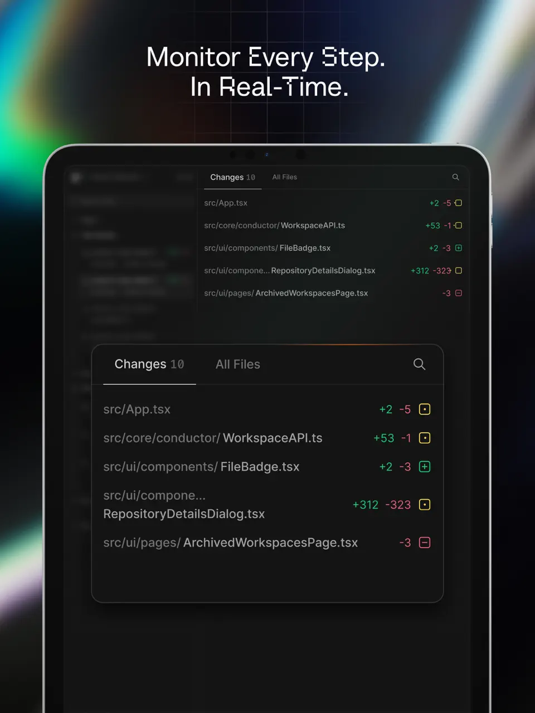 and
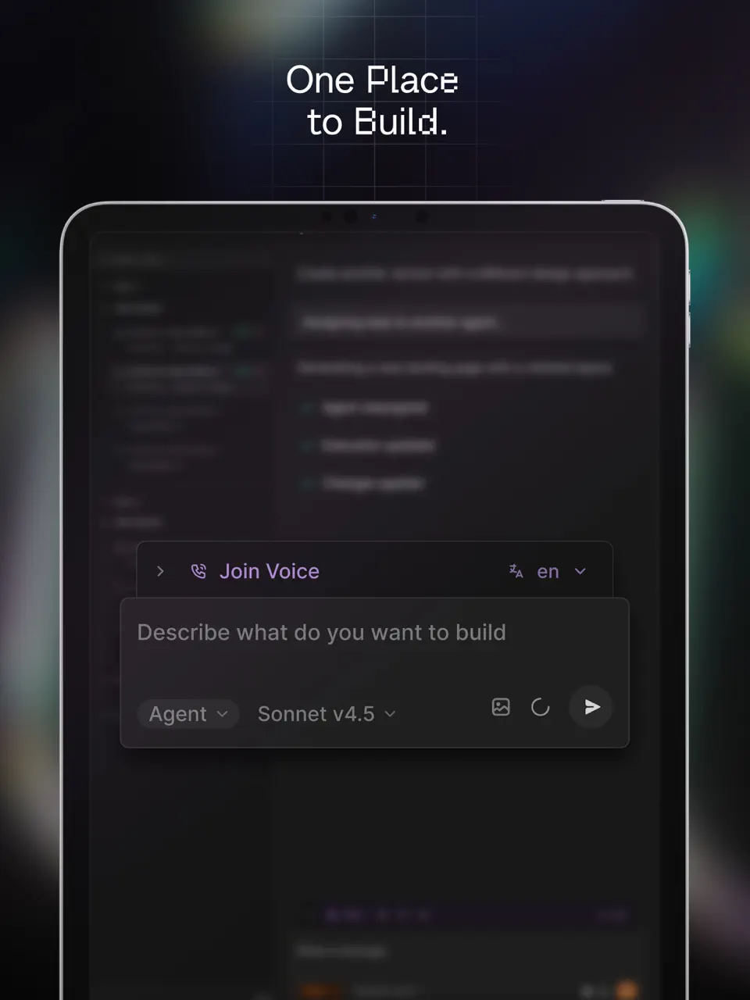.

* If Emacs were designed for a phone today
The investment would go into making powerful objects easy to work with, and
making every interaction feel dependable. Emacs's useful inheritance is live
objects, buffers, commands, composition, inspection and customization. On touch,
those become well-placed controls, direct manipulation and contextual sheets.

** A small stable set of surfaces
| Surface | Primary interaction | Uses what we already have |
|---------+---------------------+---------------------------|
| Work | Compact rows; strongest emphasis for a real pending question; + starts work | workspace/task projections and existing task intents |
| Places | Named roots and subplaces; + opens folder/name form; task composer inherits selection | persisted places, cwd resolution, hierarchy and config |
| Task | Compact title/location, readable answer, meaningful folded tool rows, contextual composer | task facts, messages, source cells and reference objects |
| Buffers | Recently visited documents, tasks, diffs, namespaces and REPL; pin or switch | provider addresses and retained editor panes |
| Reader | Full-width structured text; outline and find on demand; select → Ask/Copy | document provider, source mappings, revisions and selection snapshots |
| Review | File list → unified diff → attributed operation; deliberate publish/undo | buffer history, conflicts and guarded selective undo |
| Commands / Machine | Search first; current-object actions; evaluator opens as a buffer | command registry, native prompts, world/eval and live-image providers |

The proposed default bottom navigation is Work / Places / Buffers. Machine and
the command palette remain one action away and can be pinned. A configurable
layout can put Machine directly in the navigation for someone who lives there.
This is a proposal to drive in a prototype, not a settled navigation contract.

** Visual rules
- Share snow/espresso and semantic accent roles across desktop and Pocket.
- Use the same text/code font roles. Try 16–17px reading text, 13–14px code and
  18–22px compact titles; validate on real devices and increased text settings.
- Use small-radius working surfaces and thin rules. Borders, tone and type carry
  hierarchy. Reserve spacious platform sheets for a focused action.
- Keep touch targets around 44–48px even when rows, icons and labels look compact.
- Use color plus shape/placement for state. Keep accessibility names explicit.
- Keep labels short: Work, Places, Buffers, Ask, Open, Run, Stop, Publish.
  Errors and ambiguous decisions still deserve enough words to be understood.
- Motion should preserve continuity: the same row unfolds, a buffer returns to
  the same position, an answer resolves in place. Honor reduced-motion settings.

** Context has three separate meanings
1. Place context: the actual working directory, inherited configuration and
   environment. A name navigates; the effective path is inspectable.
2. Task input: the goal plus explicit references and selected snapshots. The
   composer can show =Beam Lisp · 2 sources=; tapping reveals exactly which
   sources and revisions will be sent. An open pane is not implicit input.
3. View context: buffer, reading anchor, selection, sheet, focus and unsent text.
   This belongs to the client; another device's navigation must not move it.

All clients still see one world. These distinctions improve presentation and
confidence without introducing another task authority or a device handoff mode.

** A concrete daily journey
Open Pocket and see the two things that need a decision first. Tap one, inspect
the question beside its evidence, answer, and return to the same list position.
Switch to Beam Lisp, tap +, dictate or type a goal, inspect attached sources and
send. A useful tool row unfolds without closing when new output arrives.
Open the resulting document in a buffer, read it without transcript clutter,
select a passage and ask about it. Return to the original paragraph afterward.
Review changed files with attribution. Open the live namespace or evaluate Lisp
from the same command system whenever needed. The desktop sees the same work;
each device keeps its own view.

Voice dictation, attachments, deep-linked notifications, haptics and native app
shells can improve this journey later. They should use these same objects and
actions. They are not prerequisites for fixing the current losses of state.

* Implementation order and acceptance
1. Continuity: reproduce and fix disclosure/address/draft loss, navigation restore,
   modal focus and the unexpected dirty warning. Stable identities before motion.
2. One-app foundation: shared tokens, readable text, compact title and rows,
   predictable composer layout, structured response rendering and one answer.
3. Daily work: native Add place and directory picker, explicit context peek,
   artifact navigation, reading/buffers and a useful file-change review.
4. Refinement: attention triage, command discovery, live-machine buffer, real
   mobile keyboard/selection testing, then optional native integrations.

Each change should load as the existing bl-ed package in an isolated world and
retain use/unuse equivalence. Reuse backend capabilities; extend only where a
real interaction requires missing data. No second router, task engine, place
registry or document model is needed to pursue this direction.

The acceptance bar should include realistic long prompts, long responses,
multiple repositories, many tasks, tool-heavy runs and documents with code:

- Leave a disclosure open across updates and while another client changes work.
- Type slowly across several probes; every unfinished field survives.
- Reload with a new-task draft and while reading a document; resume correctly.
- Read older output while new output arrives; hold the same content under the
  reader's eyes, with a discreet route to new output.
- Start work in a second place without knowing a command name or EDN syntax.
- Distinguish working, returned answer and unanswered question at a glance.
- Read exactly one well-rendered answer and inspect the tool evidence.
- Use Back, text scaling, modal focus and reduced motion coherently.
- Test iOS Safari and Android Chrome with real keyboards and native selection.
- Verify default editor presentation and package unuse after every relevant change.

The prior scripted contract checks remain valuable. This audit shows why those
checks must be complemented by realistic live usage and interaction-state tests.
