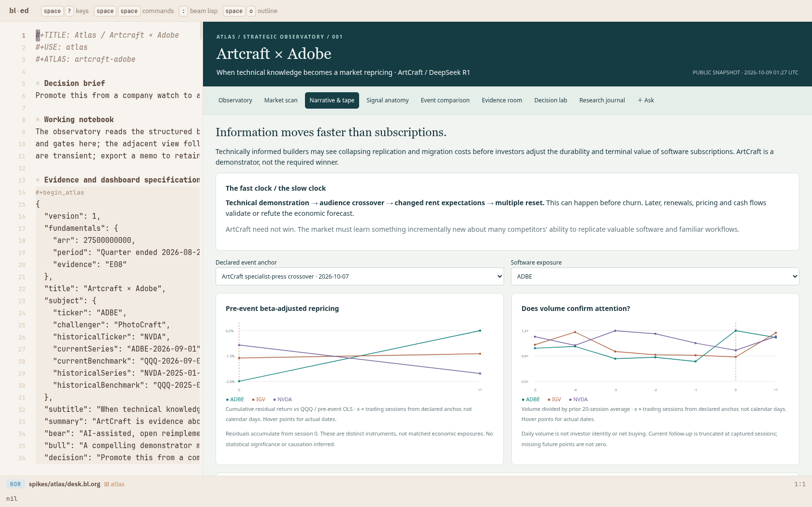
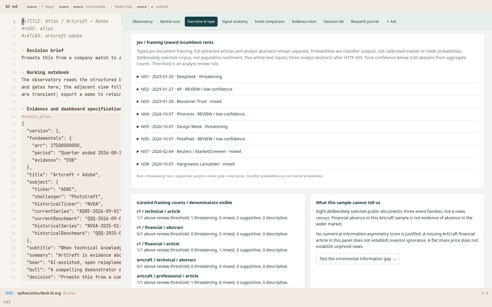
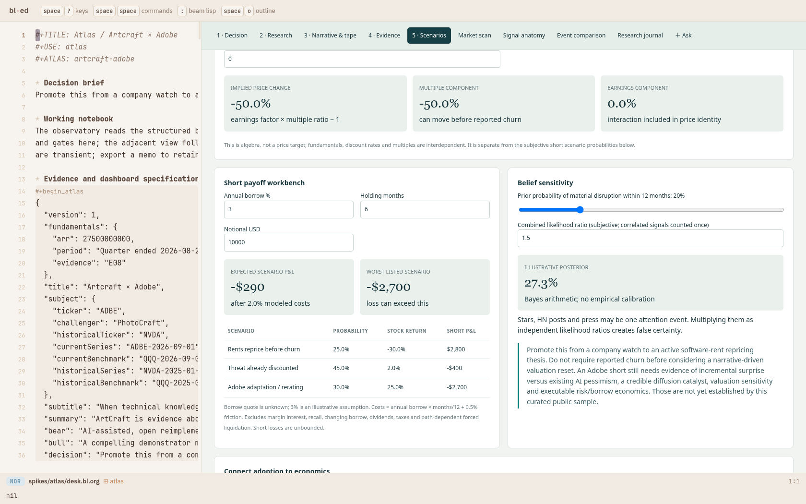
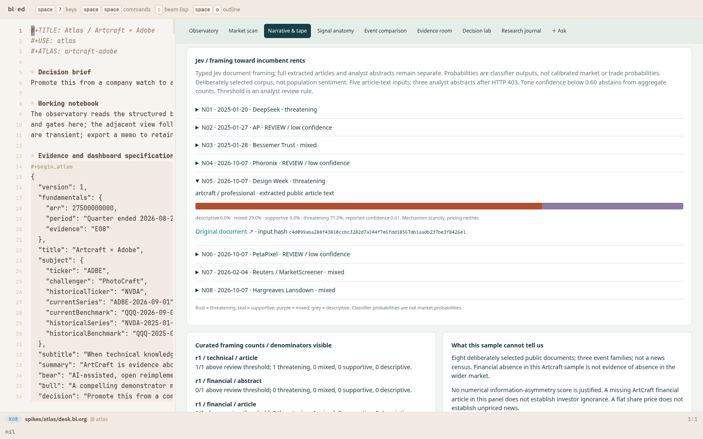

# Atlas — a strategic decision desk in the real bl-ed

An editable `.bl.org` notebook drives a public-evidence observatory, market
scan, narrative/tape study, signal ledger, comparative event study, evidence room, decision lab and
research journal. The authored case asks whether Artcraft's Adobe-replacement
story supports an Adobe short, using DeepSeek R1 as a mechanism comparison.

**Current research frame: information diffusion about replicable software rents.**
ArtCraft need not win for a market repricing to occur. Fast multiple resets
are separate from slow paid migration. The broad software-disruption story
is already public; incremental surprise, current expectations, catalyst and
executable borrow remain unresolved. All future probabilities, returns and cost inputs
are explicitly assumptions. This is a captured public-data research desk.

## Open it

From the repository:

```sh
spikes/atlas/run.sh
```

Open the printed URL (default port 8831). This builds the package and starts
an offline, in-memory world under a new `/tmp/omega-atlas.*` root. It changes
cwd before launch to avoid the existing duplicate-`--root` issue. Choose an
unoccupied port if needed; never use the user's port 8790 for testing.

For real bounded Gen-backed reviews and follow-ups:

```sh
spikes/atlas/run-gen.sh
# or ATLAS_PORT=8832 spikes/atlas/run-gen.sh
```

The existing `.env` supplies the Gen credential; secrets are never placed in
the notebook. Save notebook changes before asking. The Gen review world reads
the saved case and can critique it; it does not acquire data or mutate source.
The normal Omega harness can perform acquisition using the supplied task
instructions and adapters.

Keyboard: `space s q` ask; `space s r` reply; `space s a` home.
In the research pane, `i` opens a follow-up prompt. The journal's Return to
desk action restores the retained notebook. `:(ed/unuse "atlas")` unloads.

The package is available in the real editor through `?use=atlas` and
`:(ed/use "atlas")`. It exports one `bl-package` map, owns its layout, keeps
state under `:pkg-state`, and supplies layouts and a host view. No vendor
editor source was changed by this spike.

## Durable artifacts

- [Dashboard notebook](desk.bl.org)
- [Research dossier](docs/research.bl.org)
- [Design and interface precedents](docs/design.bl.org)
- [Architecture and data lineage](docs/architecture.bl.org)
- [Real Gen adversarial review](docs/gen-review.bl.org)
- [Real Omega + Gen experiment review](docs/harness-review.bl.org)
- [Build journal](PROGRESS.bl.org)
- [Public acquisition manifest](data/manifest.json)
- [Public market scan](data/scan.json)
- [Jev readiness classification](data/jev-review.edn)
- [Harness transcript](proof/harness.edn)
- [Live isolated Gen task proof](proof/gen-world.json)

## Reproduce and extend

```sh
spikes/atlas/build.sh
BLED_OUT=vendor/bl-ed/web/out node --test spikes/atlas/test/*.test.mjs
OMEGA_HOME="$PWD" bin/bl run spikes/atlas/test/context.bl -p spikes/atlas
# With run.sh serving the isolated world:
ATLAS_PORT=8831 node spikes/atlas/test/browser.mjs
# Editor corpus belongs to the pinned beam-lisp checkout:
BLED_OUT=vendor/bl-ed/web/out BLED_ROOT=../beam-lisp node --test \
  vendor/bl-ed/test/drive.test.mjs vendor/bl-ed/test/pkg.test.mjs \
  vendor/bl-ed/test/frame.test.mjs vendor/bl-ed/test/host.test.mjs \
  vendor/bl-ed/test/document-packages.test.mjs
node spikes/present/test/check.mjs spikes/atlas/desk.bl.org \
  spikes/atlas/docs/research.bl.org spikes/atlas/docs/design.bl.org \
  spikes/atlas/docs/architecture.bl.org
```

Refresh acquisition without overwriting human notebook text:

```sh
node spikes/atlas/collect.mjs
node spikes/atlas/scan.mjs ADBE ADSK CRM MSFT ORCL NVDA
node spikes/atlas/materialize.mjs /tmp/atlas-candidate.bl.org
# Review the candidate diff before promoting it.
```

`materialize.mjs` exclusively creates a new file. Public responses are
content-addressed and bounded; missing requests remain errors. `models.mjs`
is transport-free and shared between collection, charts and tests.

The current schema is reusable, while parts of the authored overview remain
specific to the Adobe case. New case notebooks should supply their own subject
roles, evidence, transmission chain, comparison windows and decision gates.
The current prototype has no automatic refresh or brokerage connection.

## Information-event revision

Narrative & tape adds four declared anchors, pre-event QQQ beta fits, IGV
controls, software peers and volume. Jev classifies incumbent-rent framing,
economic mechanism and pricing clocks across eight public document inputs;
article text and web-verified analyst abstracts remain distinct. Low-confidence
labels abstain. Full news article text stays in local analysis inputs; metadata,
hashes and classifications are retained. The decision lab separately models earnings × multiple repricing.

```sh
node spikes/atlas/movement-collect.mjs
OMEGA_HOME="$PWD" bin/bl run spikes/atlas/sentiment.bl -p spikes/atlas
node spikes/atlas/revise-movement.mjs /tmp/atlas-new-movement.bl.org
# Review and explicitly promote the proposed notebook.
```

The collector uses eight news requests and three batches of eight price
instruments. HTTP failures remain recorded. This is a curated sample, not a
population sentiment index. [Revised research](docs/research.bl.org) explains
the two clocks, the prior February software selloff, and the unresolved edge.

## Real-editor proof

The tour drives native controls and editor keys, edits the structured title,
undoes it, changes borrow assumptions, retains and exports a memo, follows
claims to sources, starts a research task beside the notebook, opens a reply,
returns to the desk, checks a compact viewport and unloads the package.
Assertions and results are retained in [browser.json](proof/browser.json).


The final verification counts and commands are recorded in PROGRESS.bl.org.
The presentation equivalence checker itself is unchanged.









## v3: independent research, with authored and generated work separated

The earlier read-only Gen follow-up is superseded by an actual Omega tool loop.
Start `spikes/atlas/run-gen.sh`: it builds this same package and seeds a durable,
separate `.omega/atlas-desk` world once. Tests use only `/tmp/omega-atlas.*` and
ports 8833/8834. No writes to the user's live world. The offline `run.sh` remains
a demonstration, clearly labeled as such in Research.

Decision now introduces the investigation and distinguishes the authored case
from the latest Omega-generated draft. Research exposes the real dataset catalog,
a question form, investigation presets, source IDs, tool failures, actual task
status, task-generated charts, and report/proposal links. Reports open in a real
layout beside the retained notebook. Polling preserves a typed question and focus;
unuse disposes the timer, styles, view and layout.

[`docs/independent-desk.bl.org`](docs/independent-desk.bl.org) describes what is
hardcoded/authored, reusable functions, Gen and Jev responsibilities, task data,
architecture, workflow, bounds and remaining limitations. The generic Gen adapter
and editor startup configuration live in Omega; public data adapters, numerical
analysis and domain tools stay in Atlas. Model findings are not automatically
adopted into the case. Source-ID validation establishes lineage, not semantic
truth or investment suitability.

Reproduce v3 verification:

```sh
bin/bl test test/gen_test.bl test/ed_test.bl
node --test spikes/atlas/test/*.test.mjs
# Opt-in network-backed proof, against an owned run-gen.sh world:
ATLAS_PORT=8833 node spikes/atlas/test/desk-world.mjs
ATLAS_PORT=8833 node spikes/atlas/test/research-browser.mjs
```

Real-editor proof:

- [Guided decision](proof/20-guided-decision.png)
- [Research workspace and actual dataset inventory](proof/21-research-workspace.png)
- [Compact research](proof/24-compact-research.png)
- [After unuse](proof/25-research-unused.png)
- [Browser assertions](proof/research-browser.json)

The original 19-screen tour also passed against a separate offline world on
8834, including editor edits/undo, event charts, source tracing, contextual
real task submission, reply prompt, retained-pane return and package removal.
The vendor suite passed all 60 checks. The unchanged presentation equivalence
checker passed the 1574 case variants and the new explanatory notebook.

Live proof: [actual Omega tool traces and publication](proof/independent-task.json)
and [Omega-authored report](docs/omega-task-report.bl.org). The task acquired
seven public responses, used Jev and computed three event tapes. It recovered
across an isolated-world restart. The report is a draft: its initial baseline-gap
statement was flagged against its own computation ledger and sent through a
real follow-up investigation. Citation IDs alone do not certify semantic truth.

- [Task-generated findings](proof/22-omega-findings.png)
- [Published .bl.org report beside retained source](proof/23-report-beside-source.png)

Follow-up proof: [actual review task](proof/followup-task.json) and
[Omega-authored correction](docs/omega-followup-report.bl.org). Omega checked
the prior artifacts, recomputed the shock-session anchor and repaired a rejected
citation before publishing. Both drafts remain reviewable. Gen adapter checks
now include 21 assertions, with bounded provider-error diagnostics.

The verified world is retained locally at `.omega/atlas-desk-v3` and served on
8833. Restart with `ATLAS_WORLD="$PWD/.omega/atlas-desk-v3" ATLAS_PORT=8833
spikes/atlas/run-gen.sh`. It contains the actual durable task store, full public
captures, reports and proposals. The repo stores source, proofs and shareable
reports; no credentials or full publisher articles were committed.

[Form-launched task proof](proof/form-task.json) and
[real submitted form with retained panes](proof/26-form-launched-task.png) show
the new question form opening an actual Omega task that published a result.

[Selected task draft on Decision](proof/27-selected-decision-draft.png) verifies
that a reader can choose which generated account to compare with the authored
hypothesis. This changes package reading state, not the source notebook.
