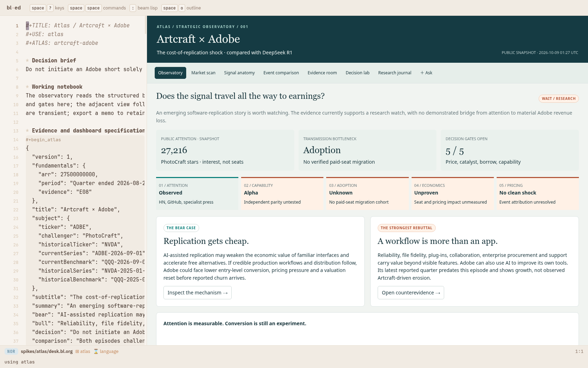
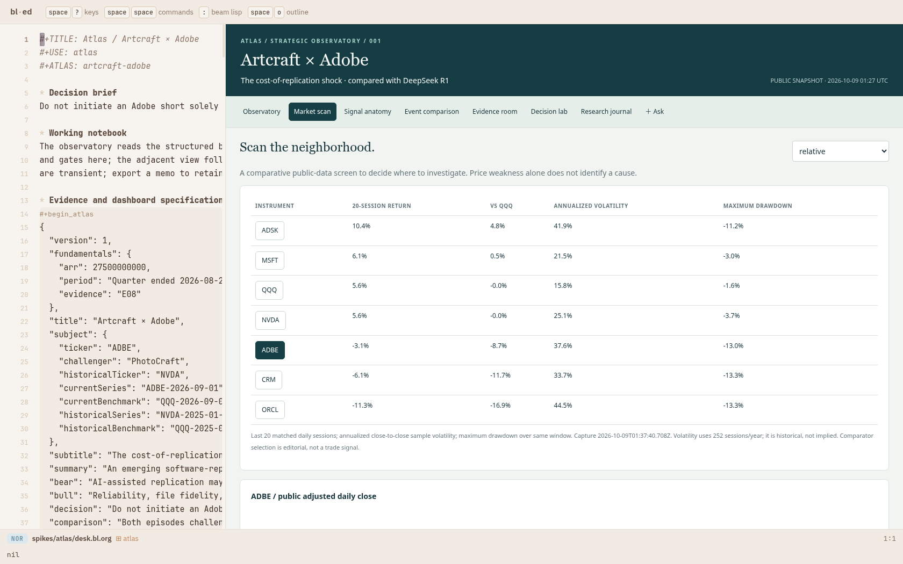
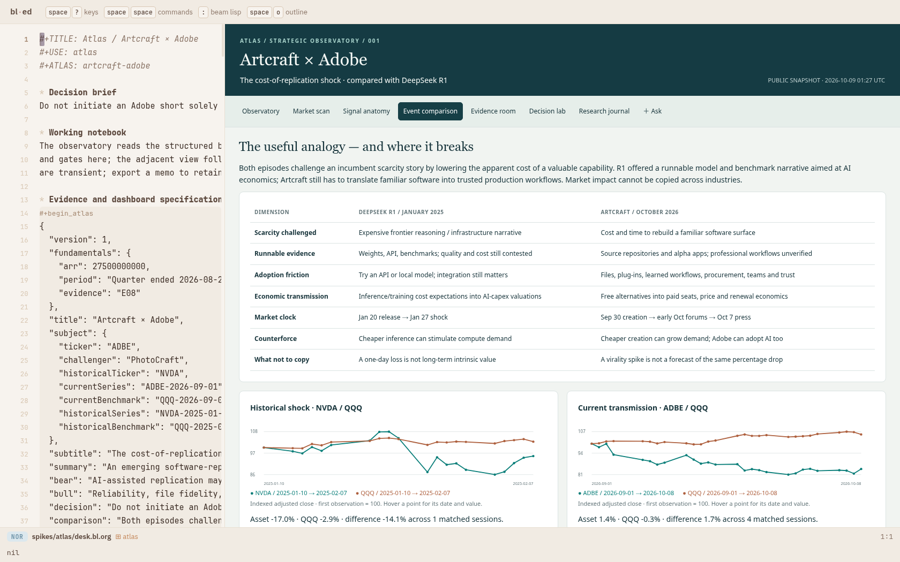
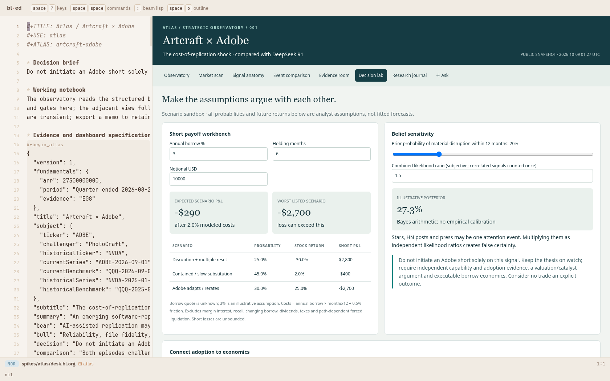
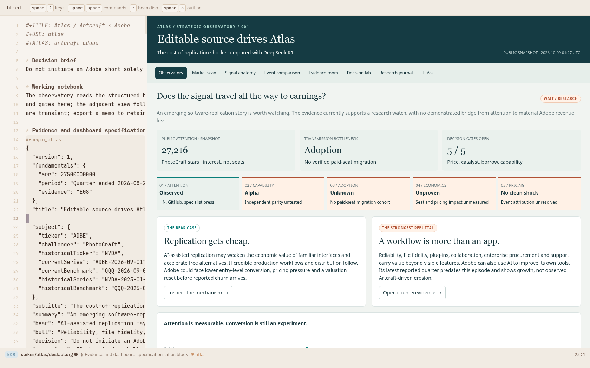
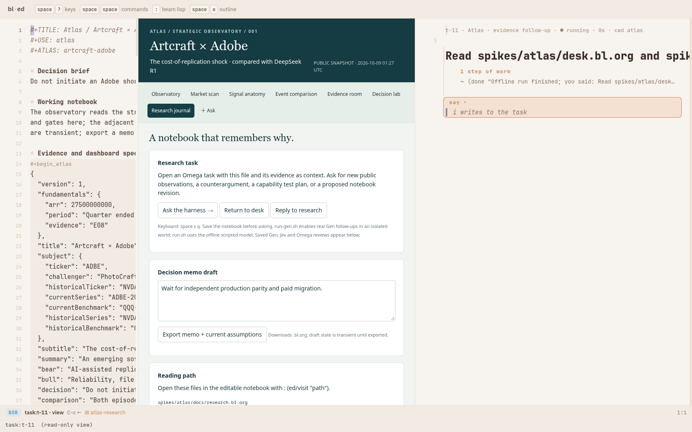
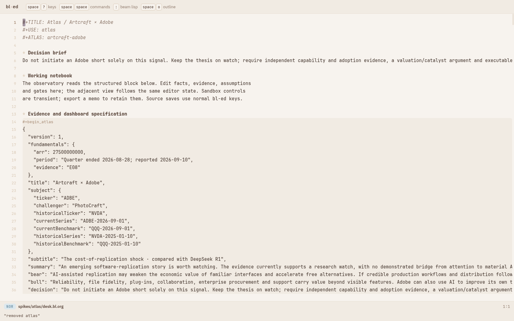

# Atlas — a strategic decision desk in the real bl-ed

An editable `.bl.org` notebook drives a public-evidence observatory, market
scan, signal ledger, comparative event study, evidence room, decision lab and
research journal. The authored case asks whether Artcraft's Adobe-replacement
story supports an Adobe short, using DeepSeek R1 as a mechanism comparison.

**Current research decision: wait and test.** Attention is observed; independent
professional capability, paid migration, exposed economics and executable
borrow remain unresolved. All future probabilities, returns and cost inputs
are explicitly assumptions. This is a captured public-data research desk.

## Open it

From the repository:

```sh
spikes/atlas/run.sh
```

Open the printed URL (default port 8831). This builds the package and starts
an offline, in-memory world under a new `/tmp/omega-atlas.*` root. It changes
cwd before launch to avoid the existing duplicate-`--root` issue. Choose an
unoccupied port if needed; never use the user's port 8790 for testing.

For real bounded Gen-backed reviews and follow-ups:

```sh
spikes/atlas/run-gen.sh
# or ATLAS_PORT=8832 spikes/atlas/run-gen.sh
```

The existing `.env` supplies the Gen credential; secrets are never placed in
the notebook. Save notebook changes before asking. The Gen review world reads
the saved case and can critique it; it does not acquire data or mutate source.
The normal Omega harness can perform acquisition using the supplied task
instructions and adapters.

Keyboard: `space s q` ask; `space s r` reply; `space s a` home.
In the research pane, `i` opens a follow-up prompt. The journal's Return to
desk action restores the retained notebook. `:(ed/unuse "atlas")` unloads.

The package is available in the real editor through `?use=atlas` and
`:(ed/use "atlas")`. It exports one `bl-package` map, owns its layout, keeps
state under `:pkg-state`, and supplies layouts and a host view. No vendor
editor source was changed by this spike.

## Durable artifacts

- [Dashboard notebook](desk.bl.org)
- [Research dossier](docs/research.bl.org)
- [Design and interface precedents](docs/design.bl.org)
- [Architecture and data lineage](docs/architecture.bl.org)
- [Real Gen adversarial review](docs/gen-review.bl.org)
- [Real Omega + Gen experiment review](docs/harness-review.bl.org)
- [Build journal](PROGRESS.bl.org)
- [Public acquisition manifest](data/manifest.json)
- [Public market scan](data/scan.json)
- [Jev readiness classification](data/jev-review.edn)
- [Harness transcript](proof/harness.edn)
- [Live isolated Gen task proof](proof/gen-world.json)

## Reproduce and extend

```sh
spikes/atlas/build.sh
BLED_OUT=vendor/bl-ed/web/out node --test spikes/atlas/test/*.test.mjs
# With run.sh serving the isolated world:
ATLAS_PORT=8831 node spikes/atlas/test/browser.mjs
# Editor corpus belongs to the pinned beam-lisp checkout:
BLED_OUT=vendor/bl-ed/web/out BLED_ROOT=../beam-lisp node --test \
  vendor/bl-ed/test/drive.test.mjs vendor/bl-ed/test/pkg.test.mjs \
  vendor/bl-ed/test/frame.test.mjs vendor/bl-ed/test/host.test.mjs \
  vendor/bl-ed/test/document-packages.test.mjs
node spikes/present/test/check.mjs spikes/atlas/desk.bl.org \
  spikes/atlas/docs/research.bl.org spikes/atlas/docs/design.bl.org \
  spikes/atlas/docs/architecture.bl.org
```

Refresh acquisition without overwriting human notebook text:

```sh
node spikes/atlas/collect.mjs
node spikes/atlas/scan.mjs ADBE ADSK CRM MSFT ORCL NVDA
node spikes/atlas/materialize.mjs /tmp/atlas-candidate.bl.org
# Review the candidate diff before promoting it.
```

`materialize.mjs` exclusively creates a new file. Public responses are
content-addressed and bounded; missing requests remain errors. `models.mjs`
is transport-free and shared between collection, charts and tests.

The current schema is reusable, while parts of the authored overview remain
specific to the Adobe case. New case notebooks should supply their own subject
roles, evidence, transmission chain, comparison windows and decision gates.
The current prototype has no automatic refresh or brokerage connection.

## Real-editor proof

The tour drives native controls and editor keys, edits the structured title,
undoes it, changes borrow assumptions, retains and exports a memo, follows
claims to sources, starts a research task beside the notebook, opens a reply,
returns to the desk, checks a compact viewport and unloads the package.
Assertions and results are retained in [browser.json](proof/browser.json).















The final verification counts and commands are recorded in PROGRESS.bl.org.
The presentation equivalence checker itself is unchanged.
