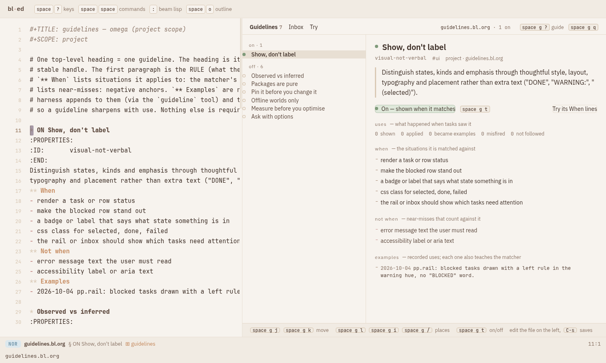

# Guidelines: rules that find their own moment, and get better with use

*Spike, 2026-10-10, two slices. Slice 1 measured whether semantic matching works (it does, with
caveats). Slice 2 built the selection pipeline, the use lifecycle, dialect help, the loop's
`:tail`/`:record`/`:situation`, loud dev hooks, and the **guideline explorer**, a bl-ed package.
Nothing is ever enabled automatically. Nothing touched the live world on :8790.*

```sh
spikes/guidelines/run.sh                      # isolated world on :8792 (temp root, in memory)
#  → http://127.0.0.1:8792/?file=guidelines.bl.org&use=guidelines
bin/bl test -p spikes/guidelines spikes/guidelines/test/{loop,recall,dialect}_test.bl
node --test spikes/guidelines/test/package.test.mjs      # package contract (after build.sh)
node spikes/guidelines/test/browser.mjs                  # real browser, own world on :8793, screenshots
```

## 1. Against "skills"

An Agent Skill is a directory with a `SKILL.md`. Its `name` and `description` sit in the system
prompt, and the **model** decides when to read the body. That works for procedures. It fails for
*taste*, because the model must already know it is about to violate the rule. A guideline turns
this around:
- The **harness** picks the rule per step, from what the agent is doing.
- It **records** what was shown and what came of it.
- A human-accepted use becomes an **example**, which is also a new match anchor.

## 2. Defining guidelines

`guidelines.bl.org` (project) and optionally a user file. Each guideline is one top-level heading:

```org
* ON Show, don't label                                               :ui:
:PROPERTIES:
:ID:       visual-not-verbal
:PATHS:    **/theme.css, src/omega/ed/render.bl     ← optional: certain triggers
:TOOLS:    http                                     ← optional: fires after this tool
:END:
Distinguish states … rather than extra text.        ← the rule (what the agent reads)
** When                                             ← situations, matched by meaning
- make the blocked row stand out
** Not when                                         ← near-misses, count against
- accessibility label or aria text
** Examples                                         ← accepted uses; also anchors
- 2026-10-10 blocked rows get a warning-hue left rule (while: make the blocked task row stand out)
```

**`ON` is the switch.** Only headings that start with `ON` are ever injected; reading or adding a
file enables nothing. Flip it by typing, or with `space g t` in the explorer. The extension
re-reads its sources when their stat changes, so a switch applies on the next step (tested).

Alternatives considered:

| | org only | datoms only | **org for rules, datoms for use (built)** |
|---|---|---|---|
| review / diff / git | ✓ | ✗ | ✓ |
| where it fired, per task | ✗ | ✓ | ✓ (traces `{:kind :guideline}`) |
| learning | file appends race the open buffer | a transaction | **candidates in datoms; a human promotes into the org, rev-checked** |

`drafts/host.bl.org` converts `~/.agents/AGENTS.md` (9.4 KB, sent to every session in every repo)
into 5 guidelines, all off. On 6 probes each fired only on its situation: an `.envrc` path
triggered the direnv rule, and "rename foo to bar" matched nothing (`proof/host-drafts.txt`).

## 3. Your challenges, answered

### 3.1 Recall: a staged pipeline (`guidelines/recall.bl`)

There is no new hook system. The existing `:context` hook calls a **pipeline value**:

```clojure
{:recall    [triggers (semantic {:threshold 0.25 :k 4})]   ; wide: anything plausible
 :precision (gate 0.42) | (jev ask)                        ; narrow: keep what really applies
 :k 3}
;; a stage = {:name kw :run (fn [ctx situation] → [hit …])}; hits carry :via
```

1. **Situation.** `omega.loop/situation` builds `{:goal :recent :step :last-tool :paths :exts
   :text}` once per step from the turns and the task's claim traces. Every `:context` hook gets it
   as `(:situation ctx)`.
2. **Recall stages, unioned.**
   - **Triggers:** `:PATHS:` globs against claimed paths, and `:TOOLS:` against the last tool. Such
     a hit is certain and skips precision.
   - **Semantic:** a low threshold and top-k over When lines and examples.
3. **Precision.** Offline, this is the score gate. Online, it is **Jev**: one calibrated yes/no per
   candidate in one request; the question includes the Not-when list. It fails **closed** for
   candidates and never drops a trigger hit.

Each hit says which stage found it (`:via`). The explorer and the `shown` trace show it.

| 24 held-out situations | P | R |
|---|---|---|
| single-stage gate 0.42 (slice 1) | 0.88 | 0.35 |
| recall t=0.20 k=4, no precision | 0.36 | 0.70 |
| same + oracle precision (the ceiling) | 1.00 | 0.70 |
| **same + LIVE Jev p≥0.6** | **0.92** | **0.55** |

Jev took ~5 s for 24 situations. Per step that is ~0.2 s; it could be cached per (situation,
candidate). Recall is now limited by the recall stage (ceiling 0.70), not by precision.
`proof/pipeline.txt`.

### 3.2 Candidates, promoted when the task finishes (`guidelines/lifecycle.bl`)

```
candidate ─(task :done, not a near-duplicate ≥0.9, judge ≠ violated)─▶ ready ─(human accepts)─▶ promoted
    └─(task failed/cancelled, duplicate, violated)─▶ dropped {:reason}
```

- **Sources of candidates:**
  - the agent's `guideline` tool (`applied`);
  - the **judge**, which looks at shown guidelines the agent didn't mention.
- **Settlement** happens when the task finishes. Judging and settling share one `:task/status`
  handler, so they run in order and a slow judge can't race settlement. A failed turn emits no
  `:turn/end`, which is why this listens to the status.
- **Live Jev judge** on the recorded A/B outputs: the 5 injected rows scored *followed* 0.86–0.92.
  The 5 uninjected rows (which printed "needs you") scored 0.40–0.46, which falls in the **n/a**
  band rather than *violated*. So the judge is good at confirming a use and weak at catching a
  violation (`proof/judge.txt`).

### 3.3 Write-back goes through the human and the editor

The explorer's **Accept** calls `guidelines/promote` with the rev the explorer read. A stale rev
is refused, like bl-ed's save. Examples are capped at 8; the oldest is dropped. The file then
reloads in place.

### 3.4 Why the injected block wasn't stored, and why it now is

Slice 1 put the block on the request **tail**. It is rebuilt every step and never becomes a turn,
following the prompt-cache contract for *volatile* lines (an attention line changes every step).
Measured over a 12-step task (`test/storage.bl`, `proof/storage.txt`), in uncached bytes per
step:

| placement | uncached bytes/step | stored | visible in the transcript |
|---|---|---|---|
| none (floor) | 439 | — | — |
| `:tail`, re-sent while it matches | **793** | 0 | no |
| system prompt | 521, but its first step re-processes everything (1,336) | 0 | no |
| **`:record`**: once, into the turn where it was shown | **473** | +339 B once | **yes** |

So the tail was the wrong home. A guideline is not volatile: once shown, the agent should keep
seeing it. **`omega.loop` now has `:record`.** A hook's blocks are sent at the tail and written
into the last user-side turn. Every later request then carries them at the same position: one
uncached step, a stable prefix, and an audit trail in the task's own transcript. Guidelines
default to `:record`, adding each guideline once, at its first match. `:inject :tail` stays
available for the request-only mode.

### 3.5 Reporting without forcing the agent

The `guideline` tool is optional; its description says so. The judge covers the rest. Whether
Sonnet calls the tool unprompted is still **untested live**.

### 3.6 Loud hooks in development (committed `231e55a`)

`OMEGA_DEV=1` or `:dev? true`: a throwing hook fails the turn with the extension and hook named,
after leaving its `:finding`. Production stays fail-open. Every spike test runs with `:dev? true`.

## 4. Dialect gaps, with semantic help (`guidelines/dialect.bl`)

A `:tool/after` hook turns `undefined var: X` into:
- **the nearest live vars, with their docs**, appended to the error the model reads (so the fix
  arrives with the failure);
- a `proposed` trace, which the explorer shows as a draft guideline.

The index is the running VM's own var table (`BeamLisp.Env/public_names` + `doc_string`), not
source: 487 vars in ~0.5 s. Indexing `priv/boot` source with `bl search` takes ~50 s and skips
`core.bl`. Names are deduplicated (`foo_bar` ≡ `foo-bar`; core vs rt).

```
take-last  → last, butlast, last-key, last-index-of
map-indexd → map-indexed — Returns a lazy seq of (f i x) …
re-find    → "exists but is not loaded here: add [clojure.re] to this namespace's :require"
```

The last line is a real trap this spike hit. `re-find` resolves under `bl run`, but under `bl test`
it is an undefined var in the same namespace, because something else had loaded `clojure.re`
first. The dialect index knows which namespaces intern into core only once loaded, and says so.
Some answers are still weak: `array-map` → `map`/`mapv`, `with-out-str` → `str`. The note shows
four candidates with docs, so a weak first guess is visible as weak.

## 5. The guideline explorer (bl-ed package `guidelines`)



**Intent.** A person deciding which rules their agents live by, reading slowly and switching
carefully. It should feel like a reading desk with a ledger, not a dashboard. The file stays the
source of truth on the left (editable, `C-s` saves). The explorer, on the right, is a view of that
file plus everything the world knows about it.

**It obeys its own first rule.** State is shown, not labelled:

| state | how it is drawn |
|---|---|
| on / off | solid sage dot / hollow ring; grouped "on · n" above "off · n" |
| how much it was used | the **width of the row's left rule** (1–5 px, log of applied + promoted) |
| would fire (Try) | a solid sage bar crossing the threshold hairline |
| would fire but is off | a *striped* sage bar |
| inbox kinds | a colour + a glyph (✓ example · + proposal · ≠ misfire · ! not followed) |

**Three places:**
- **Guidelines:** the list, plus a detail of the rule, its uses, When, Not when, triggers and
  examples.
- **Inbox:** ready examples to accept, dialect proposals with nearby functions, misfires and
  violations; each says what accepting will do.
- **Try:** type a situation and see each guideline's score as a ruler against the threshold, with
  the closest anchor and a note when a Not-when held it back.

**Learnable in one look:**
- The footer always shows the keys for *this* place.
- `space g ?` opens a guide with the model, a legend of the visual grammar, and the keys.
- Every key is also a button, and every command is in `space space`.
- The explorer **follows the file's cursor**, and selecting in the explorer moves the cursor to that
  heading, so reading either side teaches the other.

| keys | |
|---|---|
| `space g g` | open the explorer on a guidelines file (it also opens itself on `*guidelines.bl.org` / `#+GUIDELINES`) |
| `space g j` `space g k` | next / previous (guideline, or inbox item) |
| `space g t` | switch ON/off (rewrites the heading; refuses on unsaved edits) |
| `space g /` `space g .` | try a situation · try the line or selection under the cursor |
| `space g l` `space g i` | guidelines · inbox |
| `space g a` `space g x` | accept (ready examples only) · reject |
| `space g r` `space g ?` `space g q` | refresh · guide · close |

**Architecture.** The package (`guidelines/pkg.bl`) is pure, as the contract requires:
- **State** lives under `(:pkg-state ed) "guidelines"`, and `:owns [:frame/layout]`.
- **Data and writes** go through BEAM intents (`guidelines/model | try | toggle | promote |
  reject`, in `guidelines/intents.bl`). Paths are resolved under the world root and refused outside
  it.
- **The painter** (`host/explorer.mjs`) only draws the model and dispatches events; its CSS is
  per-mount and removed on unuse.
- **The world** (`world.bl`) installs the extensions through the new
  `omega.ed.main/start! :extensions`.

**Proof (AGENTS.md):**
- Screenshots of the real bl-ed with the package used and after `unuse`: `proof/screens/01…08`.
  `08-unused.png` shows one pane and no explorer CSS left.
- Drive test of the contract: `test/package.test.mjs` 9/9, covering:
  - adoption scoped to guidelines files;
  - cursor ↔ selection;
  - toggle refused on unsaved edits;
  - accept only when ready, with the read rev;
  - try the line;
  - errors shown;
  - unuse exact;
  - real frame + `(ed/unuse "guidelines")` → one pane.
- Real-browser tour: `test/browser.mjs` **15/15**, in its own fresh world.
- **Vendor drive tests: 74/74** (frame 15, pkg 3, drive 24, omega 12, host 17, document-packages 2,
  serve-cold 1).
- **Equivalence check unchanged:** 0 bad on welcome, packages.bl.md, frames.bl.md and both
  guideline files.

**A generic bl-ed bug found and fixed (`f5ccda5`).** `ed/frame.bl` `arrange` dropped every pending
effect. A package whose `:adopt` both requests data and arranges the window lost the request, and
its view waited forever. Pending `:intent`s of the kept editor now survive, retagged to its new
pane. This is pinned by a new frame test and recorded in `vendor/bl-ed/VENDOR.md`.

## 6. Harness changes in this slice

| change | where | commit |
|---|---|---|
| dev-mode loud hooks | `omega.ext/dev?` | `231e55a` |
| `:tail`: request-time blocks; the budget notice moved there from the system prompt | `omega.loop/with-tail` | `f27da06` |
| `:situation` in every hook's ctx | `omega.loop/situation` | `f27da06` |
| `:record`: blocks sent once, then kept in the transcript | `omega.loop` | `8229909` |
| `:extensions` and `:dev?` for bl-ed worlds | `omega.ed.main/start!` | `9bc4fb7` |
| arrange keeps pending intents | `vendor/bl-ed/ed/frame.bl` | `f5ccda5` |
| `AGENTS.md` → matched guidelines (draft, off) | `drafts/host.bl.org` | `80443c3` |

omega's suite: 23/23 files green after every commit.

## 7. Open

- **Recall ceiling 0.70.** The next lever is the situation text: add the file languages and the
  edited symbol. Hybrid lexical recall didn't help on these cases (slice 1).
- **Violation detection.** Jev confirms *followed* well; *violated* lands in n/a. Try a direct
  "does the output contain status words as visible text?" style question per guideline, written as
  the guideline's own `** Probe`.
- **Probes per guideline** (slice 1 §6.4): a cassette A/B in `bl test` marking dead-weight rules.
  The observed-vs-inferred rule changed nothing for Sonnet.
- **`:requires`** isn't enforced by `ed/use` yet, and package CSS is per-mount host code. Both are
  bl-ed contract gaps noted in `packages.bl.md` §8.
- The inbox shows proposals but can't yet turn one into a heading in the file. That would need an
  "insert draft" action through the editor, not the BEAM.

## Files

| | |
|---|---|
| `guidelines.bl.org`, `drafts/host.bl.org` | seeds (all off) |
| `guidelines/core.bl` | parse · layer · ON · index · match · inject · add-example |
| `guidelines/recall.bl` | the staged pipeline (triggers, semantic, gate, Jev) |
| `guidelines/lifecycle.bl` | candidates, settle, judge, promote/reject |
| `guidelines/dialect.bl` | undefined-var help + proposals |
| `guidelines/ext.bl` | the omega extension |
| `guidelines/explorer.bl`, `guidelines/intents.bl` | the explorer's BEAM side |
| `guidelines/pkg.bl`, `host/*.mjs`, `build.sh` | the bl-ed package |
| `world.bl`, `run.sh` | isolated world |
| `test/*` | loop 37, recall 14, dialect 12, package 9/9, browser 15/15; measurements `match`, `tiers`, `pipeline_eval`, `storage`, `ab*`, `judge_live` |
