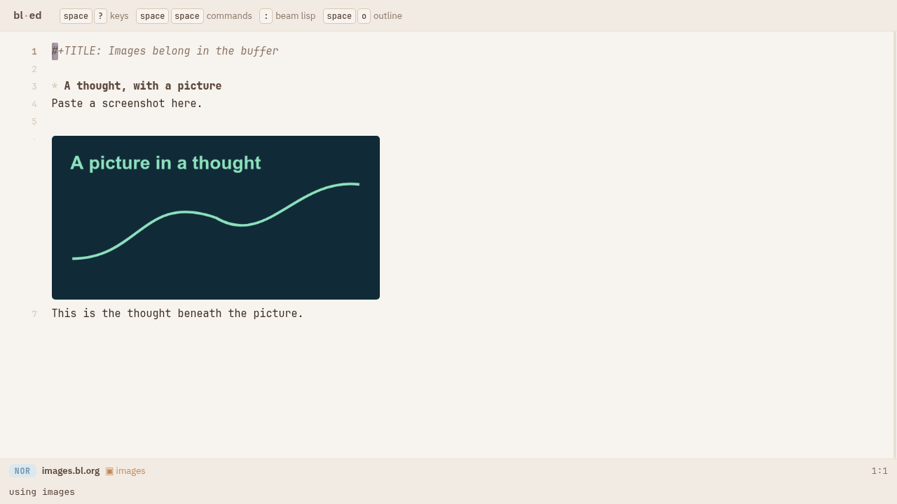
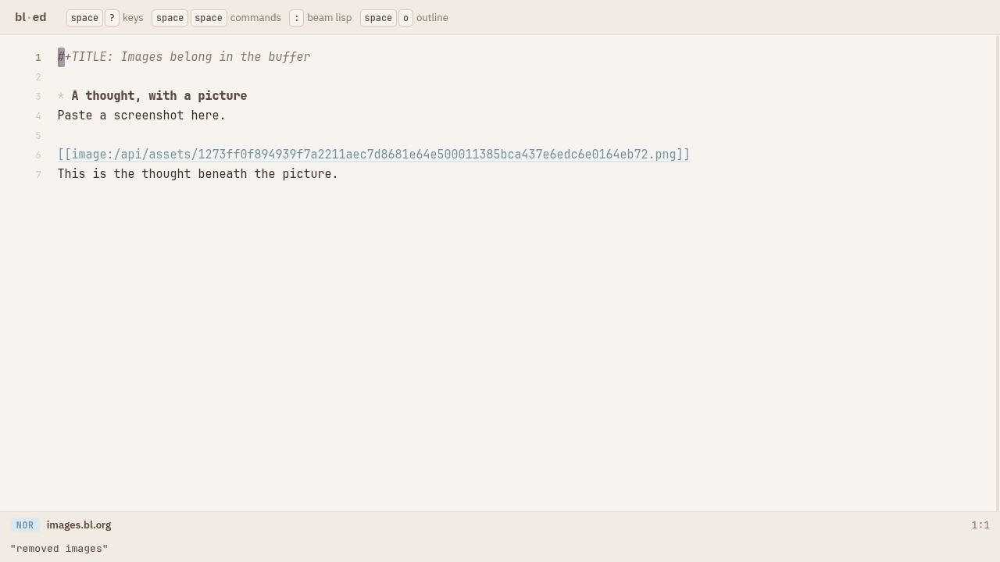
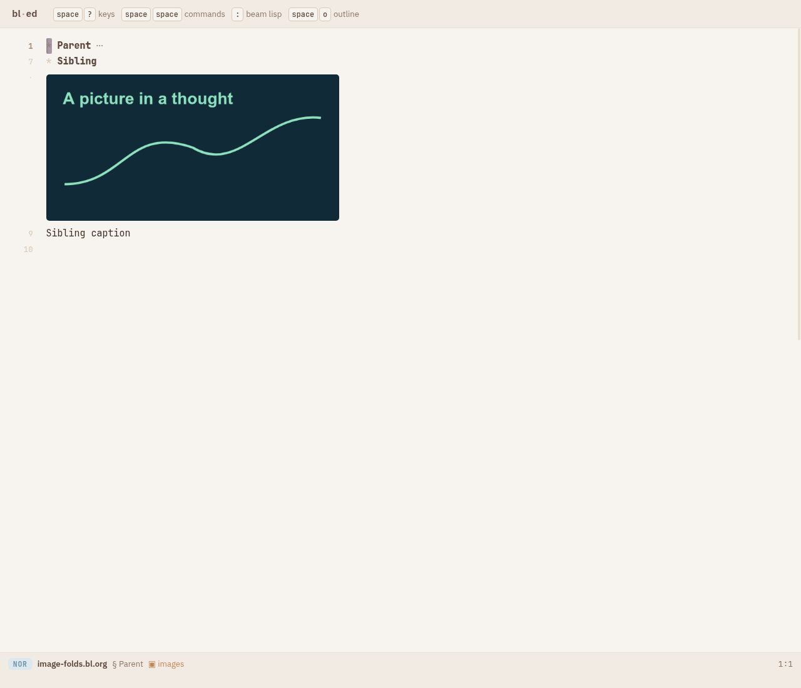
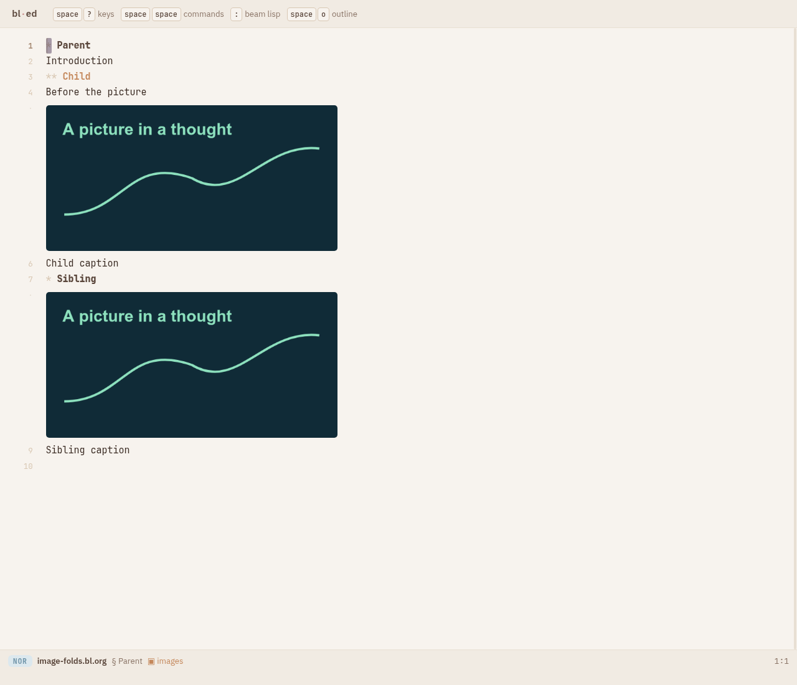

# Clipboard images in a real omega buffer

Prototype package, 2026-10-07. Load `?file=images.bl.org&use=images` or
`:(ed/use "images")` into the real bl-ed. Copy a screenshot and paste with
Ctrl/Cmd+V. The image appears in the buffer, and the cursor enters insert mode
on the next line. Write beneath it; Escape, `u`, `u` undo the writing then the
image. `U`, `U` restore both. Ctrl+S saves; reopening resolves the same image
from the world's `.assets/` directory.

`g i` toggles readable source references. `:(ed/unuse "images")` returns to
ordinary text rendering; references and image bytes remain document content.
Images and their captions fold with the containing heading when you press Tab,
including nested sections and source-reference mode.

## Implementation

`images/img/main.bl` exports one `bl-package` value. The package inserts
`[[image:/api/assets/<sha256>.<extension>]]` as an ordinary, independent history
edit, followed by a newline. Text before/after the cursor is preserved; pasting
mid-line first breaks the line. It emits an `:asset-store` effect and draws
image references through the existing presentation pipeline as ten-row image
ornaments anchored to their source line. The standard section tree and fold
policy are preserved: images decorate prose inside a section, and the layout
cache includes the fold state. References inside source blocks remain literal
code. Other rows retain the core's syntax
rendering. The package never writes command/key tables or sets global editor
keys; its source toggle lives under `:pkg-state "images"`. Its temporary
presentation value is used only during rendering/reveal/scroll calculations,
then the existing presentation is restored. Host IO and generic image painting
are recorded in `vendor/bl-ed/VENDOR.md`.

Clipboard extraction follows the browser's
[clipboardData contract](https://developer.mozilla.org/en-US/docs/Web/API/ClipboardEvent/clipboardData)
and [getAsFile API](https://developer.mozilla.org/en-US/docs/Web/API/DataTransferItem/getAsFile).
PNG, JPEG, and WebP are accepted, up to 10 MB in the browser. Image files are
addressed by SHA-256, checked again by the server, and stored independently
of document saves. Undo removes the reference; it does not delete bytes that
another buffer might use. Saving waits for referenced uploads. Failed uploads
keep the preview and report an error; pasting again retries. Clipboard decoding
is asynchronous: if the buffer or selection changes before decoding finishes,
the paste is cancelled visibly, preventing insertion into the wrong place.

## Run and proof

```sh
spikes/images/build.sh
mkdir -p /tmp/omega-image-slice
# Start FROM this root: bin/bl-ed currently prepends --root "$PWD".
cd /tmp/omega-image-slice
/home/user/code/undefine/omega/bin/bl-ed --offline --memory --port 8792 --root /tmp/omega-image-slice
```

From the repository, with that offline server running:

```sh
node --test spikes/images/test/drive.test.mjs
node --test spikes/images/test/assets.test.mjs
# Optionally set AGENT_BROWSER_EXECUTABLE_PATH to an installed Chromium.
node spikes/images/test/browser.mjs
node spikes/images/test/folding-browser.mjs
BLED_OUT=vendor/bl-ed/web/out BLED_ROOT=../beam-lisp node --test vendor/bl-ed/test/drive.test.mjs
BLED_OUT=vendor/bl-ed/web/out node --test vendor/bl-ed/test/host.test.mjs
node spikes/present/test/check.mjs /tmp/omega-image-slice/images.bl.org research/domain/interface/packages.bl.md research/domain/interface/frames.bl.md
```

The browser test uses `npx agent-browser` to write an actual PNG to Chromium's
system clipboard and press native Ctrl+V, rather than manufacturing a paste
event. It verifies image decode, text below, separate undo/redo, save to disk,
reload from the asset endpoint, source toggle, and unuse. It writes only to the
offline root; it never visits or writes port 8790.

Package drive: **4/4**. Asset endpoint tests: **2/2**. Vendored editor drive: **23/23**, including incremental
structure over its upstream document corpus. Host tests: **16/16**. The unchanged
default-presentation equivalence checker reports no mismatches on the saved
image buffer and both interface contract documents.

Used, after saving and reopening in the real editor:



After `ed/unuse`, the same buffer is ordinary editable source:



Nested heading folding, verified with native Tab presses in the real editor:





The folding regression test uses a separate `image-folds.bl.org` in the offline
world and leaves the existing image buffer untouched. Its drive regression fails
on the original flat-row reader and passes with the standard section tree.

## Prototype boundaries

This slice uses a fixed ten-row image block and a presentation for ordinary
buffers; merging image ornaments into omega's conversation/docked-composer
presentation is future work. There is no original-size viewer, asset garbage
collection, cross-world asset transfer, or multi-image clipboard batch yet.
The reference syntax is local to this package, including in `.bl.md` buffers;
it is not a standard Markdown or Org image export format. File image bytes
persist even in an `--memory` world, because they live under its document root.
