#+title: Pocket — launch and manage sessions across ~
#+subtitle: Design review, findings and implementation roster
#+date: 2026-10-30
#+todo: TODO NEXT DOING | DONE DROP
#+status: Design proposal; nothing implemented yet

* About this document
This file is the single source of truth. The page at =index.html= next to it
reads it on every load and re-reads it every few seconds, so editing a heading
state here (=TODO= → =DOING= → =DONE=) updates the roster for everyone.
Prototypes are static HTML in Pocket's snow-and-coffee tokens. They show
intent, not implementation: every roster item lands in the removable =mobile=
package (=spikes/mobile/mob=, =host/=) or the Omega host, under the rules in
=AGENTS.md=. The Android app keeps loading the same package.

Audit method: live Pocket on Work at 390×844 with =agent-browser=, read-only.
Nothing was submitted, started or cancelled. Android findings come from the
recorded proof screenshots, not a physical phone.

* Decisions so far
| Question | Answer (2026-10-30) | Consequence |
|----------+---------------------+-------------|
| What is a place? | A git repo for now; other kinds later | Discover repos under ~, pick them in a phone-friendly sheet; keep a "Folder…" escape hatch and a =kind= on every place |
| What is mobile for? | First: a focused inbox for sessions. Later: buffers, deep place browsing, other experiences | Work becomes an inbox now; the third tab becomes Open (buffers and tools) instead of disappearing |
| Show how a session runs? | Yes, tastefully | One quiet line at launch and in the session subtitle; detail lives in a sheet |
| Editor layer on mobile? | First-party; users are power users who like tasteful design | Keep ⌘ commands and Lisp, but give them one clear entry with contextual sections and prefixes |
| Notifications? | Yes, with proposed next steps | The host emits your-turn / finished / failed with up to three structured actions; Android shows them inline |

* Findings
Severity: *high* blocks the launch-and-manage goal, *medium* costs time or
trust, *low* is polish.

** F1 · high · Most projects are not places
Places shows 4 entries; Work has 17 git repos under =~= (=~/projects=,
=~/code/**=). Adding one means "+ Place" and typing a path. One past session
was literally /make a new place called ora-website/. Same-named repos exist
(=omega= ×2, =ora-website= ×2) and need disambiguation.
- 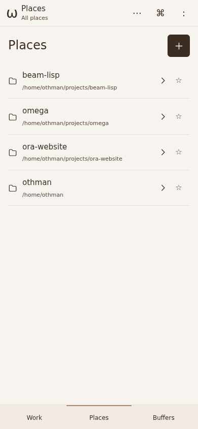

** F2 · high · The task list can't be triaged
Seven of eight cards say "Answered"; two titles are task ids
(=omega-task-id-t-107=); no times; the place is small grey text on the right.
The same state is "Answered" in the list, "◆ your turn" in the action sheet and
"idle" in =omega list=.
- 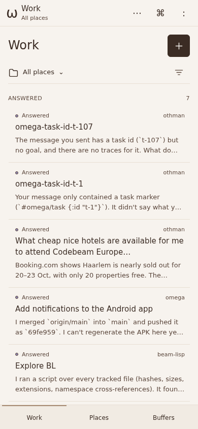
- 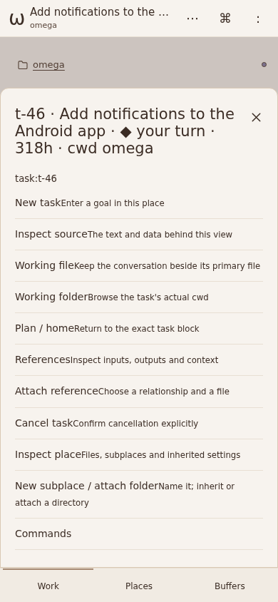

** F3 · high · Opening a place opens a file browser
The place's own Work / New task / Settings buttons sit under the entire file
list. Every row carries an internal id (=folder:omega-7590d0a7/bin=). The header
still reads "Places · All places" inside omega.
- 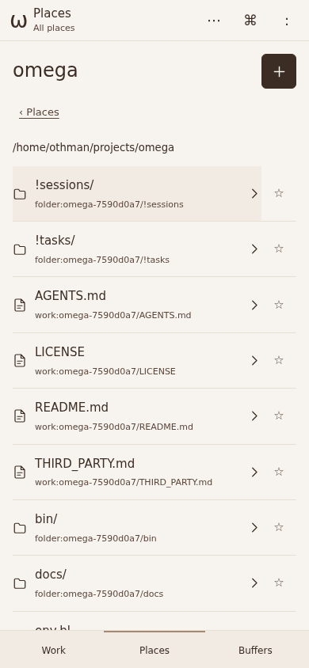
- 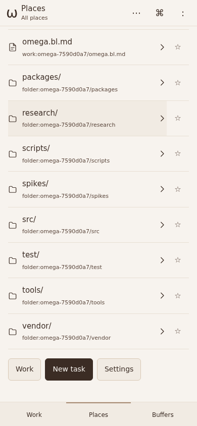

** F4 · medium · The header contradicts the screen
With the filter on "All places" the header says "Work · omega"; Buffers also
says "omega". The subtitle holds the last place visited, not the current view.
- 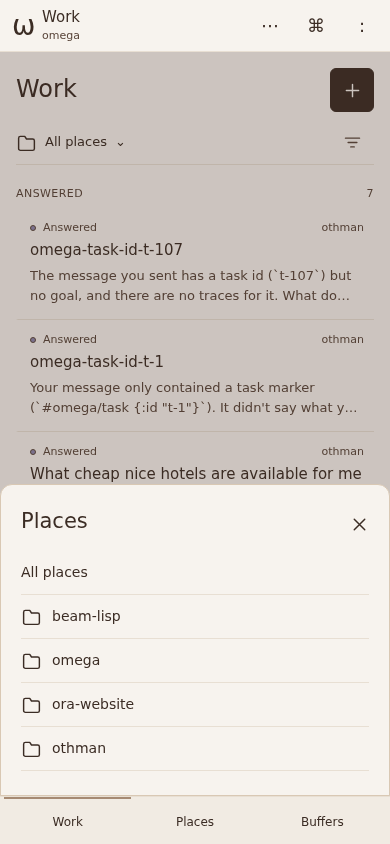
- 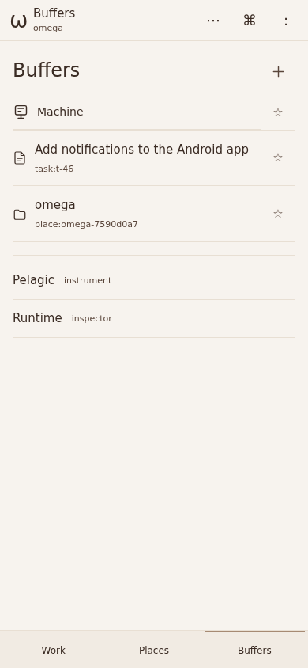

** F5 · medium · "+" means three things
"+" is New task on Work and Add place on Places, and still Add place inside a
place, where you'd expect New task.

** F6 · medium · Context hijacks New task
Tapping "Context" inside the New task sheet replaces the sheet. Closing Context
returns to the place, not to the draft.
- 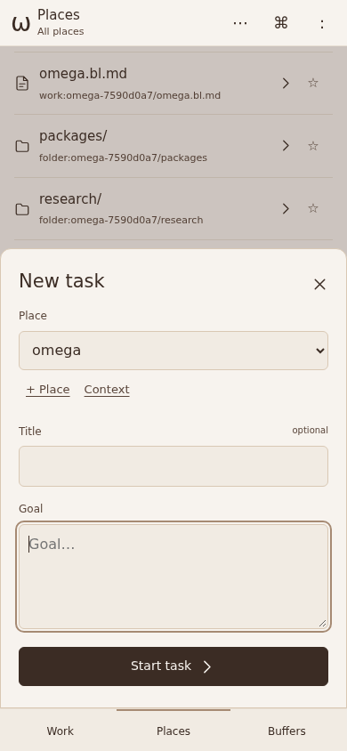
- 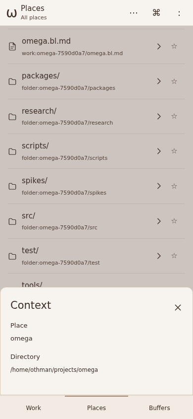
- 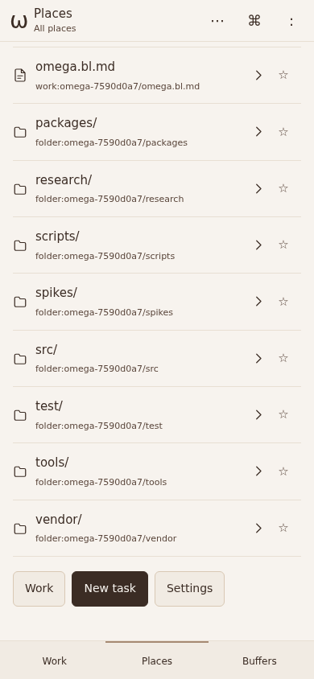

** F7 · medium · Launch can't say how a session runs
No model, branch/worktree or permission choice, and no hint that defaults exist.
The optional Title field sits above the Goal, the one thing that matters.

** F8 · medium · A session doesn't say what it's doing
No running/your-turn state in the session itself, only an unexplained dot.
Cancel is item 8 of 11 in a sheet. The title appears twice (header and H1), and
the Work / Places / Buffers bar stays visible with no back control.
- 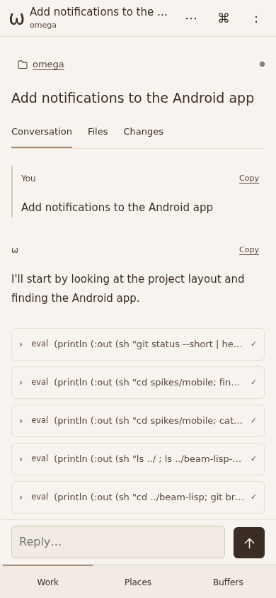

** F9 · medium · Tool calls are raw Lisp
=eval (println (:out (sh "git status --short | he…= repeated per step buries the
agent's prose on a phone.

** F10 · low · The action sheet reads as debug output
Header =t-46 · … · ◆ your turn · 318h · cwd omega=; labels run into their
descriptions ("Working fileKeep the conversation…"); jargon (Plan / home,
References, New subplace).

** F11 · medium · Power tools have no shape
Three unlabelled icons (⋯ ⌘ :). ⌘ lists editor motions (WORD next, Add cursor
below) before session actions; =:= scrolls the same sheet to a REPL with
Editor/Machine buttons. Escape doesn't close it.
- 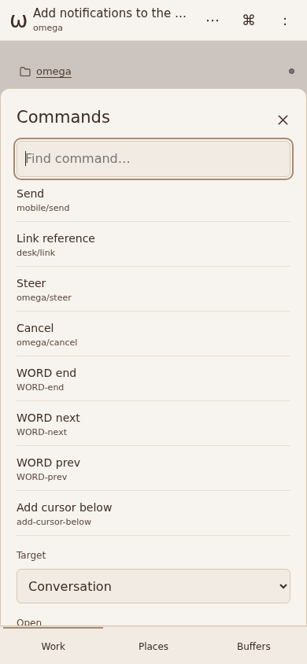
- 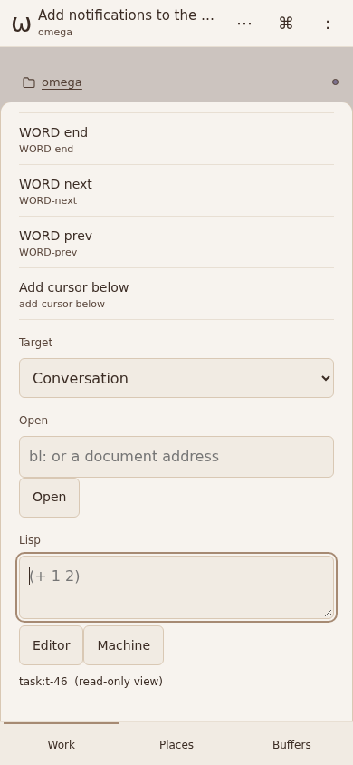

** F12 · low · Buffers is an editor word for a mixed list
Machine, a task, a place, and two experiences (Pelagic, Runtime) share one list
without grouping.

** F13 · medium · Android stacks two headers
The native bar (ω pocket · Reload · Server) sits above the web header
(ω omega / pocket). Connection state and server switching deserve one quiet home.
- 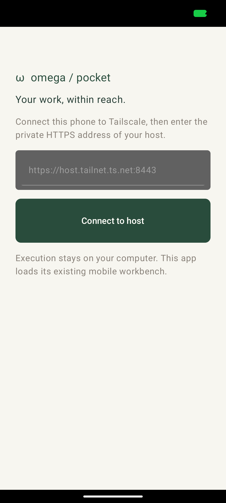
- 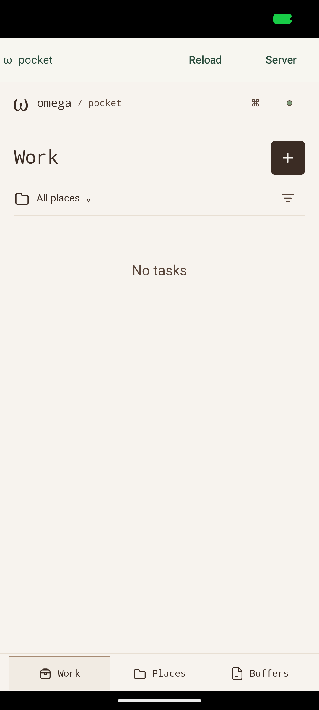

** F14 · high · Nothing reaches you when it's your turn
No notifications. The most valuable phone moment, "the agent needs you", is
invisible unless the app is open.

* Target experience
Tap inside the frames; each links to the next screen. "Open ↗" shows it full size.

** Work is an inbox
Needs you → Running → Done (collapsed). Place identity on the left, relative
time, the agent's question inline with its proposed next steps.
[[proto:inbox.html][Work inbox]]

** Places come from the machine
Discovered git repos, recent first, multi-select, duplicates show their parent.
"Folder…" keeps non-git places possible.
[[proto:places.html][Places]] [[proto:places.html#add][Add places sheet]]

** A place opens on its sessions
Sessions first with an inline starter; Files and Settings one tap away. Real
names, git status letters, Omega's own folders labelled as data.
[[proto:place.html][Sessions]] [[proto:place.html#f][Files]] [[proto:place.html#t][Settings]]

** Launch: the goal first, how-it-runs in one line
Place chips, a large goal field, references as chips. One summary line — =Opus
5.5 · on main · can edit & run= — that expands into choices.
[[proto:launch.html][Launch]] [[proto:launch.html#run][Run settings open]]

** A session says what it's doing
Title once; place, branch and model in the subtitle. A state strip with Stop
while running. Tool calls grouped and humanised. The agent's question ends with
proposed next steps.
[[proto:session.html][Your turn]] [[proto:session.html#running][Running]] [[proto:session.html#details][Details sheet]]

** Notifications carry the next step
Your turn, finished and failed, each with up to three actions and inline reply.
One ongoing summary for running work.
[[proto:notifications.html][Notification shade]]

** Power layer: Open and ⌘K
Open replaces Buffers: tools on top, recent buffers below. ⌘K puts this
session's actions first, then Go to; prefixes switch mode — =:= Lisp in the
world, =>= editor commands, =@= files.
[[proto:open.html][Open]] [[proto:open.html#palette][⌘K]] [[proto:open.html#lisp][: Lisp]]

** Android: one header
The ω mark carries the connection dot and opens the server sheet; offline
becomes a banner.
[[proto:android.html][Connected]] [[proto:android.html#server][Server sheet]] [[proto:android.html#offline][Offline]]

* Roster
Phases ship independently. Each item names the findings it closes, the
prototype it follows, and where the work lives.

** Phase 1 — Clarity, no new host data
*** TODO R1 One status vocabulary
:PROPERTIES:
:FINDINGS: F2
:AREA: host + package + CLI
:PROTO: inbox.html
:END:
Your turn · Running · Failed · Done · Cancelled, everywhere: cards, sheets,
=omega list=. "Answered" and "idle" go away.

*** TODO R2 Titles from goals
:PROPERTIES:
:FINDINGS: F2
:AREA: host
:END:
Never show task ids as titles; derive a short title from the goal and let the
user rename it later.

*** TODO R3 Work as an inbox
:PROPERTIES:
:FINDINGS: F2 F5
:AREA: package
:PROTO: inbox.html
:END:
Sections Needs you / Running / Done-today (collapsed), place chips as the
filter, relative times, inline question and next-step chips, one "New session"
button.

*** TODO R4 Header tells the truth
:PROPERTIES:
:FINDINGS: F4
:AREA: package
:END:
The subtitle derives from the current view and filter only.

*** TODO R5 Session chrome
:PROPERTIES:
:FINDINGS: F8 F10
:AREA: package
:PROTO: session.html
:END:
Back control; title once; state strip with Stop; no bottom navigation inside a
session; details sheet replaces the 11-item action list; fix label spacing;
relative times instead of hours.

*** TODO R6 Grouped, humanised tool calls
:PROPERTIES:
:FINDINGS: F9
:AREA: package (+ host summaries)
:PROTO: session.html
:END:
Consecutive tool calls collapse to "Ran 5 commands, read 3 files"; each row has
a one-line human label with the raw form underneath.

*** TODO R7 Full-screen launch
:PROPERTIES:
:FINDINGS: F5 F6 F7
:AREA: package
:PROTO: launch.html
:END:
Place chips, goal first, no Title field, context shown inline under the place,
references as chips. Drafts survive leaving and returning.

** Phase 2 — Places from the machine
*** TODO R8 Repo discovery on the host
:PROPERTIES:
:FINDINGS: F1
:AREA: host
:END:
Find git repos under =~= (depth-limited, ignoring =node_modules=, =.git=
internals, Nix outputs), with branch and last-commit time. Exposed as facts;
the package only reads them.

*** TODO R9 Add-places sheet
:PROPERTIES:
:FINDINGS: F1
:AREA: package
:PROTO: places.html#add
:END:
Filter, recent first, multi-select, "already a place" section, parent prefix
for duplicate names, "Folder…" for non-git places. Places carry a =kind=.

*** TODO R10 Place page opens on sessions
:PROPERTIES:
:FINDINGS: F3 F5
:AREA: package
:PROTO: place.html
:END:
Sessions | Files | Settings; inline starter; files without internal ids and
with git status; header shows the place.

** Phase 3 — How a session runs
*** TODO R11 Run settings at launch
:PROPERTIES:
:FINDINGS: F7
:AREA: host + package
:PROTO: launch.html#run
:END:
Model, checkout or worktree, permission (read / edit / edit & run), notify
choices. Place settings supply defaults; the summary line shows them.

*** TODO R12 Run identity in the session
:PROPERTIES:
:FINDINGS: F8
:AREA: package
:PROTO: session.html#details
:END:
Subtitle =place · branch · model=; details sheet adds permission, start time and
usage.

** Phase 4 — Notifications with next steps
*** TODO R13 Next-step actions from the agent
:PROPERTIES:
:FINDINGS: F14
:AREA: host
:END:
When a session stops for the user it records up to three structured proposals
(label + instruction). The inbox, session and notifications all render the same
proposals.

*** TODO R14 Android delivery
:PROPERTIES:
:FINDINGS: F14
:AREA: android
:PROTO: notifications.html
:END:
Your turn, finished, failed with actions and inline reply; one ongoing
notification summarising running sessions. Transport is an open question.

*** TODO R15 One Android header
:PROPERTIES:
:FINDINGS: F13
:AREA: android + package
:PROTO: android.html
:END:
Drop the native bar; the ω mark carries connection state and opens the server
sheet; offline is a banner with Retry.

** Phase 5 — The power layer
*** TODO R16 ⌘K with sections and prefixes
:PROPERTIES:
:FINDINGS: F11
:AREA: package
:PROTO: open.html#palette
:END:
This session first, then Go to, editor commands on demand; =:= evaluates Lisp
in the world, =>= editor commands, =@= files. One labelled entry in the header.

*** TODO R17 Open replaces Buffers
:PROPERTIES:
:FINDINGS: F12
:AREA: package
:PROTO: open.html
:END:
Tools (Machine, Pelagic, Runtime) as tiles above recent buffers, each labelled
by kind and place. Room for future experiences.

* Open questions
1. Which run settings does the host already support — model choice, worktrees,
   a read-only permission — and which need host work first?
2. Notification transport: a foreground connection held by the app's own BEAM
   runtime, or a self-hosted push relay (ntfy / UnifiedPush) on Work?
3. Should next-step proposals be able to start a /new/ session (e.g. "Deploy
   preview" in another place), or only continue the current one?
4. Discovery scope: only =~/projects= and =~/code=, or all of =~= with an ignore
   list?
5. Is "Open" the right name for the third tab, or do you prefer keeping
   "Buffers" for continuity with bl-ed?
