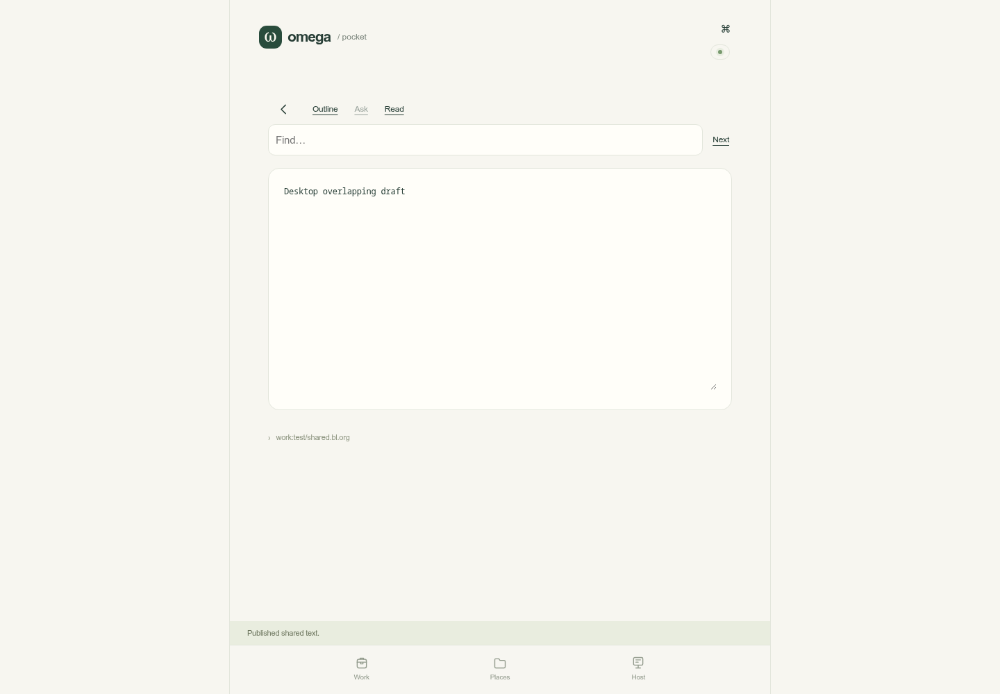
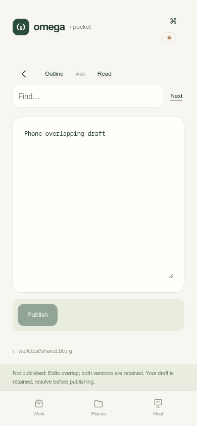
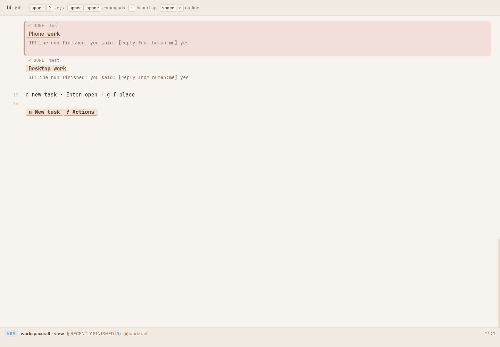

#+title: Pocket shared-world proof
#+date: 2026-10-11
#+status: PASS

* Result
The actual root BL launcher owns one VM and one world across Pocket, desktop
presets and shell operations. Independent desktop and phone browser contexts
pass all nine scenarios with zero JavaScript errors. Stop/restart preserves
the same task IDs, places, accepted file text and attributed buffer history.
The listener closes; the shared VM remains alive until the fixture cleans it up.

| Gate | Result |
|------+--------|
| Backend | 37 files, 947 assertions |
| Editor/package drive tests | 186 tests |
| Upstream supervisor, installed release | 137 assertions |
| Bootstrap floor | seed --check current |
| Default presentation | 4 documents, 36 variants, no differences |
| Browser | 9 scenarios, 0 JavaScript errors |
| Root launch | all checks true |

Machine-readable results: [[file:summary.json]], [[file:browser.json]],
[[file:launch.json]]. Raw logs: [[file:backend.log]], [[file:editor.log]],
[[file:host-browser.log]], [[file:supervisor-release.log]],
[[file:seed-check.log]], [[file:equivalence.log]], [[file:root-launch.log]].
Persistence snapshots include actual store paths and task counts before and
after restart; all four task IDs survive.

* Artifact and commands
Runtime pin =b7837470=, installed release =e684413d=.
Frontend =848027892cb07ccf1689a5b81dba18ee5346e5deb8a422ef7991c356a18491d5=.
The final browser-host asset changes reuse compiled graph
=83ddb7a99f7701f65bd98f407e1918269bca22b9401528f6b66253159661c1db=.
Its =out/= modules were compared byte-for-byte with those that passed all
186 drive tests. The final host browser regression and presentation checks
were rerun after those asset changes.

The constituent gates were run separately as fixes landed. The consolidated
reproduction entry is =spikes/mobile/test/verify.sh=; it builds or reuses the
graph and runs those same gates. Key commands:
#+begin_src sh
bin/bl --cold test test/ spikes/mobile/test/shared_world_test.bl spikes/mobile/test/attention_test.bl spikes/workspace/test/ spikes/pelagic/test/launch.bl
node spikes/mobile/test/host-browser.mjs
python3 spikes/mobile/test/shared-launch.py
#+end_src
The presentation adapter runs the unchanged =spikes/present/test/check.mjs=
against the published modules. It aliases only the checker's legacy printer
name =core.pr_str= to the runtime's =printStr= in a temporary test overlay;
presentation functions and assertions are unchanged.

* Real editor screenshots
- 
- 
- 

Screenshots were inspected. The phone retains its draft and world access when
Pocket is removed on desktop. These are Chromium browser contexts at desktop
and touch-phone sizes, using scripted models; this pass does not claim a new
physical-phone, Tailscale or paid-model test.

* Regressions and live-world preservation
Earlier failed attempts remain labeled separately. They exposed the missing
native supervisor environment conveyance, native command navigation stuck in
a loading view, and reentrant DOM replacement during blur. Focused red tests
and their green reruns are retained. Other retries corrected test selectors
and waits; the persistence audit established that the store was intact while
the original assertion depended on changing summary text.

No test accessed port 8790 or the active legacy Pocket listener. Every root
launch used a private runtime directory, disposable project files and store,
with cleanup limited to that fixture's processes. Read-only verification after
the tests found =omega-pocket.service= active with its original PID =1787= and
start time =2026-10-10 09:34:18 UTC=. Existing live stores were not opened or
changed. Adoption instructions are in [[file:../../../../research/pocket-shared-world.bl.org]].
