#+title: Pocket touch workbench — browser proof
#+date: 2026-10-11
#+status: Proven

This is the real mobile bl-ed package, not a standalone mockup. The root BL
launcher starts disposable worlds with private runtimes and durable stores.
No test writes the user's world on port 8790. The legacy live store remains
separate from all fixtures.

* Reproduce
#+begin_src sh
spikes/mobile/test/verify.sh
bin/bl --cold test test spikes/workspace/test/desk_test.bl spikes/workspace/test/demo_test.bl spikes/workspace/test/buffer_test.bl spikes/workspace/test/links_test.bl spikes/workspace/test/place_test.bl spikes/workspace/test/backend_test.bl
#+end_src

* Journeys and screenshots
- 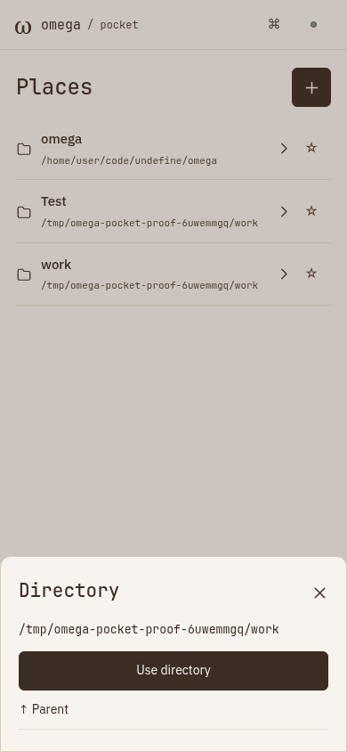 and 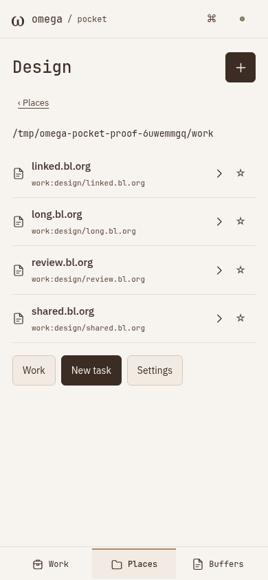.
- 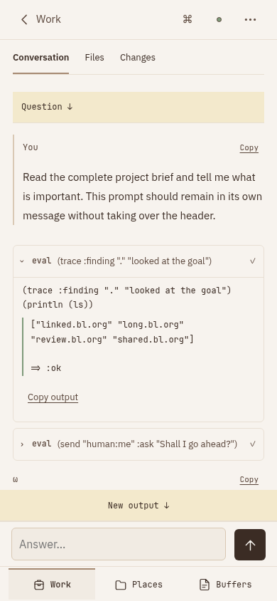, 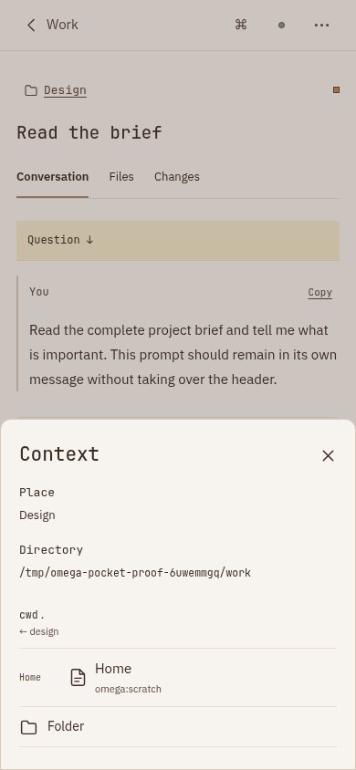, 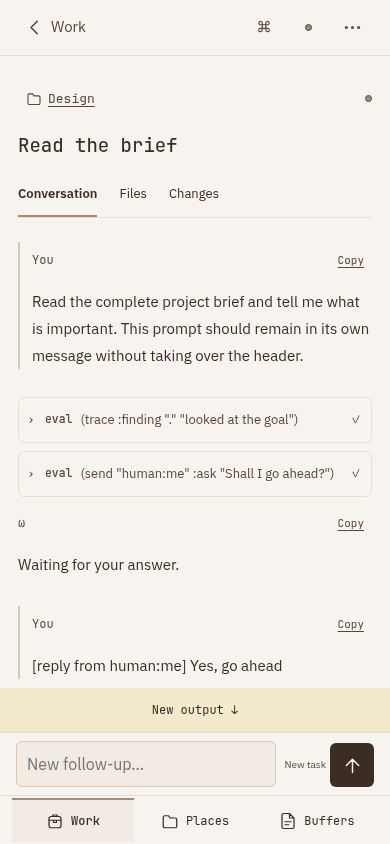.
- 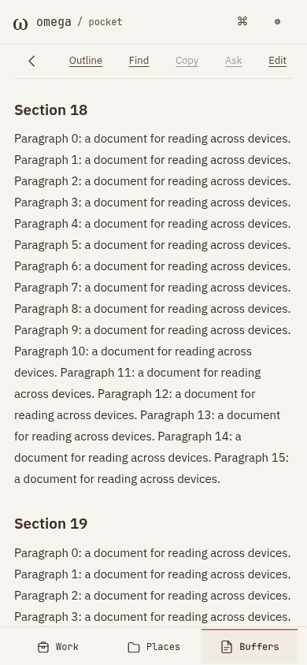, 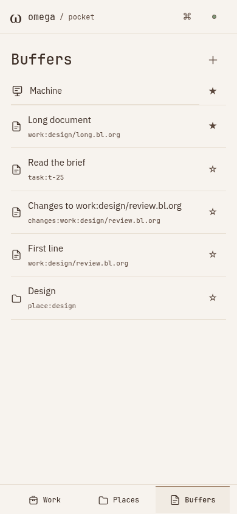.
- 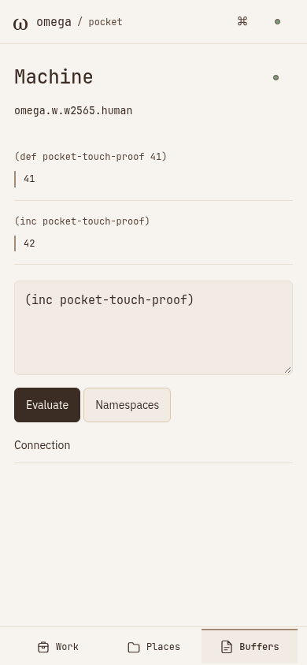, 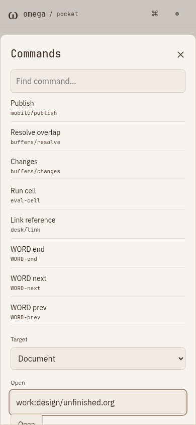.
- 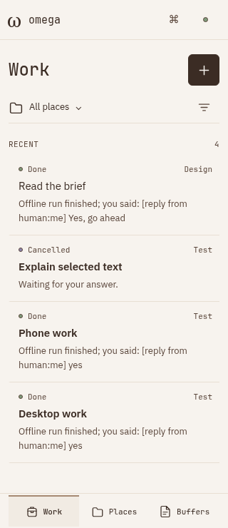, 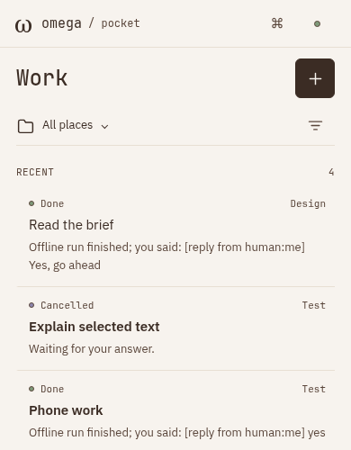, 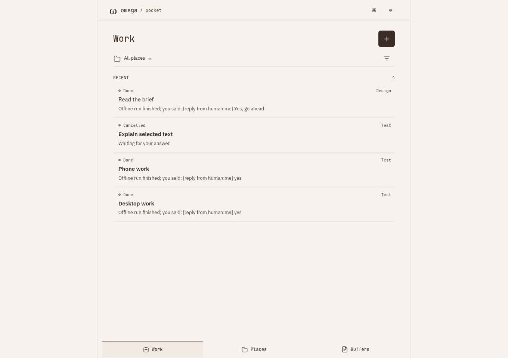.
- 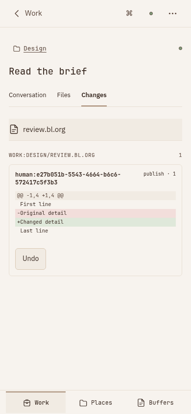, 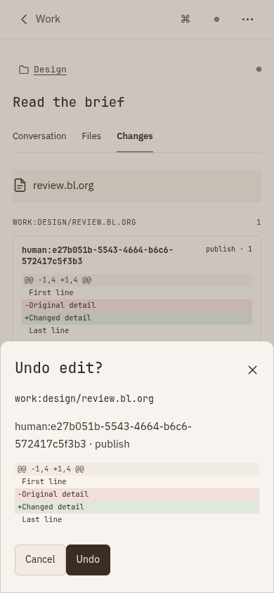.
- 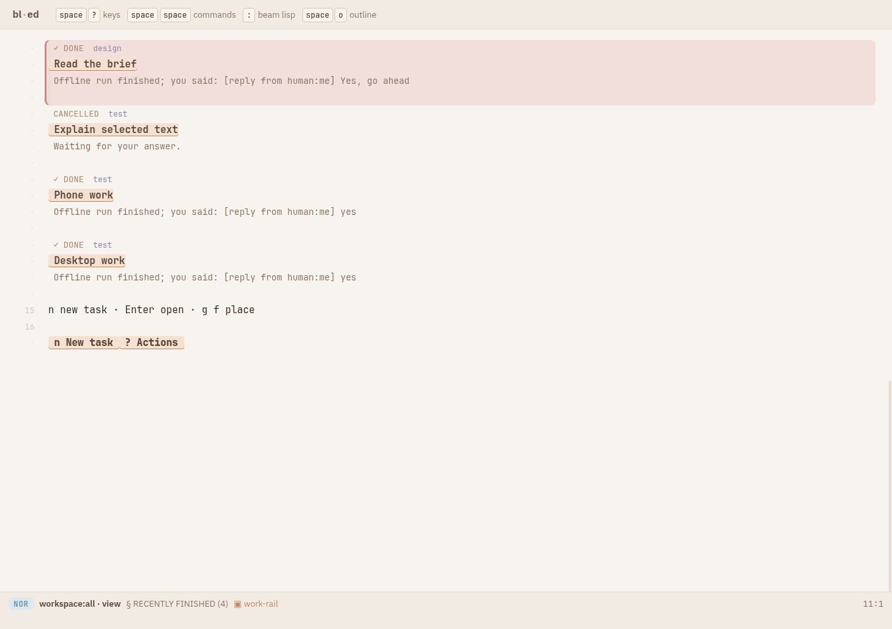.

[[file:acceptance.org][54-point acceptance map]] describes the actual behavior and its boundaries.
[[file:browser.json][Browser receipt]] records completed journeys and browser errors.
Two-client conflict/recovery and persistence receipts are in
[[file:../shared-world/README.org][shared-world proof]].

* Regression method
The original disclosure reset, erased address and focus escape were reproduced
before the stable-DOM change. Additional red/green regressions cover structured
responses, hidden place attachment, automatic dirty references, compact goals,
incorrect scratch-as-changes inference, unrelated review inheritance, native
Copy selection enablement, in-dialog validation, and resolved cwd metadata.

* Visual checks
The package consumes the existing snow/espresso theme and text/code font roles.
Metadata foreground #5a463b against #f7f3ee measures 8.01:1; body ink #3b2c24
measures 12.09:1. These are measured theme pairs, not a complete accessibility
conformance claim. Chrome/fields use 44px targets; source links stay inline.

Physical devices, Safari selection handles, VoiceOver/TalkBack, keyboard
occlusion, app suspension, push and real network handovers were not exercised.

* Verified result
Frontend =17e0f4ab4f1c6b43e477840f0aa3eaf4e3cad81ee55167b22c81736a7a024cc3=.

- 19 Pocket package tests; 193 editor/package tests in the combined gate.
- 36 presentation variants, using the unchanged equivalence checker.
- 899 assertions across the root/workspace suite. Subsequent delta checks:
  52 runtime assertions, 31 shared-world assertions and 4 attention assertions.
  These overlap the root suite; they are not added as a unique total.
- Nine two-client browser scenarios plus the five grouped touch journeys above.
- Zero JavaScript page errors in the browser journeys.
- Root launcher reused one VM across presets and CLI, rejected mode mismatches,
  and preserved tasks, places, file contents and operation history after restart.

Backend/editor/presentation checks and the final root launch/browser/persistence
run are separate recorded check groups. The corrected touch driver explicitly
selects a review file rather than depending on an asynchronous default selection.
