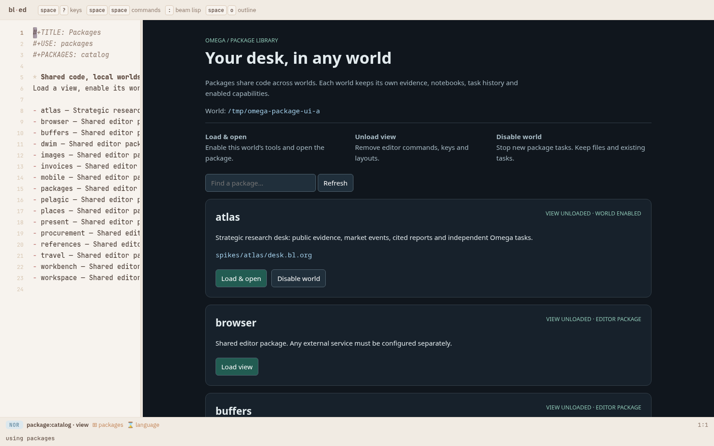
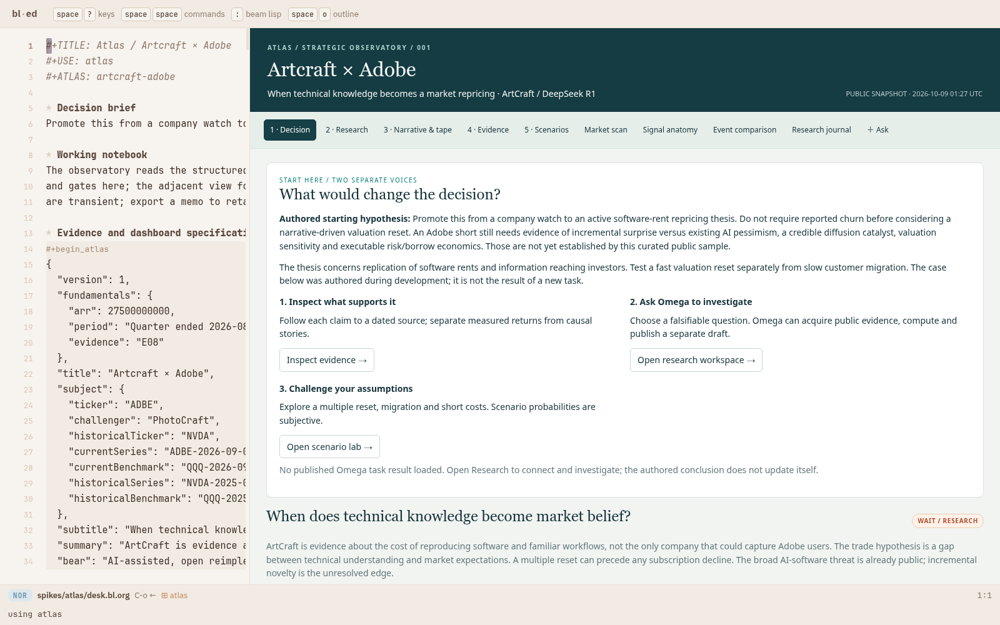
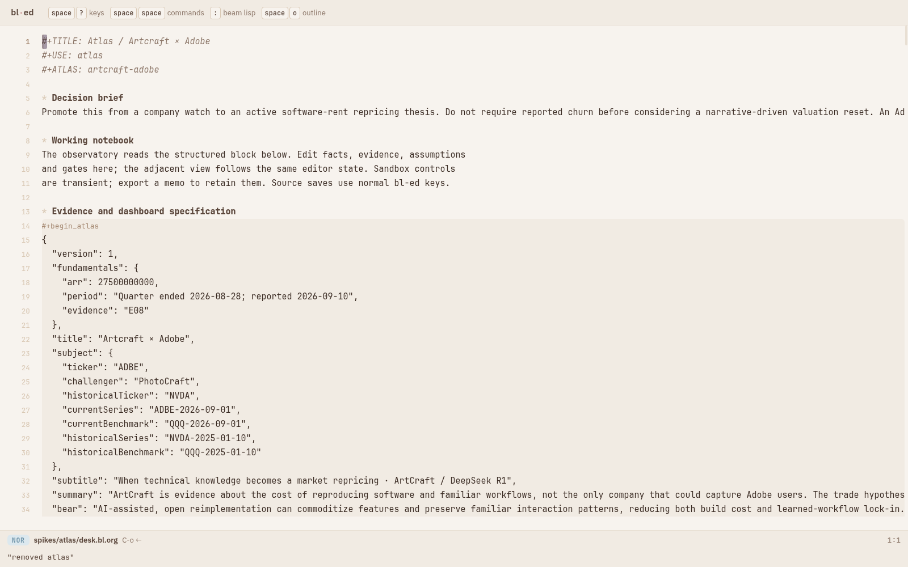
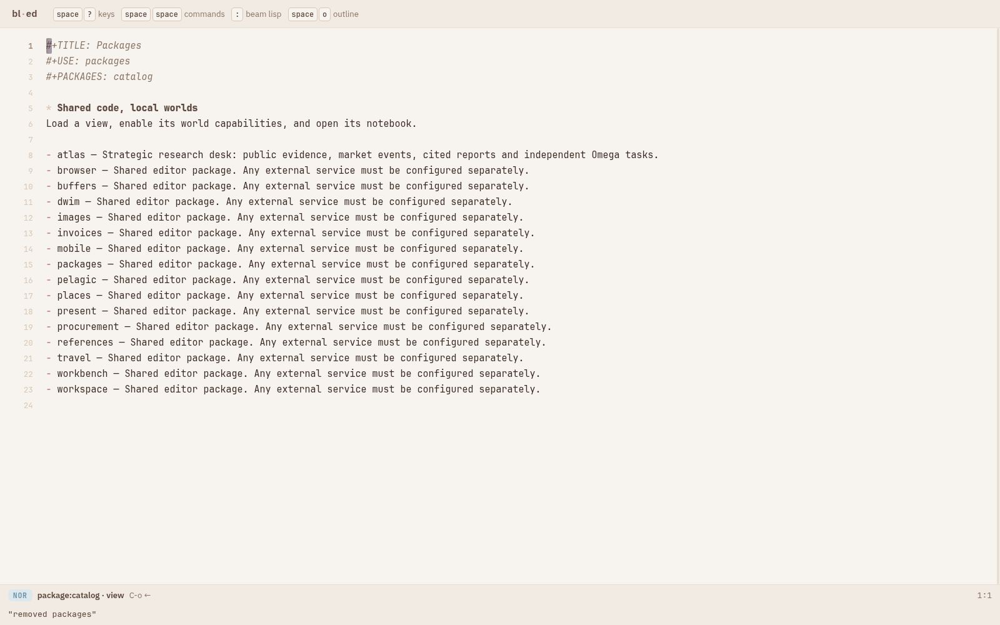

# Packages in every Omega world

A package is shared code with local world state. Atlas used to have a shared
editor module but a private launcher for its backend. Loading its view in
another world could draw a notebook but could not run its research tools.

## Use

Open `/?file=package:catalog&use=packages` on any upgraded Omega editor.
The catalog discovers compiled editor loaders and trusted backend manifests.
Load & open enables a backend, seeds missing documents and loads the editor
module. Editor-only modules offer Load view and explicitly disclose that their
external services are not installed by this operation.

Once loaded, `space p p` opens the library. The ordinary minibuffer verbs remain:

```clojure
(ed/use "packages")
(ed/cmd "packages/open")
(ed/use "atlas")
(ed/unuse "atlas")
(ed/packages)
```

Direct Atlas use enables its backend when the desk view mounts. Its home command
(`space s a`) also enables and seeds the world before opening the notebook.
Loading a package in one editor does not choose a different world's files.

Unload view removes the editor layer, keys, commands, package state and provided
layout. Disable world rejects new package tasks and package intents. Existing
tasks retain their chosen tools and model profile, and can continue through the
ordinary task conversation. Files, reports and task history are never deleted.
The two scopes are explicit because other editors may use the same world.

## Architecture

`src/omega/packages.bl` reads repository-owned `packages/*.edn` manifests.
Neither the core registry nor the editor package manager knows Atlas domain
names. The Atlas manifest points to `atlas.extension/create`, which supplies
`:step`, `:tools`, `:system-prompt`, `:max-steps` and an `:intents` factory as values.
Source is loaded from the shared repository, under a scoped loader search path.
Factory results are cached per world; task-system maps share that world's env,
supervisor and executor table. No private task harness or tool-name rewriting.

Every Omega editor gets a `package:` document provider and four generic intents:
`package/catalog`, `package/use`, `package/unuse`, `package/intent`. `task/open`
accepts `:package`; absent that argument it preserves the ordinary task profile.
Package intent envelopes carry `:package`, `:intent`, and nested `:args`.

Activation and task-to-profile bindings are persisted atomically in
`<root>/.omega/packages.edn`, serialized by a world lock. The emit hook records
new task bindings before its executor starts. `task/recover!` accepts an optional
system resolver; recovery restores the package profile even when it has since
been disabled for new work. The pin is a package identity, not a frozen code or
model version: upgrades to the shared implementation apply after restart.

Seeds are explicit relative paths, copied only when missing. Re-enabling never
overwrites an edited notebook. A failed first seed leaves the package disabled;
files already copied remain available for retry. No credentials are copied into
worlds. Backend factories resolve credentials from the shared Omega home.
An offline world keeps Atlas's captured evidence and UI, but substitutes an
explicit offline response for live Gen research.

The editor manager is a bl-ed package, `catalog.main/bl-package`, named
`packages`. It provides a frame layout and a package-owned host view; all editor
changes are pure effects and state under `:pkg-state`. Its host dispatches an
initial refresh after mounting because frame arrangement consumes adopt-time
host effects in the current editor. Atlas enables after mounting for the same
reason. No vendor code was changed for this spike.

`bin/bl-ed build` builds the editor, catalog and backend manifest build scripts.
A cold editor start builds these too. Activation builds a missing editor bundle
from its trusted manifest script. A server started before this infrastructure
was added needs one restart; subsequent package activation needs no restart.
`bin/bl-ed --root` now honors the explicit root, instead of prepending a duplicate
root that made test worlds accidentally resolve to the launcher's cwd.

## Extend

Editor-only packages need a compiled `web/pkg/<name>.mjs` loader. A backend
package additionally supplies a trusted manifest and factory, for example:

```clojure
{:name "example" :doc "Example desk" :editor "example"
 :entry "notebooks/example.bl.org" :seeds ["notebooks/example.bl.org"]
 :build "spikes/example/build.sh"
 :backend {:path "spikes/example" :ns "example.extension" :factory "create"}}
```

The catalog is a trusted local-code inventory, not an arbitrary plugin download
service. Legacy editor packages are discoverable; this does not migrate their
specialized external servers into backend factories automatically.

## Proof

- `bin/bl test test/packages_test.bl test/task_test.bl test/interrupted_test.bl`:
  134 assertions pass, covering independent roots, idempotent seeding, disabled
  task rejection, actual profile tool execution and profile recovery.
- `node --test spikes/packages/test/package.test.mjs spikes/atlas/test/*.test.mjs`:
  36 tests pass, including layer removal and the generic intent envelope.
- Vendor drive/package/frame/host/document-package suites: 60 tests pass against
  the editor corpus in `../beam-lisp`.
- Unchanged `spikes/present/test/check.mjs`: case 1574 variants and architecture
  32 variants reproduce the default presentation exactly.
- `test/browser.mjs` drives two isolated offline worlds on 8856 and 8857 (8792
  was occupied). It loads Atlas from the catalog, verifies world isolation,
  unloads the editor, disables the world, and retains its evidence.

Real editor screenshots:






The running 8811 catalog was also checked without activating a package:


Machine-readable browser results: [proof/browser.json](proof/browser.json).

## Session frontends

`bl pelagic.dev` serves an immutable frontend generation directly. The registry
uses that host's `:web` directory for editor loader discovery. Packages absent
from that generation are shown as unavailable; loading a package does not run
an installer against it.

Editor-only manifests can declare `:entry` and `:layout`. Load & open then visits
the document and selects the package's layout after its module and document arrive, without
activating world capabilities. PELAGIC exercises this path. The existing package
layer and exact unload contract remain the same.

Proof: [session launch](../pelagic/session-launch.bl.md), including real editor
screenshots, session isolation and unload checks under `../pelagic/proof/session-launch/`.
