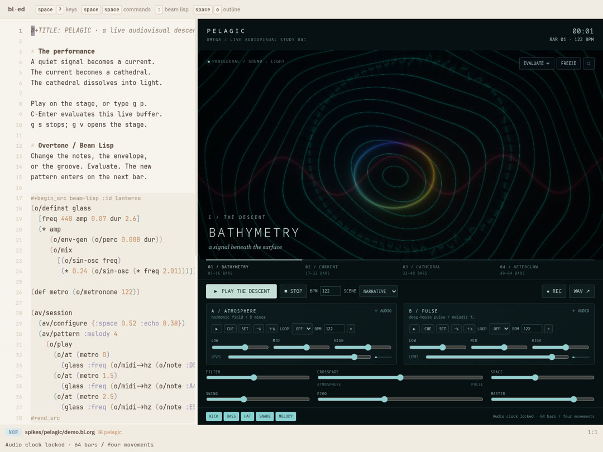

# PELAGIC / CURRENT CLUB

The second performance keeps the sea-to-light narrative but changes the groove
and visual language. It is implemented in the same independent bl-ed package.

[Phone video](proof/club/mobile/pelagic-mobile.mp4) ·
[Stereo MP3](proof/club/mobile/pelagic.mp3) ·
[Studio](proof/club/mobile/studio.jpg) ·
[Controls](proof/club/mobile/studio-controls.jpg)

## Musical changes

122 BPM, 64 bars plus a ten-second tail: 135.90 seconds total. The main pulse
enters after eight bars. Four-on-the-floor kicks alternate with offbeat bass and
longer offbeat hats; the main drop adds sixteenth-note percussion and a denser
bell pattern. Every fourth bar adds a short percussion pickup. Bars 28–31 and
52–55 remove kick and bass, followed by drops at 32 and 56. The final four bars
leave the atmospheric field. A shorter kick, stronger backbeat and less reverb
keep the rhythm defined while the original extended chords and pads remain.

The score remains Beam Lisp, in `pelagic/score.bl`. Export and playback use the
same graph interpreter and score function. The default tempo and live demo are
both 122 BPM.

## Visual changes

The former central sculpture is replaced by four compositional systems:

1. **Bathymetry:** engraved interference contours and expanding bass rings.
2. **Current:** cyan/coral perspective portals, segmented outlines and diagonal rails.
3. **Cathedral:** gold/coral folded petals, alternating six/eight-fold symmetry and spectral edges.
4. **Afterglow:** layered violet/cyan ribbons and a returning pulse.

The transport arranges scene transitions and four-bar cuts. Actual audio drives
camera expansion, contour displacement, line brightness/width, percussion
sparks and transient brackets. `host/features.mjs` measures 35–180 Hz bass,
250–2500 Hz mids, 4.5–14 kHz treble, RMS and short-window amplitude attacks.
The band mapping uses the actual sample rate and FFT size. In the first version,
the low-frequency texture coordinate sampled roughly 1 kHz instead of bass;
that dependency is removed. Live FFT smoothing is reduced to preserve attacks.

The extra uniforms are `iAudioBass`, `iAudioMid`, `iAudioHigh` and `iAudioOnset`.
Standard Shadertone volume, waveform and FFT inputs still work. These features
measure the mixed output, including imported deck audio; they do not depend on
the score's event list. They work with replacement live instruments as well.

## Executed response proof

`python3 spikes/pelagic/test/reactivity.py` holds the shader time, beat, camera
and scene fixed, then draws the actual soundtrack and silence. Mean RGB pixel
difference is **25.25/255**, with **92.68%** of pixels changing by more than
18 summed RGB levels. Silence produces exactly zero in every audio feature.
The test samples three beats near the main drop; bass ranges from 0.037 to 0.569,
and onset from zero to one. This distinguishes an audio response from a visual
that merely animates along the transport clock.

[Measurements](proof/club/reactivity.json) ·
[Audible frame](proof/club/response-audible.png) ·
[Same clock, silent frame](proof/club/response-silent.png)

The browser proof also exercises real keyboard evaluation, deck import/sync,
recording, rollback and clean removal. Package tests cover four-floor rhythm,
breakdowns, band isolation at multiple sample rates and transient detection.
The unchanged presentation equivalence check and vendored editor tests pass.

The rendered soundtrack has no clipped PCM samples: **−20.2 LUFS integrated**,
**10.4 LU loudness range**, **−5.1 dBFS true peak**. The complete film uses the
actual soundtrack FFT at every frame. The first version's proof files remain
under `proof/`; this revision's outputs are isolated in `proof/club/`.

Reproduce after starting the offline editor on port 8812:

```sh
spikes/pelagic/build.sh
spikes/pelagic/test/verify.sh
PELAGIC_REDO=1 PELAGIC_AUDIO_REDO=1 python3 spikes/pelagic/test/film.py
python3 spikes/pelagic/test/reactivity.py
node spikes/pelagic/test/analyze.mjs
bash spikes/pelagic/test/compress.sh
```



