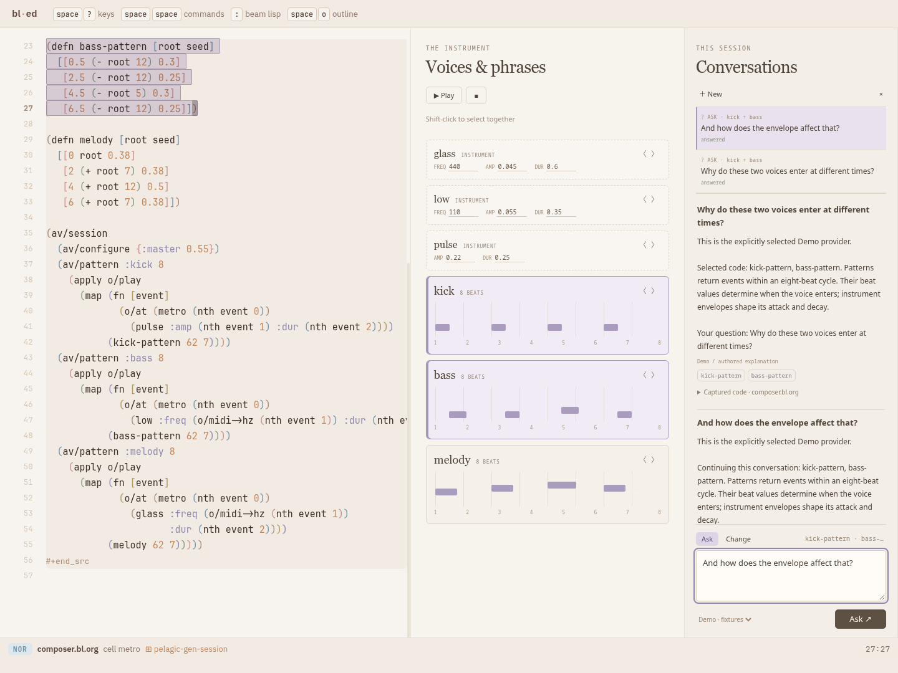
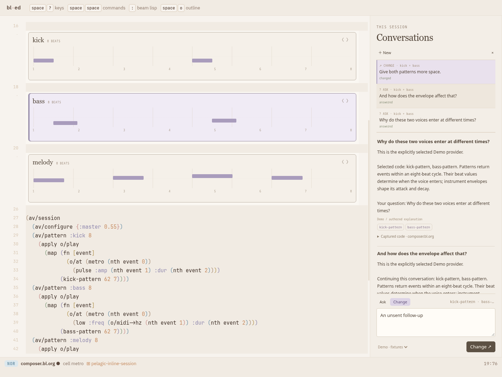
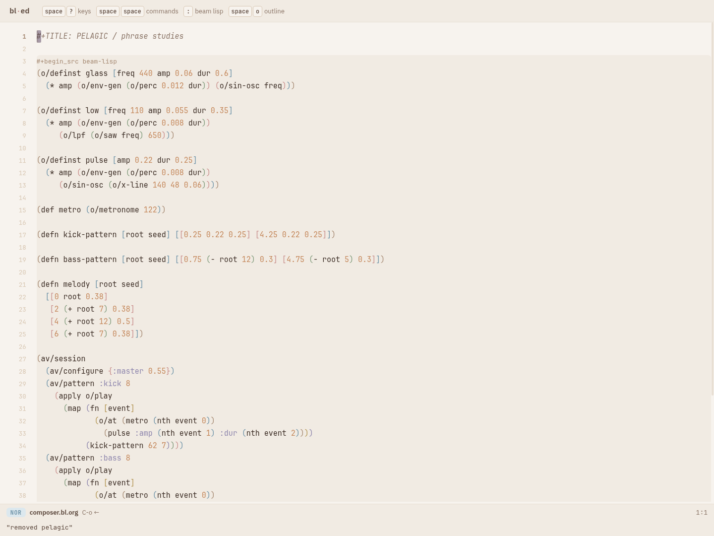
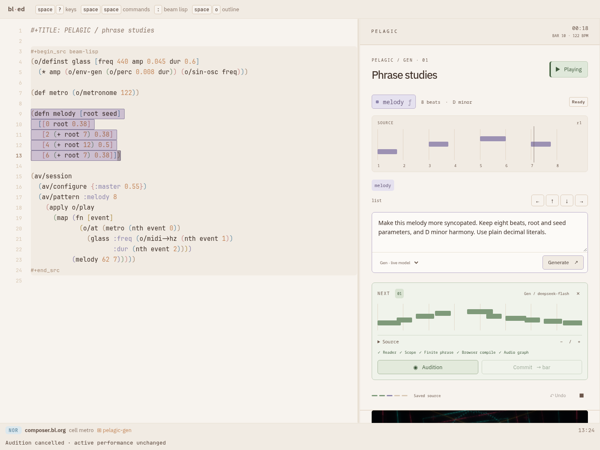
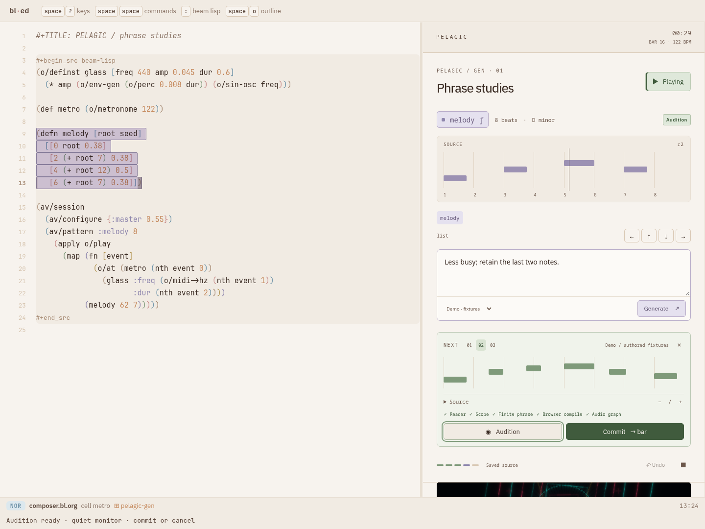
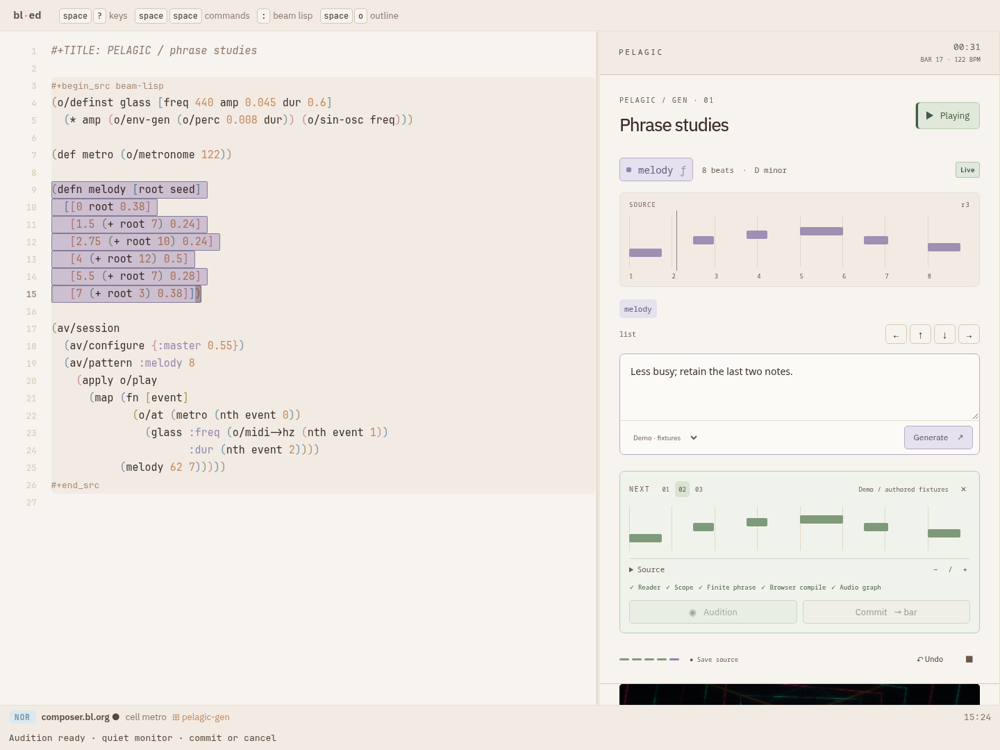
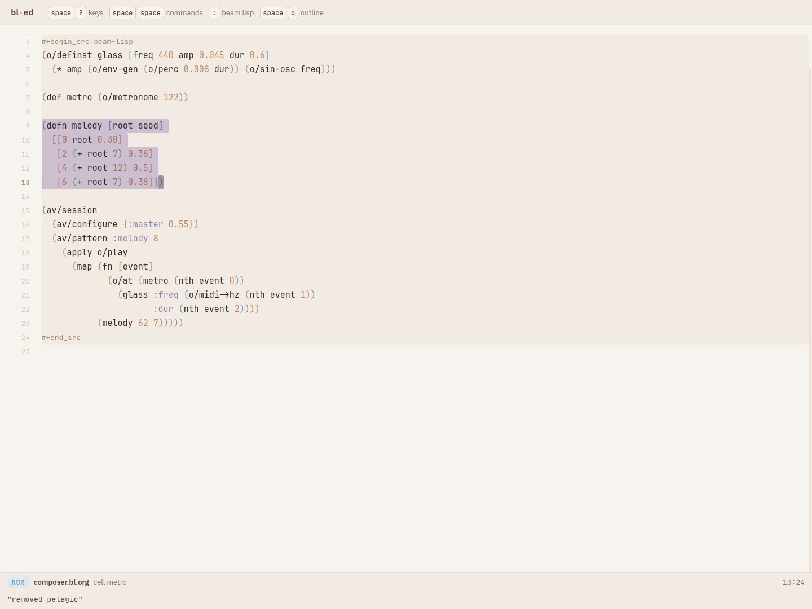

# PELAGIC / phrase studies

## Local editing and Session conversations

The current iteration implements [PLAN-024](../../!tasks/plans/PLAN-024-pelagic-editing-and-session-history.bl.org):
source-backed instruments and phrases, mixed structural selection, local
Ask/Change, inline/split presentations, source peek, and recent Session history.
The earlier prototype's candidate/audition walkthrough below is retained as its
historical baseline; it is not the required flow of the current workbench.

Launch with `bin/bl pelagic.gen`. For isolated review, build the frontend and use
`bin/bl-ed --offline --memory --port 8792 --root /tmp/omega-pelagic-editing`
with a copy of `composer.bl.org` in that disposable root. Never test on 8790.
Open `/?use=pelagic&layout=pelagic-gen&file=composer.bl.org` on the offline host.

The example has kick, bass and melody patterns and three source-backed
instruments. Click a component or select a code form. Shift-click adds another
component; `g m` adds/removes the current syntax form. Structural motions remain
`g j`, `g k`, `g H`, `g L`. Component parameter fields edit numeric defaults in
the same source document. Musical object identity is shared by both views.

`g a` opens a local prompt at the selection. Choose **Ask** for an explanation
or **Change** for direct generation. Enter submits, Shift-Enter adds a line,
and Escape dismisses. A Change updates the selected draft ranges together as
one undoable edit. Ordinary `u`/`U`, evaluate (`Ctrl+Enter`/`g e`) and save keep
their roles. Generation does not automatically publish audio or save a file.
The existing performance continues while requests run.

`g v` toggles components in place / source beside components. `g c`, or a
component's code control, peeks its source. Inline peek uses the ordinary
editable source rows. In split view the component's source field writes the
same document via the editor's edit transaction. There is one source authority.

`g q` opens/closes **Session**. It lists recent requests and retains answers,
change summaries, target references, and expandable before/after source.
Reply to an exchange in Ask or Change mode; **Use current selection** explicitly
retargets the reply. Opening old exchanges never applies their code. Questions
can address arbitrary selected code or the current buffer; Change currently
supports the example's finite pattern functions and supported instrument forms.
The sidebar becomes a focused drawer on narrow screens.

Recent history is bounded to 100 requests and stays in memory across document
visits and layout changes. Reload or package removal ends the session. Durable
history, source-version browsing and the [richer evidence experience](../../research/pelagic-gen/evidence-follow-up.bl.org)
remain separate follow-ups. Demo responses remain explicitly labeled; provider
failures do not substitute fixture responses.

All views load through the same `pelagic` bl-package in the actual editor. The
inline surface reuses `pp.present` source-backed marks/slots, with a generic
optional host mount per ornament row. Host IO uses the existing package resource
lifetime. State lives under the Pelagic package; no shared command/key mutation
or independent document/render loop is introduced.

Executed proof and screenshots for this iteration are retained in
[the browser report](proof/workbench/browser.json) and
[verification records](proof/workbench/verification.txt).
The browser driver is `spikes/pelagic/test/workbench-browser.py`; it drives
questions, follow-ups, coordinated changes, undo/redo, both layouts, source peek,
draft retention, actual audio, real-provider requests when enabled, narrow use,
and unuse. The actual used/unloaded screenshots are saved beside its report.





## Earlier prototype baseline

A selectable musical phrase and its real Beam Lisp source share one target.
Point at a note or a source form, ask for a variation, inspect the candidate,
audition it, commit at a bar boundary, and undo. The source and performance
remain separate until commit; committing updates the source draft, not disk.

## Open prototype 1

```sh
bin/bl pelagic.gen
```

This opens the phrase layout through the ordinary shared Omega launcher. The
currently running review world is isolated at
<http://localhost:8792/?use=pelagic&layout=pelagic-gen&file=composer.bl.org>.

Build with `bin/bl --cold pelagic.build`, then launch an isolated world:

```sh
mkdir -p /tmp/omega-pelagic-gen
cp spikes/pelagic/composer.bl.org /tmp/omega-pelagic-gen/composer.bl.org
bin/bl-ed --offline --memory --port 8792 --root /tmp/omega-pelagic-gen
```

Open <http://localhost:8792/?use=pelagic&layout=pelagic-gen&file=composer.bl.org>.
This is the real `pelagic` package and `ed/frame.bl` layout. There is no private
editor, rendering loop, or parallel playback engine. On an existing compatible
development frontend, the same layout opens with
`?use=pelagic&layout=pelagic-gen&file=spikes/pelagic/composer.bl.org`.

Click **Play**, then the **melody** object or one of its note marks. Select a
source form directly or use the arrow controls. Existing structural motions
remain available (`g j`, `g k`, `g H`, `g L`); `g a` focuses the request. Prompt
typing retains normal text input; Ctrl/Command+Enter submits from that field.

The default provider uses `gen.llm/chat`, reading `DEEPSEEK_API_KEY` from the
Omega `.env` or environment. `GEN_BASE_URL` and `GEN_MODEL` optionally select an
OpenAI-compatible provider. Keys remain server-side. Without that configuration,
the existing Omega provider is available through the same text seam. Transport
errors are visible and never switch to canned output. **Demo · fixtures** is an
explicit, labeled provider for rehearsing the interaction without a network;
its responses are authored examples, not model generation.

Try “Make this more syncopated; keep the same harmony,” audition the candidate,
then refine it with “Less busy; retain the last two notes.” Versions appear as
small numbered tabs. Opening Source reveals the exact selected before/after
forms. Commit becomes available after audition. The pending badge changes to
Live when Pelagic activates the revision. Undo restores the previous performance
and source draft when this workspace still owns the most recent commit.

## What the interface carries

The source gets most of the frame width. The adjacent instrument has one phrase
lane, a selection breadcrumb, request field, candidate lane and audition/commit
controls. The original stage becomes a small live monitor. Other DJ controls
remain in the ordinary Pelagic layouts. On narrow windows the source and phrase
workspace stack; the package owns and removes the stylesheet that arranges them.

Snow/coffee surfaces and typography come from bl-ed's vocabulary. Lavender
connects source selection, the melody object and selected notes. Sage connects
candidate notes, successful checks and audition. Butter marks work in progress
and the upcoming bar. Icons, outlines, disabled states, note positions, version
tabs and a five-step strip carry state; short text and accessible labels provide
the same meaning without depending on color. Motion is limited to the musical
playhead. There are no external fonts or images.

The note marks are typed presentations in this deliberately small profile:
each maps to an event vector within `melody`. The melody chip maps to its whole
definition. Clicking ordinary source uses `ed.forms`; the current selection is
the shared target. A renderer cannot infer a source object for arbitrary DOM or
shader pixels. This prototype does not claim universal CLIM presentations.

## Contract and implementation

- `pelagic/main.bl` still exports the single `bl-package`. The additional layout
  is `pelagic-gen`; state remains under `[:pkg-state "pelagic" :composer]`.
- `pelagic/composer.bl` owns selection, frozen source basis, requests, candidate
  versions and state transitions. It uses the existing lenient `ed.forms` tree
  and structural motion contract. Editing invalidates old candidates; canceled
  or superseded replies cannot publish. Exact captured ranges determine splices.
- `pelagic/melody.bl` is the shared pure generation profile: a real
  `(defn melody [root seed] ...)` with a finite vector body of at most 24 events.
  Only numeric expressions, `root`, `seed`, and binary `+ - * mod` are admitted.
  The demonstration invokes root 62 and seed 7. Checks apply to those inputs;
  they are not universal proofs about arbitrary function arguments.
- `omega/music_gen.bl` owns text transport and at most three validation/repair
  attempts. The authoritative BEAM reader requires one form; decoded output is
  inspected as data and never evaluated on the host. Each replacement must fit
  the profile. The browser checks the complete enclosing function after splicing.
- `host/composer.mjs` owns DOM, fetch/abort lifetime and calls into the existing
  Pelagic host. Candidate checking uses its actual browser compiler and graph
  validators without queuing a performance change. Audition uses its separate
  monitor bus; commit uses its existing stale-base guard and bar scheduler.
- The new generation endpoint does not write documents, install functions into
  the user's BEAM image or call a model during loading/building. Browser checking
  evaluates the user's enclosing document in Pelagic's worker, as ordinary
  Pelagic evaluation does; it is not a general untrusted-code sandbox.

Versions are bounded to twelve and live in this editor session. They are not a
durable generation ledger. Source saves use the editor's ordinary command.
Live and Saved remain independent; undo cannot retract sound already heard.
`:(ed/unuse "pelagic")` disposes fetch/view/audio/graphics resources and removes
the layout and state. It preserves the current source draft and cursor.

The build uses the repository's checked immutable frontend. The ordinary
`web/pkg/pelagic.mjs` loader and compiled `out` modules carry the same package;
the verification installation into `vendor/bl-ed/web` is generated output.
No domain behavior was added to the vendored editor.

## Prototype 2

The separate [research and executable analysis probe](../../research/pelagic-gen/research.bl.md)
extends the experiment toward the REPL repository's original Gen plan. It
exercises upstream codebase facts, type diagnostics, scalar ANF translation,
solver verdicts and concrete witnesses. The [implementation plan](../../!tasks/plans/PLAN-023-pelagic-generative-instrument.bl.org)
separates that measured probe from the broader editor integration still to do.

## Proof

The [browser report](proof/gen/browser.json) records eleven completed checks
with no page exceptions: note/source selection, structural parent, `g a`, a
real configured Gen request, refinement and historical candidates, stale-audition
protection, measured non-silent audition, bar commit, source/runtime undo,
invalid output, cancellation, narrow layout, and actual `ed/unuse` cleanup.
The real model candidate passes browser compilation and graph validation;
authored Demo responses make the remaining lifecycle assertions repeatable.
Both providers remain labeled in the UI and report.









The [narrow view](proof/gen/07-narrow.png) retains source and reachable controls.
The musical queue receipt records the requested target beat and activation;
the test checks a future multiple-of-four boundary. Source/cursor equality and
closed AudioContext/disposed shader assertions accompany the after-unuse image.

| Gate | Executed result |
| --- | --- |
| Omega suite | [30 files green](proof/gen/omega-tests.log) |
| Backend generation/repair | [20 assertions](proof/gen/backend-tests.log) |
| BEAM package lifecycle | [20 assertions](proof/gen/composer-beam.log) |
| Compiled package drive | [5 tests](proof/gen/composer-drive.log) |
| Pelagic package/resource suite | [74 tests](proof/gen/package-tests.log) |
| Vendored editor | [23/23 core drive tests; 82 passing checks overall](proof/gen/vendor-tests.log) |
| Default presentation | [29 variants, zero differences](proof/gen/equivalence.log) |
| Launch/cache policy | [34 assertions](proof/gen/launch-tests.log) |
| Analysis prototype | [Real diagnostics, solver verdicts and witness](../../research/pelagic-gen/proof/prototype2.log) |

One **existing verification limitation remains**: the broader editor suite's
cold packaged-server fixture does not reach readiness inside its unchanged
60-second window. It failed in the complete run and an
[isolated retry](proof/gen/vendor-cold-retry.log). The same test also
[times out on untouched HEAD `c3ece62`](proof/gen/vendor-cold-baseline.log).
The fixture's timeout and assertion were not relaxed. This is separate from
the green core editor drive contract; the full broader suite is not claimed
green. Pelagic's previously documented sustained timing gates also remain open.

Reproduce with the frontend path printed by the build:

```sh
bin/bl --cold test test/music_gen_test.bl
bin/bl --cold test -p vendor/bl-ed spikes/pelagic/test/composer-beam.bl
PELAGIC_OUT="$frontend/out" node --test spikes/pelagic/test/*.test.mjs
BLED_ROOT="$PWD/../beam-lisp" BLED_OUT="$frontend/out" BLED_WEB="$frontend" \
  node --test vendor/bl-ed/test/*.test.mjs
node spikes/present/test/check.mjs vendor/bl-ed/web/welcome.bl.org \
  spikes/pelagic/demo.bl.org spikes/pelagic/composer.bl.org
PELAGIC_GEN_LIVE=1 python3 spikes/pelagic/test/gen-browser.py
bin/bl --cold run -p research research/pelagic-gen/run.bl
```

The presentation checker is unchanged. The only vendored source fix is the
portable decimal parser's predicate-shadowing bug, documented in
[`VENDOR.md`](../../vendor/bl-ed/VENDOR.md) and covered by its new regression
test. The generated compatibility installation in `vendor/bl-ed/web/out` and
`web/pkg/pelagic.mjs` uses the same package and host as this recorded frontend.
