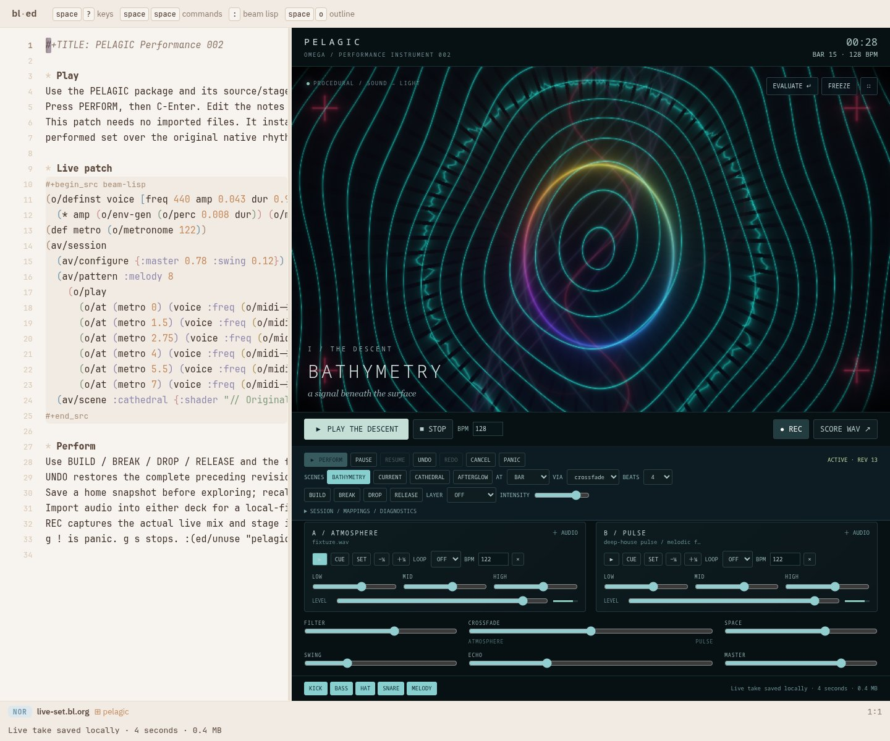
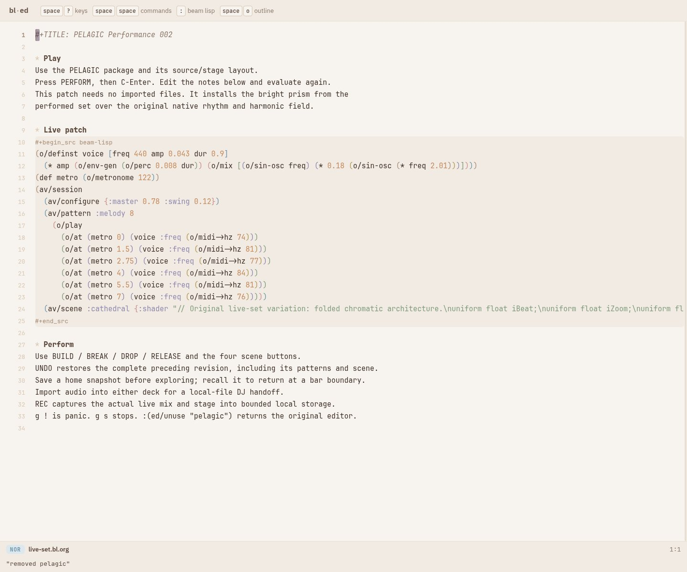
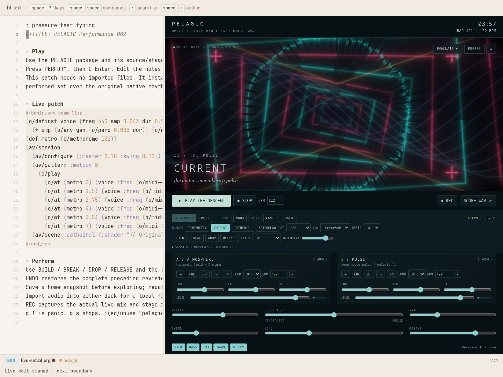

# PELAGIC, compiled for local use

This optional build packages the real bl-ed editor, PELAGIC, its live Beam Lisp
compiler, shaders and example patches as static files. It needs no Omega world
or BEAM server at runtime. Omega's server compiler pin is unchanged; both launch
modes now share the native-JS frontend graph.

From the Omega repository root:

```sh
bl pelagic.local                 # serve the demo at http://localhost:8818/
bl pelagic.local -- --port 8820     # choose another port
bl pelagic.bundle                # export dist/pelagic-local.zip
```

The normal server-backed session is `bl pelagic.dev`; local is the optional demo
adapter. Both reuse the same checked BL JavaScript graph. Only `pelagic.bundle`
creates the ZIP. [Build and session architecture](session-launch.bl.md).

From `spikes/pelagic`, `bl bundle` still exports the demo. The compatibility
command `spikes/pelagic/build.sh --local` does the same. The first use resolves
the pinned compiler once; it can take several minutes. Later launches reuse it
and unchanged frontend output.

The ZIP contains `local/`. Unzip it and use any static HTTP server:

```sh
python3 -m http.server 8820 --bind 127.0.0.1 --directory local
```

Open `http://localhost:8820/`. Static hosting is needed for browser modules and
worklets; opening `index.html` through `file://` is not supported. After the first
complete load and service-worker installation, reload works offline on the same
origin. Service workers require localhost or HTTPS. Changing the hosting port
changes the browser storage origin.

For a fast, progressive introduction, start with the [showcase tutorials](tutorials/00-start.bl.org).

Press PERFORM, then C-Enter to run the bundled patch. Edit BL and evaluate again.
The same `bl-package` is loaded through the editor's package layers and layouts;
`:(ed/unuse "pelagic")` returns to the source editor and releases its resources.

Editor saves use IndexedDB with atomic revision checks and 32 prior revisions
per document. Reload restores the saved source. PELAGIC's existing session,
imported-audio and partial-recording stores remain local too. Concurrent stale
saves fail rather than overwriting a newer revision. Local storage is scoped to
this browser/origin; clearing site data removes it. Arbitrary filesystem browsing,
world intents and editor image storage are outside this PELAGIC bundle.

`pelagic.browser` is annotated `^:js` and owns explicit `bl->js` / `js->bl`
conversion, audio-context creation, asset fetching, DOM text updates and downloads. Its public JS bridge unboxes numeric
results. `pelagic.bridge` declares live namespace names and BL values directly,
removing handwritten generated-name mangling. The DSP/GL interpreters remain
native JS. The regular server build now uses this same frontend boundary through
PELAGIC’s package compiler pin; the older compatibility module remains for legacy
checks. See [shared frontend and preparation](preparation.bl.md).

## Transparent browser performance

Live patches use the same functions, aliases and Overtone macros. The bundle
preloads `pelagic.overtone` functions and private macro helpers, and captures
its macros during the build. `pelagic.worker` reads and evaluates patches;
`js.worker` implements the bounded message transport in annotated BL. The
host applies the returned data to its audio and graphics resources. Unload
terminates the worker, and failed evaluations release their temporary names.

String operations use automatic ASCII fast paths and a bounded Unicode
segmentation cache. The editor batches geometry measurements and coalesces
resizes. Graphics initialization starts after the first paint through
`pelagic.browser/after-paint`. These optimizations require no changes in live
patch syntax. The page evaluator starts on demand for editor commands such as
`ed/unuse`; those commands retain access to the live editor on the main thread.

## Artifact identity and updates

`bl artifact-check` verifies the BL inventory, byte counts, SHA256 hashes,
repeatable manifest generation and generated worker syntax. The bundle contains
`assets.json`; its identity covers every shipped asset and the builder/template.
Generated manifest/worker files are excluded from their own inventory.

An updated cache activates after old tabs retire, keeping each open page on one
module graph. Cache cleanup is scoped to the hosting path. The server frontend
uses the same compiled modules but excludes this local cache manifest/worker.
Current integration evidence is maintained in [actor consolidation](actor-consolidation.bl.md)
and `proof/actor-consolidation/artifact/`.

## Earlier local-build measurements

The earlier bundle pinned compiler `c9e95080`; generic BL frame pacing is committed on
upstream main as `7861aa54`, following runtime improvements in `cb485ab3`.
It contains 44 modules, 2,766,014 bytes of static files and a 608,464-byte ZIP
(integrity checked).

The bundle passes **46 PELAGIC tests**, **73 vendored editor tests**,
**51 runtime tests**, native live interop and **14 static browser checks**.
The unchanged presentation gate passes all 23 variants. The browser proof
covers real C-Enter and Overtone macros during audio playback, worker isolation,
main-thread heartbeats during a long evaluation, overlapping edits, failed
compilation cleanup, local saves, offline reload and real package unload.
It makes zero server API requests and reports zero uncaught browser errors.

Three fresh browser contexts per bundle on this host gave these medians
([raw timing report](proof/local/startup.json)):

| Measurement | Previous bundle | Optimized bundle |
| --- | ---: | ---: |
| Editor ready | 4,805 ms | 3,005 ms |
| Graphics ready | 7,351 ms | 4,675 ms |
| First patch evaluation | 1,520 ms | 280 ms |
| Repeated small evaluation | 79 ms | 229 ms |

The worker keeps the UI responsive, but adds scheduling overhead and starts
with a cold compiler. Repeated tiny edits are slower in this run; this is a
responsiveness tradeoff rather than a uniform latency improvement. GPU compilation still runs on the main thread after first paint. These measurements do not establish sustained audio timing limits.

[Build log](proof/local/build.log), [runtime tests](proof/local/runtime-tests.log),
[native live interop](proof/local/native-live.log), [package tests](proof/local/contract-tests.log),
[editor tests](proof/local/editor-tests.log), [browser drive](proof/local/browser.log),
[browser report](proof/local/report.json), [real editor with PELAGIC](proof/local/01-used.png),
[after unuse](proof/local/02-unused.png), [presentation equivalence](proof/local/equivalence.log).

Reproduce the checks after building:

```sh
PELAGIC_OUT=$PWD/spikes/pelagic/dist/local/out node --test spikes/pelagic/test/*.test.mjs
BLED_ROOT=/path/to/beam-lisp BLED_OUT=$PWD/spikes/pelagic/dist/local/out \
  BLED_WEB=$PWD/spikes/pelagic/dist/local node --test vendor/bl-ed/test/*.test.mjs
python3 spikes/pelagic/test/local-browser.py
bin/bl run spikes/pelagic/test/legacy-build.bl
```

The browser proof and `test/startup.py` start temporary static servers and need Python
Playwright/Chromium; `CHROMIUM` overrides its executable. This optional build
does not resolve the timing release failures recorded in the sustained
performance proof.

## Audio/video execution lanes

The optional local bundle uses an owned OffscreenCanvas worker when supported.
The real editor and controls keep their normal host lifecycle. Rendering has one
frame in flight and one replaceable pending snapshot, with a 15-second failure
watchdog. Unuse terminates the worker and releases its validation context. Browsers
without this capability retain the original main-thread stage.

Clock projection, adaptive resolution, output-clock selection and the bounded
immutable score cache are written in the annotated `pelagic.browser` namespace
and compiled with the same BL pipeline. Web Audio continues to render through
native browser audio nodes. Automatic quality changes are private to rendering;
patch authors keep using the existing scene, shader and instrument APIs.

Synchronous shader validation preserves whole-revision rejection; a small off-DOM
context prepares programs, while the worker owns all per-frame rendering. Actual
1280×720 VP8 capture, invalid-shader rejection, context loss/restoration and exact
unuse passed the real-editor drive in `test/performance-browser.py` (19 checks).
40 package tests pass, including finite cache eviction, score/mute equivalence,
cross-realm clock projection and stale output-timestamp fallback.

Real editor with the package: 
After unuse: 

Diagnostics distinguish main-thread frame cadence, worker cadence, worker CPU
submission work and AV submission acknowledgements. Worker acknowledgements
include round-trip delay; neither they nor audio sample probes measure physical
speaker/display synchronization. The 16 ms end-to-end target remains open.


The audio worklet sends its native clock directly to each graphics worker. Each
subscriber has one unacknowledged packet; the subscriber count is bounded at eight.
The generic annotated BL `js.frame` namespace races RAF with a one-period timer,
cancels the loser and owns an opaque cancellable handle. The next tick is armed
before GL submission. Neither clock requires a responsive editor thread.

Native audio reserves four seconds of score; audible revisions prepare 1.15 seconds
ahead and replace the reservation at their quantized boundary. Pure BL
`pelagic.performance/audio-equivalent?` identifies visual-only revisions so scene
edits preserve those audio graphs and automation. Cancellation stops sources
immediately and disconnects retired nodes in bounded batches. FFT windows are
shorter, feature calibration handles their actual shape, and shader uploads retain
their normalized texture contract. Public patch APIs are unchanged.

GPU timing uses at most four asynchronous disjoint queries. Automatic quality
responds to measured GPU cost where available, preserving full resolution when
CPU scheduling is the bottleneck. Unsupported timing reports unavailable. Audio
construction, native clock progress, worker submission and frame cadence have
separate diagnostics; none substitutes for another.

An attempted AudioParam envelope fusion was rejected by waveform comparison.
The retained DSP passes the reference-render gate (peak sample difference below
0.00000009, relative RMS difference below 0.00000015). Reproduce it with
`python3 spikes/pelagic/test/audio-lowering.py`.

The sustained pressure harness is `python3 spikes/pelagic/test/realtime.py`;
set `PELAGIC_REALTIME_SECONDS=300` for the five-minute gate. It uses an isolated
static server, real editor compilation, continuous scene edits, actual VP8 capture,
250/500 ms editor-thread stalls, atomic shader rejection and worker failure/unuse.
[Current measurements](proof/realtime/report.json) and earlier failed runs in
`proof/realtime/` retain deadline misses and unfiltered tail measurements.
Physical speaker/display synchronization requires a separate loopback measurement.


Five-minute pressure result (2026-10-09, loaded Linux host; browser contract checks
also ran during this interval):

| Measurement | Result | 16 ms gate |
| --- | ---: | --- |
| Worker CPU submission p95 | 6.1 ms | Pass |
| GPU execution p95 | 1.9 ms | Pass |
| Worker frame interval p95 | 22 ms | Open (60 Hz period is 16.67 ms) |
| Native audio clock → worker submission p95 | 21 ms | Open |
| Main-thread submission acknowledgement p95 | 642 ms | Open |
| Missed scheduler events | 0 | Pass |
| Sample-onset probe p95 / maximum | 0.022 / 320 ms | Tail remains open |

All 30 visual revisions ran at full internal quality. Native audio progressed at
0.776 of wall time, and three graphs completed after their scheduled start. Zero
scheduler misses therefore does not establish glitch-free physical audio. Actual
1280×720 VP8/Opus capture, both injected UI stalls, atomic shader rejection,
worker failure stopping transport, source preservation and exact unuse passed.
The final run exits successfully; its strict cadence/AV budget flags remain false.

Real editor during pressure: 
After unuse: 


The current build also prepares the immutable default score through native BL at
build time and interns repeated graph templates. Runtime loading uses a short-lived,
bounded worker; live patterns retain normal BL evaluation. The actor-managed
alternative, measurements, shared server build and current proof are documented
in [preparation.bl.md](preparation.bl.md). Actor runtime assets are included only
when explicitly requested with `PELAGIC_ACTORS=1`.
