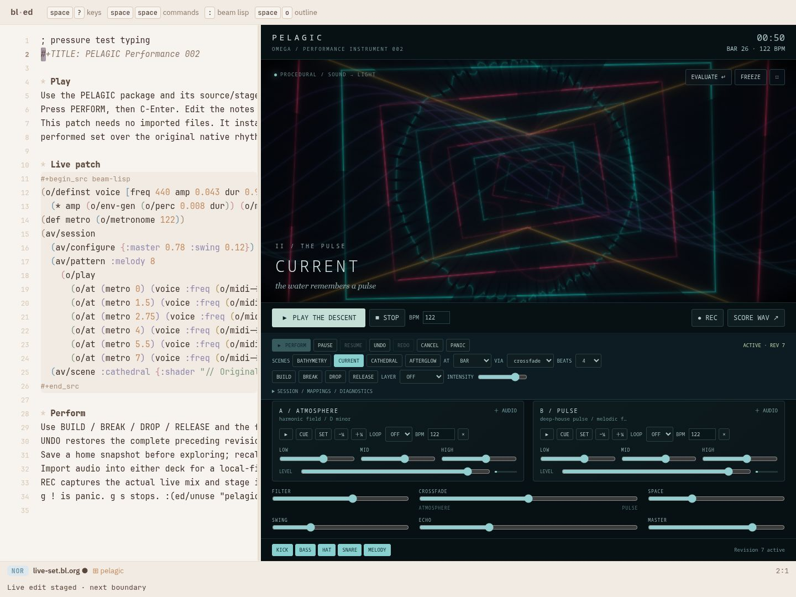

# Native actor namespace prototype

PELAGIC's optional actor preparation now uses one annotated Beam Lisp namespace:

```clojure
(ns ^:js pelagic.prepare (:require [pelagic.browser :as browser]))
```

Its actor calls `browser/score-slice` through a static ES import, directly. The
same function handles native JavaScript expressions and actor receive/spawn/send.
The generated kernel call has no actor call frame, encoder, Promise or host-emitter
round trip. Native objects retain identity through local actor messages. The only
Worker messages are the explicit cross-thread boundary to the editor.

This is an upstream checked-actor-compiler prototype, not yet an extension of the
ordinary synchronous `js/build!` profile. Both profiles share the native expression
emitter. `system.js` checks native operation boundaries; annotated namespace bounds
and ordinary source privacy/alias resolution remain in the existing BL compiler.
Linked synchronous BL helpers use native JS arguments/results; profile-specific BL
collections still need explicit conversion. A suspending actor function cannot be
used as a synchronous JavaScript callback.

The package build owns the native-link manifest and checks export arities. Package
users write normal annotated BL and requires. `actor/prepare-bridge.bl` remains a
measurement baseline; it is excluded from shipped optional actor assets.

```
cd spikes/pelagic
bl actors
PELAGIC_ACTORS=1 bl bundle
```

The default remains the build-time BL score cache. `?prepare=actor` exercises the
native actor namespace; `?prepare=worker` uses the native Worker comparison.
The benchmark also supports `actor-bridge` without shipping it in the package.

The compiler now prunes checked, reachable definitions (including function values
and hidden receive helpers). Dynamic `host/ref` lookup conservatively retains the
whole registry. Native argument guards disappear only where `system.js` proves a
raw native value; unknown values keep their checks. Pelagic retains 84 of 353
actor definitions: generated native actor code falls from 1,224,489 to
335,230 bytes (73%). Reference auditing and native-boundary validation happen
before pruning.

Instrument macros now prepare immutable parameter names/default maps once, alongside
the graph. Calls reuse that plan and update only supplied arguments. Score defaults
avoid a redundant merge when the original immutable default map is passed. These
optimizations sit behind existing instrument and score APIs. `score-slice` checks a
4 ms budget between steps, makes at least one step of progress, and caps a slice at
16 rows. This is cooperative yielding: a single step and browser scheduling can
exceed the budget. `actor-fixed` and `worker-slice` are benchmark controls.

Correctness checks compare all 1,024 steps against the original SHA-256 digest
`11d812d7eff77acc25e66e80215b366f4dc2bf5daf7b80b8e5524e94b0080b9a`.
Instrument checks cover positional/keyword parameters, duplicate keys, invalid
arguments and unchanged defaults. The initial unpruned and pruned measurements
are in [round 1](proof/native-actors/round-1/) and
[round 2](proof/native-actors/round-2/).

The benchmark rotates mode order and uses fresh realms/processes. Node CPU time
includes all process threads, startup and GC; it is not a worker-only CPU timer.
Browser wall time is heavily affected by this host's scheduling and I/O pressure.
The final verification rebuilds five changed BL modules through `js.build` and
reuses the existing common editor graph; it does not represent a cold rebuild of
all 44 modules. The live macro cache and both actor programs are regenerated.

Final measurements and real-editor proof are recorded below.

Five fresh browser contexts and five fresh Node processes per mode produced the
same score digest. The figures below are medians; “chunk p95” is the median of
each run’s p95, not a pooled percentile. Browser and Node are separate experiments.

| Profile | Browser complete | Browser chunk p95 | Browser heartbeat p95 | Node process CPU |
| --- | ---: | ---: | ---: | ---: |
| worker | 1,680.9 ms | 33.8 ms | 7.5 ms | 1,500.8 ms |
| worker-slice | 2,108.3 ms | 19.6 ms | 7.9 ms | 1,723.4 ms |
| actor-bridge | 3,005.4 ms | 36.2 ms | 6.9 ms | 2,305.6 ms |
| actor-fixed | 3,586.1 ms | 43.6 ms | 7.1 ms | 2,288.6 ms |
| actor | 874.2 ms | 4.1 ms | 5.4 ms | 3,626.1 ms |
| prebuilt | 251.4 ms | 0.0 ms | 7.3 ms | 234.5 ms |

[Browser results](proof/native-actors/final/benchmark.json),
[CPU results](proof/native-actors/final/cpu.json),
[control probes](proof/native-actors/final/control.json).

The direct fixed-chunk actor profile is effectively level with the bridge in
final Node CPU (2,289 vs 2,306 ms); browser wall time does not establish a direct-call
speedup. The budgeted actor profile trades more messages/turns for shorter chunks:
its median per-run browser chunk p95 is 4.1 ms, but the worst run’s p95 is 18 ms.
Its cold busy-ping probe is 197 ms. A single native call, cold JIT work, or host
scheduling still breaks a strict 16 ms bound. The browser’s favorable total-time
median for budgeted actors does not reproduce in Node; do not treat it as a
portable throughput win.

A separate warmed-kernel comparison excludes startup and actor scheduling: five
fresh processes per revision, three warmup scores and seven measured scores each,
with revision order alternating. Median CPU across 35 samples falls from 466.9
to 251.7 ms (46%). One paired process comparison reverses the improvement; host
variability remains substantial. All output digests match.
[Raw kernel samples](proof/native-actors/final/kernel.json).

Keep the prebuilt score as the default: it avoids repeated runtime score
construction and remains much cheaper. Keep actors optional for cancellation,
mailbox ownership and future dynamic work. Actor processes in one realm supply
logical concurrency; the Worker supplies thread isolation. The native call between
BL profiles adds no transport, but the actor scheduler and actual Worker messaging
still have costs.

Reproduce from Omega’s root after building both outputs:

```sh
PELAGIC_BENCH_REPEATS=5 PELAGIC_BENCH_MODES=worker,worker-slice,actor-bridge,actor-fixed,actor,prebuilt python3 spikes/pelagic/test/prepare-benchmark.py
PELAGIC_BENCH_REPEATS=5 PELAGIC_BENCH_MODES=worker,worker-slice,actor-bridge,actor-fixed,actor,prebuilt node spikes/pelagic/test/prepare-cpu.mjs
PELAGIC_BASELINE_OUT=/path/to/baseline/out PELAGIC_OUT=spikes/pelagic/dist/local/out node spikes/pelagic/test/kernel-benchmark.mjs
python3 spikes/pelagic/test/actor-control.py
```

Upstream commits on Beam Lisp main: `ddceb2df` (native actor namespace),
`3485d726` (statement/finally effects), `dab34779` (checked specialization/pruning),
and `24065c6a` (untruncated macro preload scripts). Pelagic pins the tested
source-worktree tip `c9e95080`. Changes are committed locally; no push is claimed.

Two separate 60-second real-editor pressure runs exercised live edits, recording,
250/500 ms UI stalls, invalid shader rejection, injected graphics-worker failure,
source preservation and package unload. Both passed those lifecycle checks and
recorded zero missed scheduler events. Both recorded actual 1280×720 VP8/Opus
capture. These are headless browser results, with no physical audio loopback.

| Pressure metric (p95) | Actor | Default prebuilt | 16 ms target |
| --- | ---: | ---: | --- |
| Worker render work | 4.9 ms | 6.6 ms | Pass |
| GPU execution | 3.1 ms | 3.1 ms | Pass |
| Worker frame interval | 20 ms | 22 ms | Open |
| Worker audio-clock activation → render submission | 9 ms | 11 ms | Pass; 6 samples each |
| Main-thread submission acknowledgement | 261.4 ms | 277.5 ms | Open |
| Main-thread frame callback interval | 84 ms | 119 ms | Open |

The actor run's score-preparation chunk p95 was 14.8 ms, maximum 90.6 ms.
Main-thread native audio-preparation turns had p95 4/7 ms and maxima 169.5/408.8 ms
(actor/default). Silent AudioWorklet onset probes had p95 about 0.020 ms, but
maximum 2.66/18.66 ms; those probes do not measure physical output latency.
Native audio progressed at only 0.796/0.813 of wall time. Zero scheduler misses
therefore does not demonstrate glitch-free physical audio or smooth 60 Hz output.

[Actor pressure report](proof/native-actors/final/realtime-actor/report.json),
[default pressure report](proof/native-actors/final/realtime-default/report.json).

Real editor with the actor package:

After unloading the same package:


The shared source changes apply to both `bl frontend` and `bl bundle`.
The staged local/server graph has 128 byte-identical shared assets; the default
ZIP contains no actor runtime, and optional actor assets exclude the bridge.
[Artifact checks](proof/native-actors/final/artifacts.json).
The staged graph is deliberately incremental, as described above; running the
regular build performs the complete pinned compilation and installs the frontend.
This task did not replace the user's running world or install over concurrent
editor work.

Follow-up priorities supported by these results:

1. Promote checked native links into the ordinary package linker, with a shared
   BL collection ABI or explicit profile contracts. Today this remains an actor
   compiler prototype with a package-owned static link manifest.
2. Reduce actor startup and scheduler CPU before selecting it for small finite
   jobs. Budgeted slices improve control opportunities but add turns/messages;
   they cannot preempt an individual native step or cold JIT compilation.
3. Profile and reduce editor-thread rendering and AudioNode construction. Worker
   shader work is already below 16 ms at p95; these main-thread paths and observed
   frame cadence are the remaining measured obstacles. A typed BL DSP kernel in
   AudioWorklet or a native backend is a candidate to benchmark, not an achieved
   improvement in this prototype.
4. Validate on a quiet machine and physical audio/video loopback before claiming
   the 16 ms end-to-end target. Keep per-run tails and cold-start measurements;
   median preparation time alone obscures the failures seen here.

Final verification: 48 Pelagic tests, all 73 editor tests, 23 unchanged presentation
variants, 16 actor ABI checks, seven native refusal cases, direct-call/mailbox
identity and side-effect checks, three native-value tests, and the long-source
preload regression pass. All six control profiles pass.
[Verification record and logs](proof/native-actors/final/verification.json).

Implementation review: the preparation adapter now rejects completion before all
1,024 rows arrive and rejects negative/nonfinite work-time samples. Completed jobs
ignore late worker messages; pending credits are cleared. The working score
fallback survives malformed input. All 50 Pelagic tests pass after this change;
one real prebuilt and one real actor Worker integration run preserve the score
digest. These integration runs are not additional performance comparisons, and
the earlier pressure measurements precede this protocol hardening.
[Worker integration results](proof/native-actors/protocol-review/cpu.json).

The 84/119 ms figures above measure the main-thread frame callback interval;
they do not establish that editor rendering alone caused the delay. Profiling must
separate BL execution, DOM/layout, AudioNode construction, capture and host
contention. The actor pressure run reports `outputLatency` of 40 ms and
`baseLatency` of 10.67 ms; physical end-to-end latency needs its own measurement.
