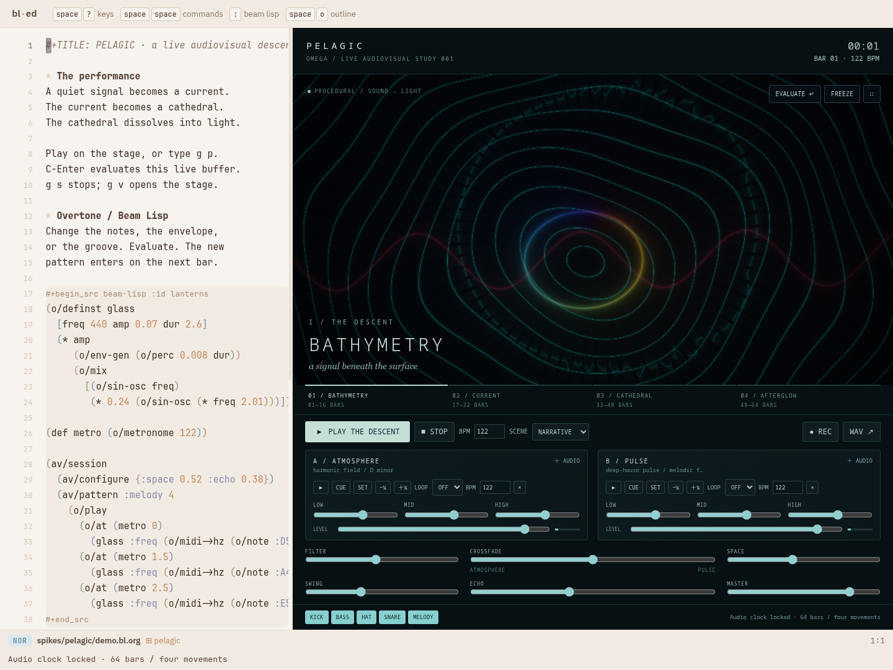
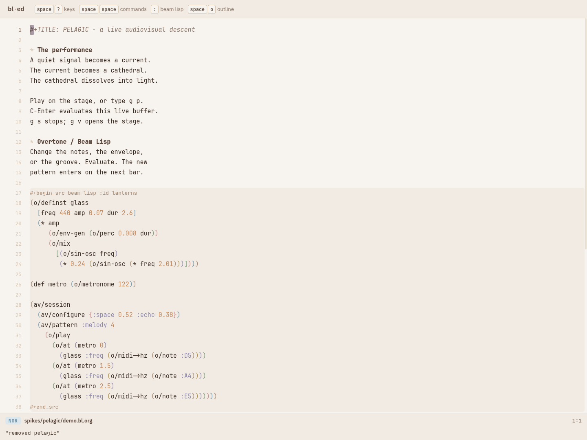
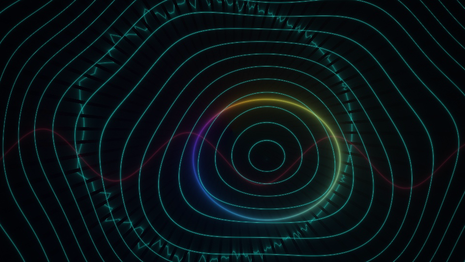
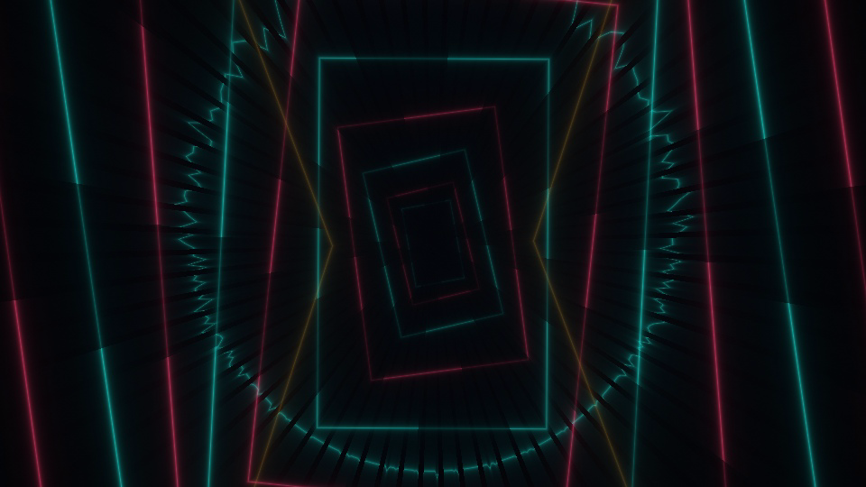
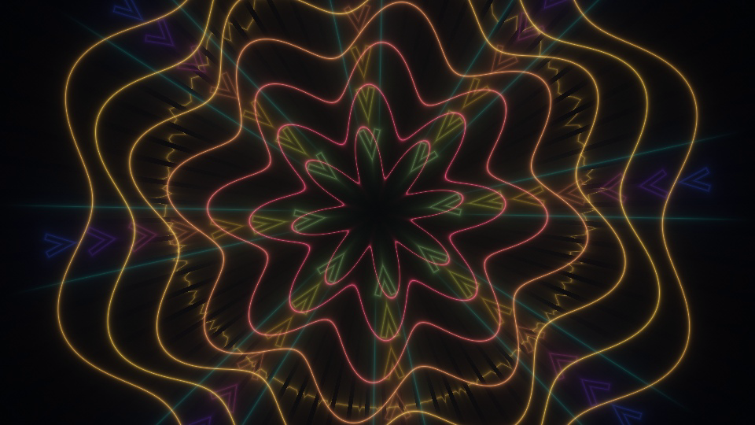
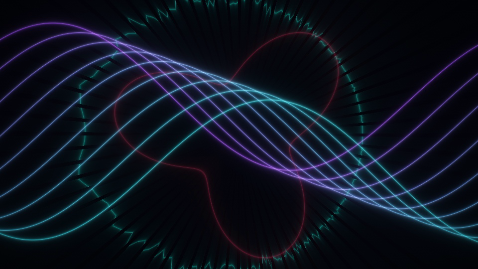

# PELAGIC — Omega / bl-ed live audiovisual package

An original 64-bar descent: **Bathymetry → Current → Cathedral → Afterglow**.
Reworked as **CURRENT CLUB**: a four-on-the-floor descent with explicit
audio-band-driven VJ scenes. [Revision and response proof](club.bl.md).
The next iteration adds a continuous performance instrument: quantized scenes,
transactions, history, snapshots and bounded live capture.
[Performance guide and measured limits](performance.bl.md).
At 122 BPM, the main narrative runs 125.90 seconds, followed by its atmospheric
tail. Live soundscapes, a syncopated dub groove, harmonic bells and procedural
orbital geometry share one clock.

[Watch the phone-friendly performance](proof/club/mobile/pelagic-mobile.mp4) ·
[Listen to the phone-friendly MP3](proof/club/mobile/pelagic.mp3) ·
[Watch the complete performance at original quality](proof/club/pelagic.mp4) ·
[Listen to the stereo score](proof/club/pelagic.wav) ·
[Watch an actual live recording](proof/club/live-excerpt.webm) ·
[Read the implementation research](research.bl.md)

Phone copies retain the complete 2:16 narrative: H.264/AAC MP4 at 640×360,
24 fps with streaming metadata at the beginning, and stereo 128 kbps MP3.
The master video and WAV remain available. Recreate and decode-check the mobile
files with `bash spikes/pelagic/test/compress.sh`. Smaller studio screenshots:
[studio](proof/club/mobile/studio.jpg), [live controls](proof/club/mobile/studio-controls.jpg).

## Run it

From Omega:

```sh
spikes/pelagic/build.sh
bin/bl-ed --offline --memory --port 8812 --root /tmp/omega-pelagic-world
```

Open:

```
http://127.0.0.1:8812/?use=pelagic&layout=pelagic&file=spikes/pelagic/demo.bl.org
```

The existing server currently resolves file documents relative to Omega even
when passed a different `--root`; that separate issue is already tracked in
FUP-012. This proof used a fresh offline memory world on **8812** because **8792**
was occupied. It performs **no writes to a world**, and never tests against 8790.
The demo is read directly from this repository. Build output and the loader live
in `vendor/bl-ed/web/out` and `vendor/bl-ed/web/pkg/pelagic.mjs`.

The package works independently: no `present`, `workspace`, `browser`, images,
DWIM, procurement or other domain package is required. There is no private page.
Its source pane is a real editor; the stage is a view in an `ed/frame.bl` layout.

Press **Play the descent**. `g p` plays, `g s` stops, `g v` opens the stage.
**C-Enter** or **Evaluate** compiles the live buffer with the existing Beam Lisp
reader/compiler/macro runtime. `pelagic-cinema` is a second provided layout.

## Play and code

`demo.bl.org` contains an editable Overtone-style instrument and a repeating
melody patch. Change a note or envelope, then evaluate: a valid patch enters on
the next bar without rebuilding the editor or restarting the score.

```clojure
(o/definst glass [freq 440 amp 0.07 dur 2.6]
  (* amp (o/env-gen (o/perc 0.008 dur)) (o/sin-osc freq)))

(def metro (o/metronome 122))
(av/pattern :melody 4
  (o/play
    (o/at (metro 0) (glass :freq (o/midi->hz (o/note :D5))))
    (o/at (metro 2) (glass :freq (o/midi->hz (o/note :A4))))))
```

Ordinary top-level instrument calls play as well. Their returned descriptor can
be bound and passed to `o/ctl` or `o/kill`. The host resolves it to the played
voice. Graph controls support exposed `:freq`, `:amp`, `:cutoff` and `:pan`.
Use `o/play` to retain multiple calls inside a single nested expression.

Add a `#+begin_src glsl` block and evaluate to hot-swap the shader. Both `main`
and Shadertoy-style `mainImage` are accepted. Shadertone uniforms include
`iGlobalTime`, `iResolution`, `iOvertoneVolume`, `iMouse`, `iDate`, the audio
texture `iChannel0` and previous frame `iChannel1`. `t/start` accepts an inline
source string, and `t/uniform` supplies a scalar or vector. A failed compilation
preserves the last working shader; a failed BL edit preserves playback. All
shader requests inside an `av/session` are validated before committing edits.

The two decks provide atmospheric and rhythmic stems, local audio import,
manual source BPM, rate sync, cue/set cue, 1/2/4/8-beat loops, jog, three-band EQ,
volume, equal-power crossfade, filter, space, echo, swing and stem mutes.
Movement cues seek the shared narrative. Imported files replace the corresponding
score deck during transport playback. They stay local to the browser.

**REC** captures the live shader canvas plus the real audio bus to WebM.
**WAV** renders the original score with current mixer settings to stereo PCM.
WAV does not include imported files or custom live patches; REC does.

Both upstream repositories are vendored, with exact source hashes and license
notices. The executable port is a practical API subset with Web Audio/WebGL
backends. It does not run JVM Overtone/Shadertone or provide full SC/DJ parity.
The [compatibility matrix](research.bl.md#compatibility-boundary) lists the precise
boundaries, including rate sync changing pitch and no hardware headphone routing.

## Package and host contract

[`pelagic/main.bl`](pelagic/main.bl) exports the single `bl-package` value.
Commands, keys, state and layouts remain layered. State belongs to
`[:pkg-state "pelagic"]`; user tables are untouched. Package functions do no IO:
all requests leave as `:package-host` effects. Synth graphs, pitch, patterns,
movement choices and score composition are Beam Lisp values/functions.

The optional generic `createHost(api)` seam owns the browser's AudioContext,
AudioNodes, WebGL programs/textures, timer, recording streams and shadow view.
It initializes lazily, stops on page leave and disposes on unuse. Generation
checks reject an old asynchronous answer after a fresh use of the same name.
Only this generic lifetime/IO boundary was added to bl-ed; its vendor changes
are recorded in `vendor/bl-ed/VENDOR.md`.

```clojure
(ed/unuse "pelagic")
```

removes the stage layout and returns to the source editor. Audio stops, the
AudioContext closes, the shader disposes, and the original source/cursor remains.

## Executed proof

The browser proof drives the actual editor in headless Chromium using Playwright,
including a real keyboard C-Enter and the real `:(ed/unuse "pelagic")` command.

- [Used package](proof/club/01-used.png)
- [Playing inside the real editor](proof/club/02-playing.png)
- [Live edit, imported deck and mixer controls](proof/club/03-live-controls.png)
- [After unuse](proof/club/04-unused.png)
- [Browser assertions and resource/timing statistics](proof/club/browser.json)
- [Live WebM with VP9 video and Opus audio](proof/club/live-excerpt.webm)





Scene captures:






Verification commands:

```sh
node --test spikes/pelagic/test/*.test.mjs
BLED_ROOT=/home/user/code/undefine/beam-lisp BLED_OUT=vendor/bl-ed/web/out \
  node --test vendor/bl-ed/test/*.test.mjs
node spikes/present/test/check.mjs \
  vendor/bl-ed/web/welcome.bl.org spikes/pelagic/demo.bl.org
python3 spikes/pelagic/test/browser.py
python3 spikes/pelagic/test/film.py
```

`test/verify.sh` builds and executes the first four checks. Start the offline
server first. `PELAGIC_URL`, `CHROMIUM`, and `PELAGIC_ANGLE` override browser setup.
The proof uses hardware ANGLE/OpenGL; `PELAGIC_ANGLE=swiftshader` uses software WebGL. `film.py` writes
intermediate frames only into `/tmp/omega-pelagic-club-film-jpeg` and supports resuming.
Set `PELAGIC_REDO=1` to regenerate frames after changing a shader/score, and
`PELAGIC_AUDIO_REDO=1` to rerender the cached WAV after musical changes;
`PELAGIC_FPS` changes export rate (clear/change the intermediate directory when
changing it). There are no external samples, fonts, CDNs or runtime dependencies.
Python Playwright/Chromium and ffmpeg are proof tools, not package dependencies.

Results: **14/14 package/resource tests**, **73/73 vendored editor tests**, and
**23 presentation-equivalence variants** pass. The presentation checker is
unchanged. Logs: [package tests](proof/club/contract-tests.log),
[vendor tests](proof/club/vendor-tests.log), [equivalence](proof/club/equivalence.log).
The full film uses the same owned ShaderStage, with a deterministic FFT of the
actual OfflineAudioContext soundtrack for every frame. It is an offline quality
render; the separate live excerpt proves the realtime capture path.

Audio measurement: 135.90 s, stereo 44.1 kHz / 16-bit PCM. The revised mix
measures −20.2 LUFS integrated, 10.4 LU loudness range and −5.1 dBFS true peak;
no clipping. The opening stays quiet and the pulse opens the dynamic range.
[Measured audio report](proof/club/audio-analysis.log) and [movement levels](proof/club/audio.json).
`node spikes/pelagic/test/analyze.mjs` verifies the delivered WAV has no clipped samples.

The completed MP4 has H.264 video at 960×540 / 24 fps and stereo AAC audio;
the full file decodes without errors. [Media metadata](proof/club/media.json),
[render provenance](proof/club/film.json), and [decode check](proof/club/decode.log).
