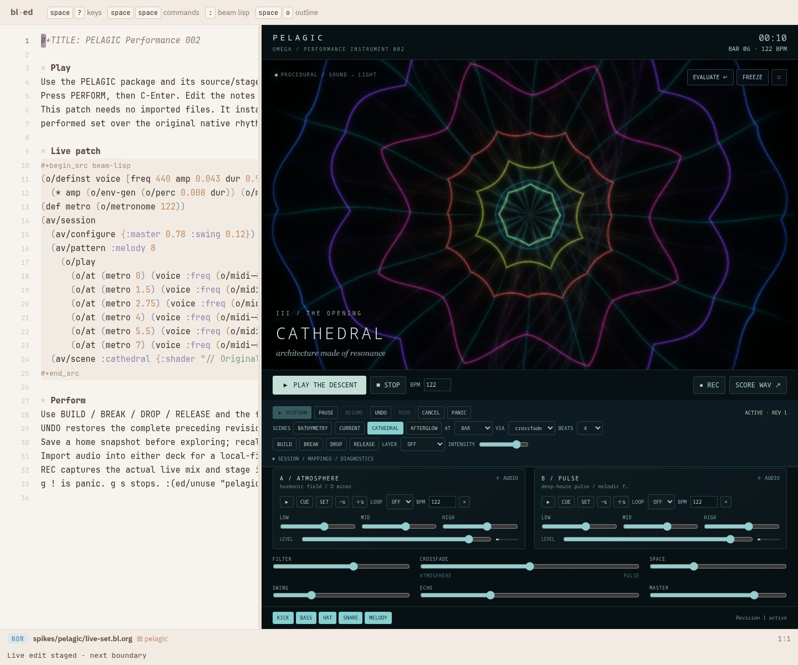
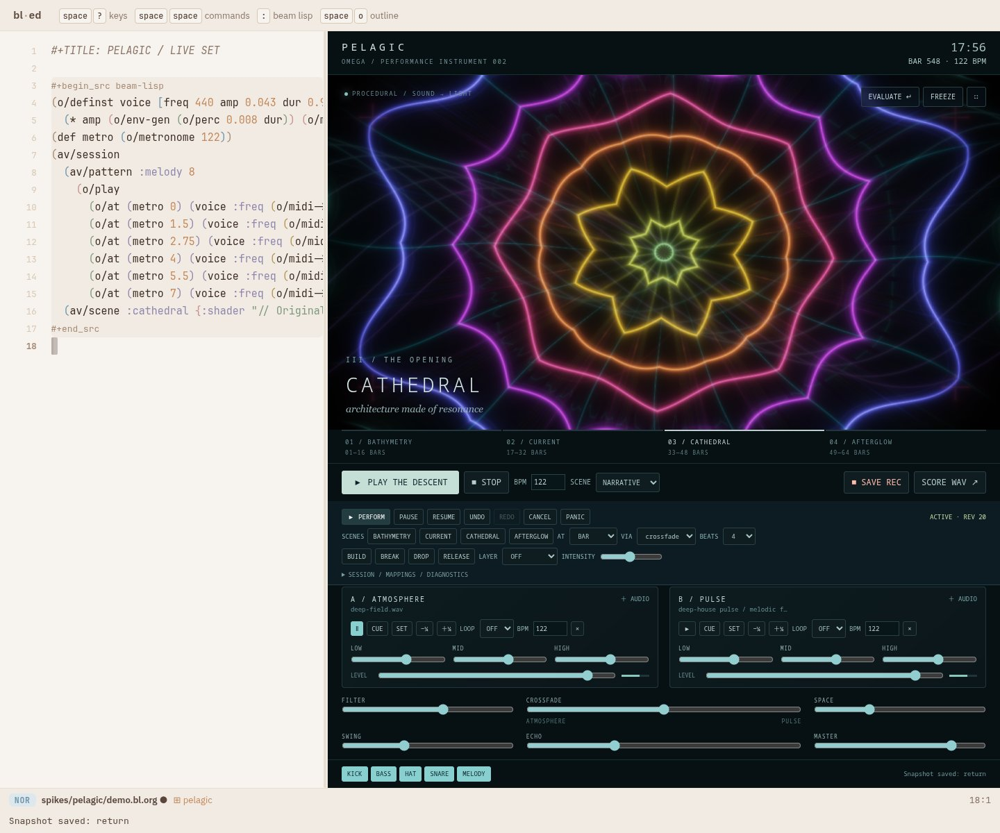
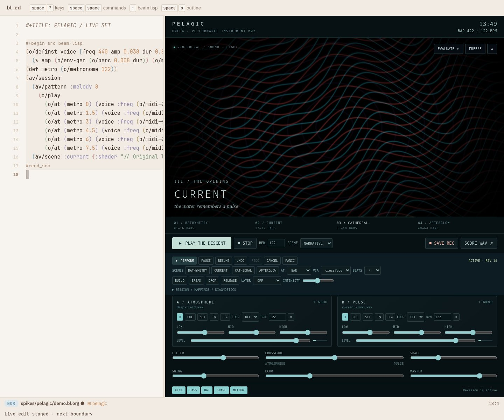
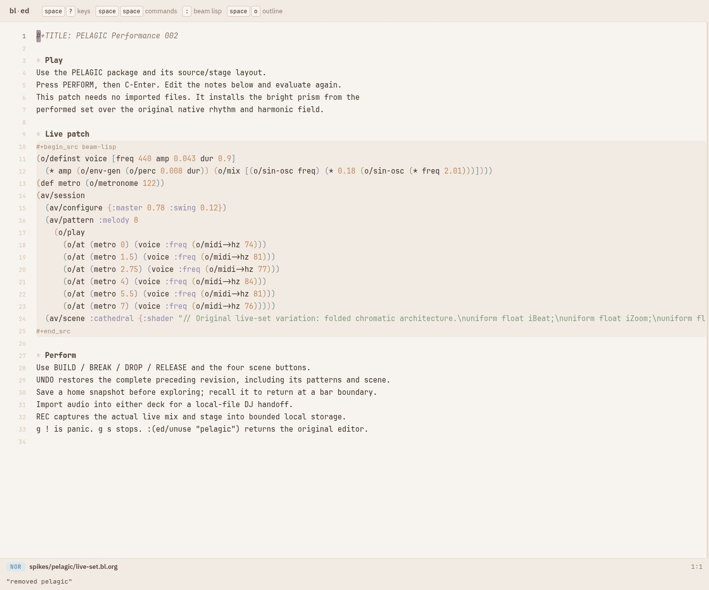

# PELAGIC performance instrument

PELAGIC now has a continuous performance mode, quantized audio/visual revisions,
playable scene transitions, undo and snapshots, local audio references, and live
recording that writes chunks to local storage. It remains one independent bl-ed
package. The [implementation plan](../../!tasks/plans/PLAN-008-pelagic-playable-av-instrument.org)
sets the scope and provisional performance gates.

Build and open the [existing studio](pelagic.bl.md#run-it), then press **PERFORM**
(or `g P`). **Play the descent** still plays the original finite composition.
Continuous mode retains its opening and then cycles the developing middle acts;
it does not stop at bar 64. Code, gestures and scenes can change its direction.
The complete [standalone live patch](live-set.bl.org) needs no audio imports:
open it with `?use=pelagic&layout=pelagic&file=spikes/pelagic/live-set.bl.org`,
press **PERFORM**, then **C-Enter**.



## Three implemented workstreams

1. **Playable visuals.** Four named scenes, a second overlay, three transitions
   (crossfade, dissolve, iris), beat/bar/phrase launches, controllable intensity,
   symmetry, palette and feedback. Each layer uses its own scene value; the
   compositor owns one WebGL context and three fixed render targets. Stem
   activity and measured audio features drive geometry rather than only elapsed
   time. Imported decks and the master output provide measured level and bands.
2. **Safe performance changes.** Beam Lisp owns current, pending and historical
   values. Source evaluation stages requests in a fresh namespace, validates
   audio graphs and prepares GLSL in the actual rendering context. A failed
   candidate leaves the active revision intact. Accepted changes show QUEUED,
   ARMED, then ACTIVE at a musical boundary. Undo/redo retain 32 revisions;
   sixteen named snapshots retain patterns, configuration, scene definitions,
   visual controls, variation seed and audio asset hashes.
3. **Sustained operation and proof.** Bounded voices, intent history, shader
   programs, namespaces, event logs and recording backlog; pause/resume, panic,
   GPU loss recovery, session files, local audio deduplication, recording
   recovery and diagnostics. The rehearsal runner distinguishes deterministic
   stress actions from an agent-operated live set and evaluates the original
   acceptance gates without silently relaxing them.

## Code in the real source pane

The existing self-hosted Beam Lisp compiler evaluates these forms. `o` is the
studio's Overtone alias; `av` supplies performance requests. C-Enter evaluates
the document. The commands below can be separate evaluations.

```clojure
(o/definst glass [freq 440 amp 0.055 dur 1.8]
  (* amp (o/env-gen (o/perc 0.008 dur))
     (o/mix [(o/sin-osc freq)
             (* 0.18 (o/sin-osc (* freq 2.01)))])))
(def metro (o/metronome 122))
(av/commit
  {:quantize :bar
   :edits [(av/configure {:space 0.52 :echo 0.34})
           (av/pattern :melody 8
             (o/play
               (o/at (metro 0) (glass :freq (o/midi->hz 74)))
               (o/at (metro 1.5) (glass :freq (o/midi->hz 69)))
               (o/at (metro 4) (glass :freq (o/midi->hz 77)))
               (o/at (metro 6.5) (glass :freq (o/midi->hz 76)))))
           (av/launch :cathedral {:transition :iris :beats 8})
           (av/visual {:symmetry 8 :feedback 0.12})]})
```

```clojure
(av/snapshot :home)
(av/gesture :break)
(av/gesture :build)
(av/gesture :drop)
(av/undo)
(av/redo)
(av/recall :home)
(av/pattern-stop :melody)
(av/cancel)
```

`pattern-stop` installs an empty lane override: it suppresses the original score
for that lane too. Density and transposition apply deterministically; a snapshot
retains the seed. A pending edit coalesces with subsequent edits until superseded
or cancelled. Already audible sound cannot be undone; revision changes preserve
existing tails, while panic stops them.

```clojure
(av/commit {:quantize :phrase
            :edits [(av/variation {:density 0.8 :transpose 12 :seed 93})
                    (av/layer :afterglow 0.25)
                    (av/launch :current {:transition :dissolve :beats 16})]})
```

Scenes can contain inline GLSL and explicit signal mappings. This small example
shows the schema; the built-in scenes use the richer original
[pelagic.glsl](shaders/pelagic.glsl).

```clojure
(av/session
  (av/scene :pulse
    {:shader "uniform float iZoom;
              void mainImage(out vec4 c,in vec2 p){
                vec2 uv=(p-.5*iResolution.xy)/iResolution.y;
                float r=length(uv)*(1.-iZoom);
                float ring=.003/(abs(r-.25-iAudioBass*.12)+.003);
                c=vec4(vec3(.1,.9,.8)*ring,1.);
              }"
     :mappings {:zoom {:signal [:stem :bass :level] :amount 0.2}}})
  (av/launch :pulse {:transition :crossfade :beats 4}))
```

Mapping scopes are `:stem`, `:deck` and `:master`; features are `:level`, `:onset`,
`:pitch`, `:bass`, `:mid` and `:high`. Musical stems expose level/onset/pitch;
decks/master expose measured level/onset/bands. A feature absent from its scope
contributes zero. Onset is an amplitude attack estimate, not beat detection.
Targets are zoom, accent, intensity, symmetry, feedback and palette. Controls are
clamped. Muting a stem removes its onset contribution. `iChannel0` remains the
FFT/wave texture; `iChannel1` is that layer's preceding frame.
`t/start` changes the fallback shader. A scene with its own `:shader` keeps that
shader; edit its `av/scene` definition to replace it. Both sources are validated,
so an invalid fallback cannot silently pass just because a custom scene is active.

## Sessions and recording

Import audio with either deck's **AUDIO** control. Set its source BPM, cue and
beat loop; use the equal-power crossfade and three-band EQ. Session JSON stores
content hashes, BPM, cue and loop settings. Audio files stay in this browser's
IndexedDB, deduplicated by SHA-256. Moving JSON to another device does not move
its audio: a missing asset is reported and the current track is retained.
Session and snapshot recall decode available assets before queuing the change;
a superseded asynchronous load cannot replace a newer request.

**REC** captures the actual canvas and mixed output, including imported audio
and live patterns. Two-second MediaRecorder chunks are stored incrementally;
a 16 MB pending-write cap stops capture on storage failure. Small takes download
automatically. Larger takes stay local for explicit recovery/export, and the
proof runner exports each stored chunk in order without assembling the whole
recording in JavaScript memory. Explicit browser download may assemble a Blob;
recording itself does not retain the full take in RAM. **RECOVER LAST TAKE** can
recover the latest completed or journaled partial take in the same browser
profile. An initial journal precedes chunk writes and is updated after each
committed chunk; a crash may lose the current unwritten two-second chunk.
Quota errors remain visible and partial downloads are labelled accordingly.
Recovery cannot promise chunks that were never written or a journal when storage
failed before its initial write. IndexedDB is local browser storage, not a backup.
**SCORE WAV** exports the original composition with current mixer settings,
not a live take.

**PAUSE/RESUME** preserve beat phase and elapsed visual time. **PANIC** cancels
pending changes and stops voices. GPU context loss pauses transport and capture;
restoration rebuilds graphics resources and requires an explicit resume. Removing
the package closes its AudioContext, disposes GPU resources, removes controller
listeners and returns the existing editor layout/source without a private page.

## Measurement and limits

The stage targets 30 fps. Recording uses VP8 when available; scene geometry is
rendered at 960×540 and composited into a 1280×720 capture. Diagnostics report
both sizes. Inactive GLSL scene branches and duplicate layer draws
are skipped. Revision graphics submit before status-display updates, so editor
painting does not delay the first changed visual frame. Diagnostics count missed
scheduler steps, whole-run frame interval distributions, revision-to-first-draw
submission delay, voice/node/program counts, history and namespace sizes, storage
backlog and post-GC heap checkpoints. Startup and deliberate GC pauses remain
in the reported measurements. The diagnostics also expose native audio-clock
progress against wall time, sample rate and browser output-latency estimates.
A normal minimal-clock probe does not guarantee that the full DSP/graphics
workload keeps wall time. Percussion graphs now stop at their envelope end;
ADSR graphs retain their gate and release, while shared effect tails continue.
UI updates read compact revision counts and snapshot names rather than repeatedly
converting the complete history.

Continuous mode schedules one second ahead; quantized edits target a boundary
beyond that horizon. This provides headroom for source/shader preparation and
can add a bar of waiting compared with the finite score.

An AudioWorklet receives separate silent sample-onset probes scheduled by the same
AudioContext as kicks. It measures those probe graphs on the browser sample
timeline, not the onset of the audible kick graph. Expected time travels in a second,
silent audio channel, avoiding asynchronous message-order associations; Float32
quantization is below .125 ms at twenty minutes. Cancelled probes cancel with
their voice. Neither that
probe nor the graphics submission measurement measures physical speaker/display
latency or proves an absence of device underruns. Physical MIDI hardware and
mobile sustained-performance testing are outside this proof; the MIDI adapter
is exercised with synthetic messages and retains keyboard/code alternatives.

This is still an Overtone-shaped browser subset, not Overtone running on a JVM
or SuperCollider. Beam Lisp compiles to JavaScript; native Web Audio renders
synthesis, and WebGL compiles GLSL on the GPU. Vendored upstream trees remain
reference material. See [compatibility and provenance](research.bl.md) for the
implemented operators and exclusions. There is no pitch-preserving time stretch,
headphone prelisten, arbitrary UGen parity or portable embedded sample archive.

## Reproduce the proof

```sh
spikes/pelagic/build.sh
node --test spikes/pelagic/test/*.test.mjs
python spikes/pelagic/test/performance-browser.py
python spikes/pelagic/test/live-example.py
PELAGIC_PROOF=spikes/pelagic/proof/performance/legacy python spikes/pelagic/test/browser.py
python spikes/pelagic/test/run-live.py --kind soak --seconds 1200 --port 8813
python spikes/pelagic/test/run-live.py --kind set --seconds 1200 --port 8814
python spikes/pelagic/test/publish-set.py
python spikes/pelagic/test/summarize-set.py
```

Use an offline editor on 8812; never use the running world on 8790. The set runner
has no musical action script: its local HTTP control endpoint accepts live edits,
requests, imports and screenshots. The soak runner's actions are deterministic.
Each writes source commit, browser/GPU facts, timestamped actions, session values,
checkpoints, gates and cleanup evidence. A failed gate produces `needs-review`
and a nonzero exit; it must be reported as such.

For set imports, `test/make-set-assets.py` makes an original seamless D-minor
field and extracts an eight-beat loop from our own score. The latter requires
the score WAV produced by `test/film.py`. These are the only imported sound
sources in this proof. Hashes are in [summary.json](proof/performance/set/summary.json).
The exported [session](proof/performance/set/session.pelagic.json) contains local
asset references; regenerate/import the matching files before recalling its
sample-dependent snapshots. Media files remain local ignored artifacts, with
sizes, hashes and complete-decode results in the [media manifest](proof/performance/set/media.json).

## Performed proof and remaining gates

The distinct agent-operated set recorded **20:00.48** of the actual live canvas
and mix, at source commit `d653019`. Its action log contains ten accepted live
pattern edits, thirteen visual launches, all four gestures, three breaks/four
drops, two imported files, undo/redo, two snapshot recalls, and deliberately
rejected BL and GLSL. Rapid edits can coalesce; these are accepted-request counts,
not a claim that every request produced a distinct audible revision. This was
operated through the real editor, with C-Enter source evaluation; the set runner
does not contain a prerecorded musical arrangement.

The [raw report](proof/performance/set/report.json) and
[summary](proof/performance/set/summary.json) keep the status **needs-review**.
On Chromium/ANGLE with AMD Radeon 860M, 48 kHz audio, 1280×720 capture and
960×540 scene geometry:

| Measurement | Result | Target / status |
| --- | ---: | --- |
| Missed scheduler steps | 0 | 0, pass |
| Native audio-clock / wall-clock rate | 0.99524 | 0.99–1.01, pass |
| Frame interval p95 | 50 ms | ≤40 ms, **open** |
| Frame intervals over 100 ms | 0.283% | <1%, pass |
| Revision to graphics submission p95 | 41.45 ms | ≤50 ms, pass |
| Silent sample-probe p95 / maximum | 0.049 / 34.64 ms | ≤5 / ≤15 ms, **maximum open** |
| Heap growth, last two five-minute checkpoints | 4.40% | <10%, pass |
| Peak voices / final programs / render targets | 31 / 5 / 3 | bounded, pass |
| Final staging namespaces / storage backlog | 0 / 0 | bounded, pass |

The earlier [twenty-minute stress soak](proof/performance/soak/report.json)
failed more gates and remains retained. Its old sample-pairing measurement was
defective; the [erratum](proof/performance/soak/errata.json) identifies that defect
without discarding independent frame/scheduling failures. Subsequent fixes stop
silent voice graphs earlier, encode sample timestamps in the audio path, and
reduce UI/history work. The performed set measures those fixes, but does not
establish a passing corrected automated soak. These are explicit reliability
blockers, not a production-release claim. Recorded system pressure is context,
not proof of the failures' cause. Browser-clock deviations and encoded sample
duration also mean this evidence does not prove uninterrupted physical output.

Final UI/error/partial-recovery changes are committed in `ad2b09d`; they have
shorter functional coverage, not another twenty-minute claim. Final validation:
**26 package tests, 73 editor tests, 23 unchanged presentation variants, 19
performance browser checks, 24 legacy browser checks**, plus the standalone
patch/C-Enter/unuse drive. See [verification](proof/performance/verification.json).

## Watch and listen on a phone

- [Three-minute highlight, 7.6 MB](proof/performance/set/mobile/pelagic-highlight.mp4)
- [Full uncut phone video, 32.1 MB](proof/performance/set/mobile/pelagic-full.mp4)
- [AAC listening copy, 14.8 MB](proof/performance/set/mobile/pelagic-live.m4a)
- [MP3 alternative, 19.1 MB](proof/performance/set/mobile/pelagic-live.mp3)
- Five-minute video downloads: [1](proof/performance/set/mobile/pelagic-part-00.mp4),
  [2](proof/performance/set/mobile/pelagic-part-01.mp4),
  [3](proof/performance/set/mobile/pelagic-part-02.mp4),
  [4](proof/performance/set/mobile/pelagic-part-03.mp4) (about 8 MB each).

The full video preserves the original timeline and mix. The highlight is an
excerpt at 17:00–20:00, with 3 dB gain and ending fades. Listening copies reset
audio timestamps to continuous encoded samples (19:54.9), add 3 dB gain and a
twelve-second fade; they are labelled mastered derivatives. The native capture
measures −21.1 LUFS / −4.7 dBFS true peak; the pre-encode listening master measures
−18.1 LUFS / −1.6 dBFS true peak. The original includes the performed release and
ambient ending; an attempted final manual fader fade arrived after capture ended.
Every delivered media file passes complete decoding.




