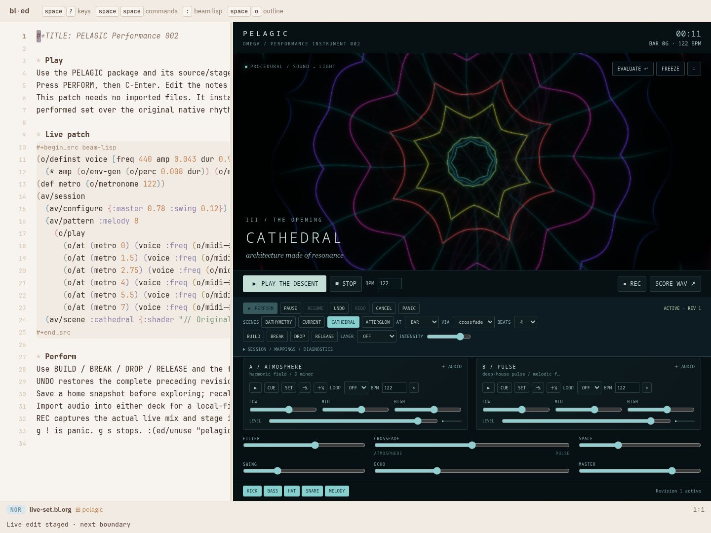
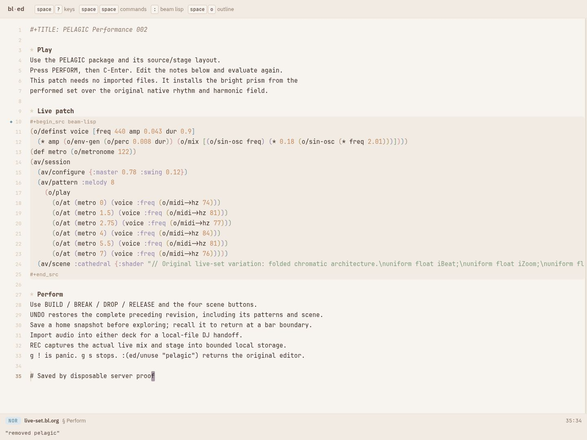
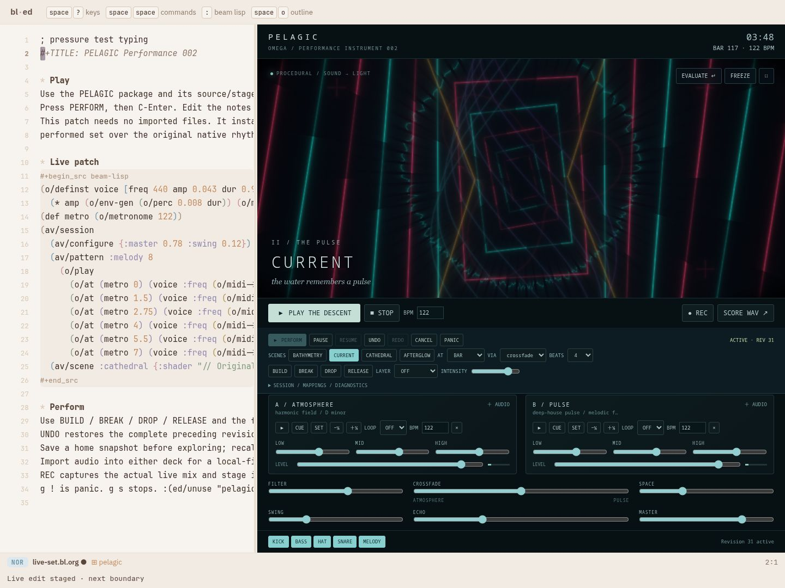
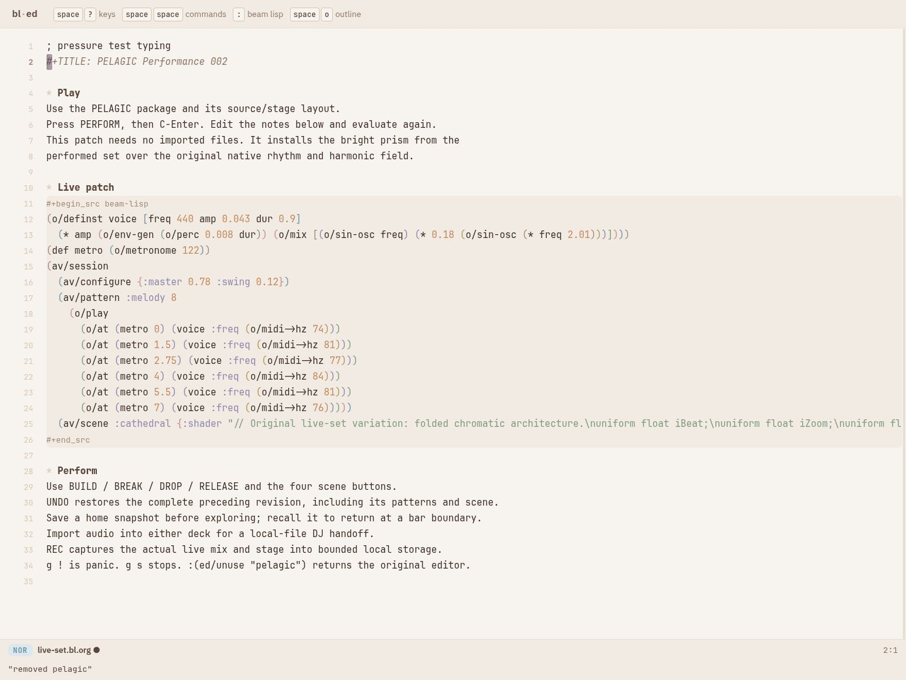

# Shared frontend and actor preparation prototype

PELAGIC's regular server build and optional local bundle now use one pinned BL
JavaScript graph and the same annotated browser boundary. The server keeps its
normal document, save and world-intent transport; the local bundle uses IndexedDB.
The regular build no longer launches four separate compilations or disables the
compilation/rendering workers through the old compatibility boundary.

```sh
spikes/pelagic/build.sh
bin/bl-ed
# Open ?file=spikes/pelagic/live-set.bl.org&use=pelagic&layout=pelagic
```

`bl frontend` from `spikes/pelagic` stages a server frontend under `dist/server`
alongside `dist/local`. `build.sh` installs its editor/runtime graph and PELAGIC
loader in the real editor's web directory, preserving unrelated package files.
Omega's server compiler pin is unchanged. The frontend pin is `a5f51eae`.

## CPU placement and actors — original bridged prototype

The subsequent [native actor namespace prototype](native-actors.bl.md) removes
the computation bridge described below. These measurements remain the historical
baseline; the selected default is still the prebuilt score.

The native JS emitter and the existing generator actor profile have different
control/value ABIs. The native profile rejects `receive`; the actor profile owns
mailboxes, bounded turns and process lifetimes. This prototype combines them in
one owned Worker using the actor runtime's existing typed input/output transport.
Only numeric job IDs, offsets and credits cross their ABI boundary. Native BL
computes the score data; the actor controller handles demand and cancellation.

An ABI regression was fixed upstream as `47c14301`: canonical `rt/not_` now links
to the actor prelude's existing `core-not`. Seven positive and nine refusal checks
pass; 353 runtime/application definitions compile through the checked actor emitter.
The actor runtime/compiler were reused rather than implementing another scheduler.

Each preparation mode has one demanded chunk, at most 16 steps, a 1,024-step cache,
a timeout, stale-job protection and deterministic worker disposal. There is no
application `async`/`await` CPU workflow. Actors coordinate logical work in one
realm; the Worker supplies actual thread isolation. A native function call remains
indivisible: actors cannot preempt the native score kernel inside a chunk.

## Measured alternatives

Three fresh-context runs per mode use identical 1,024-step output. Every output
has SHA-256 `11d812d7eff77acc25e66e80215b366f4dc2bf5daf7b80b8e5524e94b0080b9a`.
Measurements below are medians on this loaded host. The heartbeat column is the
median of each run's maximum delay; it is not a frame-pacing measurement.

| Preparation | Total time | Maximum editor-thread heartbeat delay |
| --- | ---: | ---: |
| Whole score on main thread | 737.2 ms | 738.9 ms |
| Main thread, yielding every 16 steps | 965.5 ms | 67.3 ms |
| Native worker | 803.5 ms | 10.4 ms |
| BL actor-managed native worker | 1,302.1 ms | 10.0 ms |
| Build-time BL score data, loaded in worker | **79.5 ms** | **8.1 ms** |

[Measurements](proof/preparation/benchmark.json),
[initial kernel comparison](proof/preparation/kernel-comparison.json),
[control/demand checks](proof/preparation/control.json).

The actor variant is useful for ownership and control, but slower for this finite
job. Its generic runtime adds approximately 1.2 MB plus a 68 KB host before
compression. Native-kernel control responses during a busy chunk were about
65–92 ms in the control probe: the actor abstraction does not remove native work.

The selected default is build-time preparation. `local/score-build.mjs` invokes
the compiled annotated BL kernel and emits the immutable default score as data. A second native BL build-time pass
interns seven repeated graph templates: 126,424 bytes replace 603,278 bytes of
flat score data (about 79% less; approximately 2.8 KB under gzip). Reconstruction
preserves the exact score digest.
Runtime work no longer reconstructs all those graphs. Live patterns, instruments,
variation and mixer settings retain their existing BL APIs and runtime behavior.
This is specialization of PELAGIC's finite score, not general constant folding.
Missing/failed preparation retains the existing lazy score implementation.

Native AudioNode construction still belongs to the main thread. A BL reservation
policy fills one second promptly, then yields between score steps after a 4 ms
turn budget while building the existing four-second reserve. Individual graph
creation may exceed that budget; diagnostics record complete turn p95 and maximum.

## Reproducing the prototype

The default bundle needs no actor runtime. To include the actor comparison:

```sh
cd spikes/pelagic
bl actors
PELAGIC_ACTORS=1 bl bundle
```

`PELAGIC_ACTOR_ROOT=/path/to/beam-lisp` selects a compiler source checkout if the
launcher installation does not contain `research/js-actors`. The build reuses that
checkout's checked actor emitter/runtime; use the package's pinned revision.

The measurement harnesses can serve `dist/actor` directly after `bl actors`;
rebundling with `PELAGIC_ACTORS=1` is needed only to select actors in the real
package frontend.

Query `?prepare=prebuilt`, `worker`, `actor` or `none` selects the preparation
variant for measurements. Patch authors need no changes. Run from Omega's root:

```sh
python3 spikes/pelagic/test/prepare-benchmark.py
python3 spikes/pelagic/test/actor-control.py
PELAGIC_REALTIME_SECONDS=90 PELAGIC_PREPARE_MODE=prebuilt \
  python3 spikes/pelagic/test/realtime.py
```

The benchmark's worker credit delay is zero to compare scheduling overhead;
ordinary playback spaces credits by 4 ms. Its whole-score main-thread baseline
is deliberately blocking; the old playback path computed score steps lazily.
These throughput figures therefore do not imply an eightfold playback speedup.


## Real package validation

The shared frontend passed against a disposable offline, in-memory Omega/BEAM
world on its own ephemeral port: server document transport, both evaluation and
rendering workers, bounded preparation, real C-Enter during transport, server save
verified by reading the document back, and exact source-preserving unuse releasing
all package workers. No writes were made to the live world.

Server-backed real editor: 
After unuse: 

The 60-second comparison runs included recording, visual revisions, typing,
250/500 ms main-thread stalls and worker failure. All three passed with zero
missed scheduler events and zero late-built graphs. They share the new reservation
policy; host load and order also vary, so these are observations rather than an
isolated causal comparison of rendering performance.

| Preparation mode | Render work p95 | Worker cadence p95 | AV submission p95 | Native scheduling turn p95 / max |
| --- | ---: | ---: | ---: | ---: |
| Lazy main-thread score | 4.6 ms | 20 ms | 37 ms | 6 / 86.7 ms |
| Actor-managed worker | 4.2 ms | 19 ms | 16 ms | 4 / 76.8 ms |
| Prebuilt data (before template factoring) | 3.3 ms | 18 ms | 13 ms | 2 / 51.5 ms |

[Lazy run](proof/preparation/pressure-none/report.json),
[actor run](proof/preparation/pressure-actor/report.json),
[prebuilt run](proof/preparation/pressure-prebuilt/report.json).

The native graph construction maximum still exceeds 16 ms. Physical AV timing
is unmeasured, and the strict end-to-end target remains open. Further actor work
should focus on a shared native/generator ABI and reachable-runtime pruning;
preempting a large synchronous native kernel requires splitting it or lowering
its body to the actor profile. Actors alone cannot remove browser thread contention.


## Final default-bundle pressure gate

The factored, actor-free default passed a 300-second run with 30 visual revisions,
real 1280×720 VP8/Opus capture, both injected UI stalls, atomic shader rejection,
worker failure stopping transport and exact source-preserving unuse.

| Measurement | Result |
| --- | ---: |
| Render submission work p95 | 3.7 ms |
| GPU execution p95 | 1.9 ms |
| Worker cadence p95 | 19 ms |
| Native-clock-to-worker submission p95 | 22 ms |
| Main-thread submission acknowledgement p95 | 149 ms |
| Missed scheduler events / late-built graphs | 0 / 0 |
| Native scheduling turn p95 / maximum | 3 / 163 ms |
| Sample-onset probe p95 / maximum | 0.022 / 395 ms |

[Full unfiltered run](proof/preparation/final-default/report.json).
The native AudioContext advanced at 0.754 of wall time on this loaded headless
host. Zero scheduler misses does not establish glitch-free physical audio. The
strict cadence and AV deadline flags remain false; work/submission cost passes.

Default real editor: 
After unuse: 

46 package tests, 73 editor tests, 23 unchanged presentation variants, 14 final
static/offline browser checks, six server-backed checks and actor demand/control
checks pass. The performance-browser drive also passed its 19 checks before the
score-template factoring; the final soak validates capture and lifecycle with
factored data. ZIP integrity passes; the default ZIP is 608,464 bytes and contains
no actor runtime. Actors remain an explicitly included comparison prototype.

Validation reused the existing common compiled graph and emitted the changed
native namespace through the pinned compiler. The complete cold 44-module graph
build was not repeated. Build-time BL score generation, staging/install behavior,
compiler-pin selection and both real browser transports were exercised separately.
