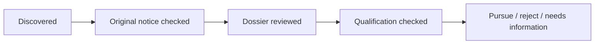

# Procurement as a loadable Omega workspace

This is a bl-ed package, `procurement`, composed with `present` and `browser`.
There is one package value, compiled into the real editor. No private page or
render loop. File-local `#+USE: present,browser,procurement` loads installed
package names on boot and ordinary visits. `#+PROCUREMENT_DESK: ora` selects a
scoped three-pane layout. Explicit unload removes the layout and commands in all
panes, cancels package-owned prompts and suppresses automatic reload until an
explicit use or a new browser page. File contents and durable desk facts survive.

## Daily use

Open `desks/ora/desk.bl.org`. The queue selects a notice into the decision pane;
the activity pane shows tasks, reported usage and page budgets. Buttons and keys:

| Action | Key | Meaning |
|---|---|---|
| Desk | space p h | Return to the scoped shortlist |
| New / reuse | space p n | New independent desk; copy profile and functions |
| Discover | space p d | Bounded official-source discovery |
| Refresh | space p r | Execute saved search, preserve notices and change history |
| Qualify dossier | space p q | Read local/downloaded originals and compare profile |
| Needs information | space p i | Record missing information and rationale |
| Pursue | space p y | Requires qualification check and no unknown requirements |
| Reject | space p x | Record an explicit rejection rationale |

C-Enter on a decision opens it. C-Enter in a saved search source runs a refresh
through Omega; saved `search.bl` functions load into the actual task namespace
before each eval, including edits. C-Enter on a browser declaration opens the
same browser package's observation layout. Existing browser keys handle watching,
pause/resume and headful/headless. `space b a` saves storage privately; closing
then `space b f` forgets it. Browser restart retains indexed artifacts and saved
profiles. Login validity remains unknown until evidence says otherwise.

## Files and modules

- `pq/main.bl`: pure package, commands, source-aware decision presenters and layouts.
- `service.mjs`: host IO, scoped facts, publication validation, runs and change history.
- `instructions.bl.org`: operational instructions supplied to Omega.
- `desk-tool.mjs`: literal JSON publication, not a procurement search strategy.
- `pages.mjs`: page-labelled excerpts from extracted PDF text, not an analyst.
- `import-previous.mjs`: reproducible import of the previous dated real Omega run.

Each desk has `profile.bl.org`, `search.bl`, `search.bl.org`, `settings.json`,
`state.json`, generated `desk.bl.org` and opportunity documents, qualification
reports, run reports and evidence. State publishes atomically; requests serialize
per desk. Different desks own different scratch files and browser sessions.
Generated code is authored by Omega. Desk creation copies reusable inputs, never
opportunities, decisions or run history. Copied Org files get the new desk ID.

Stages and decisions are distinct:



Stage advancement requires retained evidence. Dossier and qualification stages
also require requirement → document → page/section → profile fact → verdict
records. Unknown qualifications stay unknown. These are provenance guards, not
an automatic guarantee that a model interpreted a legal requirement correctly.

Refresh retains previous facts and records before/after changes, including
updated deadlines, availability and decisions. It cannot silently drop an old
opportunity by publishing a new shortlist. The report is materialized from facts;
Omega writes its analytical reports and curated code separately. The file selects
an installed layout; arbitrary file code is not executed on document load.

## Budgets and partial results

`settings.json` configures explicit browser opens (default 8 discovery / 4
qualification), inclusive input up to 400,000 and output up to 12,000 tokens.
The browser gateway refuses additional operations after limits; the Omega model
loop independently warns at 70% of its 400,000/12,000 budget, and pauses before
another paid request once reported cumulative usage reaches a limit. Continuation
does not reset usage. One response can overshoot a reported token threshold;
these are accounted stops, not exact preflight token predictions. Each turn also
has a sixteen-step guard. Clicking forms can navigate without an explicit `open`;
the page counter is labelled for explicit opens, not a comprehensive page audit.

Existing files remain usable after a paused run. Activity exposes the task so the
user can inspect, steer or start a fresh bounded follow-up with saved artifacts.
Downloaded dossiers are reused before another browser request. Archived run
reports survive world restarts; old task IDs are not linked to new-world tasks.

## Run locally

```sh
spikes/procurement/build.sh
PROCUREMENT_DEMO=1 BROWSER_LIVE=1 BROWSER_OPENAI=1 BROWSER_PROVIDER=deepseek \
  BROWSER_CREDENTIAL_FILE="$PWD/.local/browser-credentials.json" \
  BROWSER_DEMO_ROOT="$PWD/.local/procurement-flash-run" spikes/browser/run.sh
```

Default model is `deepseek-flash`. The existing ignored mode-0600 credential copy
is outside the served root. To seed an empty run from the previous real evidence:

```sh
node spikes/procurement/import-previous.mjs .local/procurement-flash-run
```

Then open `http://127.0.0.1:8797/?file=desks/ora/desk.bl.org` with no `use` query.
World 8796, browser gateway 8797, model adapter 8808 are isolated. User world 8790
is untouched. Saved browser storage is under the sibling private run directory,
not public desk files. Remote Kernel execution remains an adapter design, not a
claim demonstrated by this local slice.

## Real-model evidence and friction

Final run artifacts, actual provider usage, completed task turns, screenshots and
reuse proof are retained under `proof/`. Early Flash passes exposed wrong helper
paths, manual function loading, accessibility-ref syntax and argument escaping.
The implementation fixes those rather than claiming the initial run was smooth.
A global repository grep stalled; its child was stopped, paths were corrected,
and the intervention is retained. Early browser-only budget gates did not stop
model generation during repairs; the model-level cumulative stop now does.

Omega downloaded the ONMT dossier anonymously, containing RC.pdf and CPS.pdf.
No temporary account or invented company identity was needed. The acquisition
pass reached its token stop while reading extracted text; a separate analysis
pass reuses those files. Reports preserve actual document access and uncertainty.

## Current facts, archived reports and final proof

Opportunity files link a generated `qualification-facts-<id>.bl.org` with the
current requirement/document/page/profile/verdict records. This view regenerates
on publication and decision changes. Historical analyst narratives stay separate:
a real final-model discrepancy showed why a model's claim that it edited a report
cannot be trusted as synchronization. The current facts view avoids presenting an
old report as the current decision. Missing narrative reports are labelled as
not researched rather than linked to nonexistent files.

The changes buffer shows before/after decision, stage, deadline and availability,
plus rationale, next action and an opportunity link. A real UI reject/restore
exercise in the reused desk retains both rationales. Original dossier downloads
are served through a scoped artifact route, with traversal/symlink rejection.

Run with `spikes/procurement/run.sh` (defaults to Flash). Flash thinking is
explicitly disabled by default; `BROWSER_THINKING=enabled` and
`BROWSER_REASONING_EFFORT=low` opt into thinking. See
[DeepSeek's documented controls](https://api-docs.deepseek.com/guides/thinking_mode/).
Incomplete provider calls retain billed usage and execute no malformed tools.

To restore the committed text-only demonstration into a new ignored local root:

```sh
mkdir -p .local/procurement-restored/desks
cp -R spikes/procurement/proof/results/. .local/procurement-restored/desks/
BROWSER_DEMO_ROOT="$PWD/.local/procurement-restored" spikes/procurement/run.sh
```

Original binary dossiers and saved auth are not part of that public snapshot.
The original run keeps its binaries in `.local/procurement-flash-run`; the proof
contains their SHA256 manifest and extracted page-labelled text. Saving a browser
profile through the UI does not make any auth values part of served files.

The [full audit and tour](proof/README.md) links both decision desks, current
qualification facts, reusable search, model reports and retained original PDFs.
It reports all 132 paid Flash responses, including failures: 1,996,171 inclusive
input and 86,442 output tokens. The completed analysis and reuse tasks are
archived with turns and costs. The acquisition hit its cumulative budget; repair
and follow-up steers are disclosed. Generated functions and their Org source
match exactly in both desks.

Proof: `proof/contracts.txt` (33 green), `proof/vendor-tests.txt` (73 green),
`proof/core-tests.txt` (33 task + 15 codemode green), and the unchanged default
presentation equivalence check (no bad variants). The source-level package drive
covers owned prompt submission, frame-wide unload and package-layer identity;
the actual UI screenshots show use, reuse, browser observation, decision history
and unload. Explicit unuse remains respected on a subsequent file visit.

## Slice 2 — everyday decisions, cited reviews and honest partial runs

Approved scope and future deferrals: [NEXT-SLICES.md](NEXT-SLICES.md).
Implementation, screenshots, real-editor drive evidence and actual model outcomes:
[proof/slice2/README.md](proof/slice2/README.md).
The compact desk, original-page evidence layout, assigned blockers, scoped browser
shelf and persistent checkpoint lifecycle are package-owned and unload together.
Contracts: 41 passing; vendored editor drive/package/frame/host tests: 72 passing;
unchanged default-presentation equivalence: no bad variants. Actual unload leaves
one pane, no procurement state/package and no PDF iframe. Two unsteered paid Flash
discovery runs stayed bounded but failed to publish; autonomous discovery remains
an unmet acceptance criterion, explicitly recorded with raw proofs.
