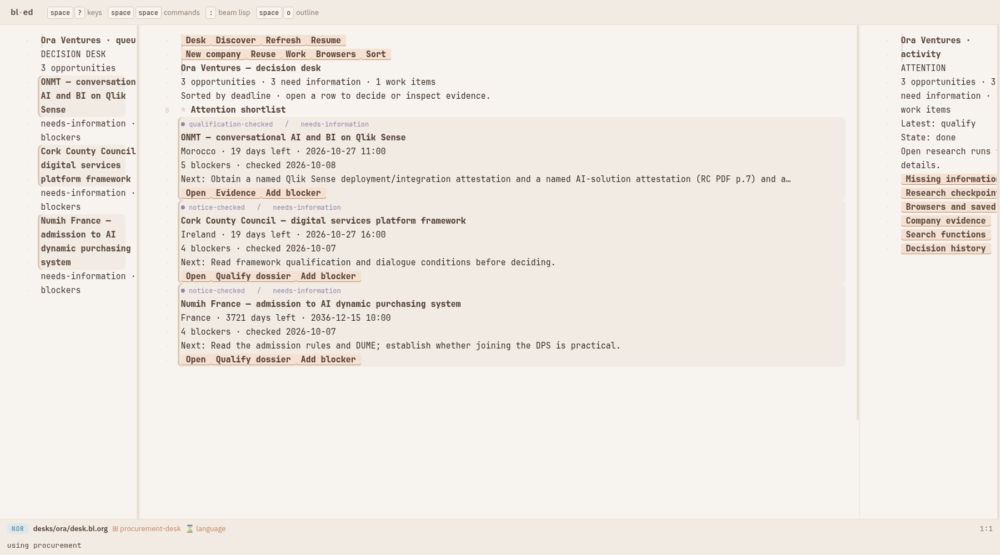
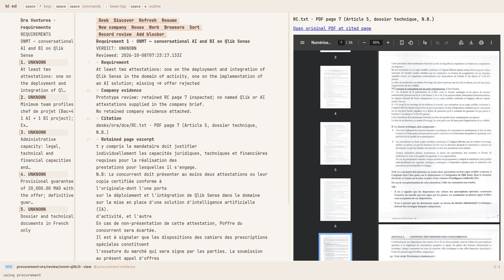
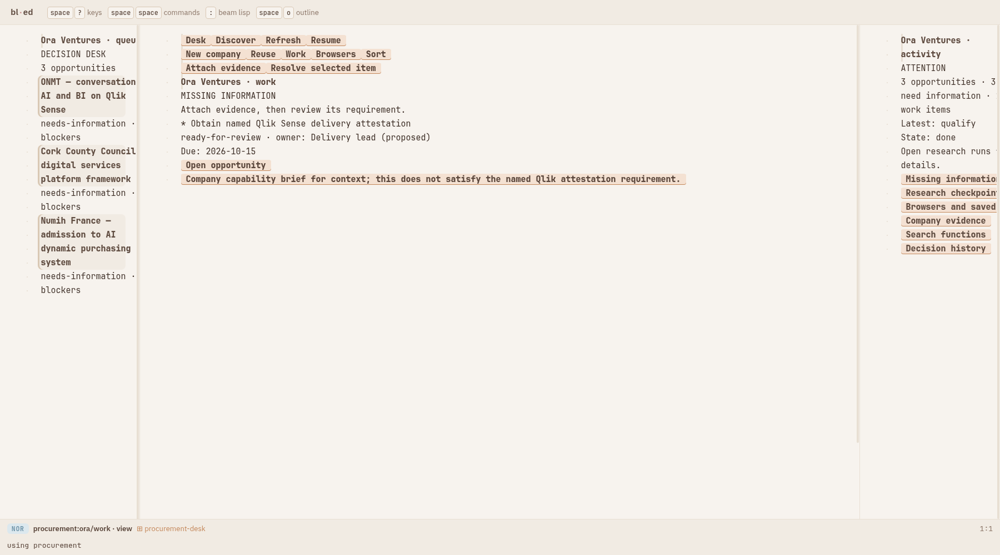
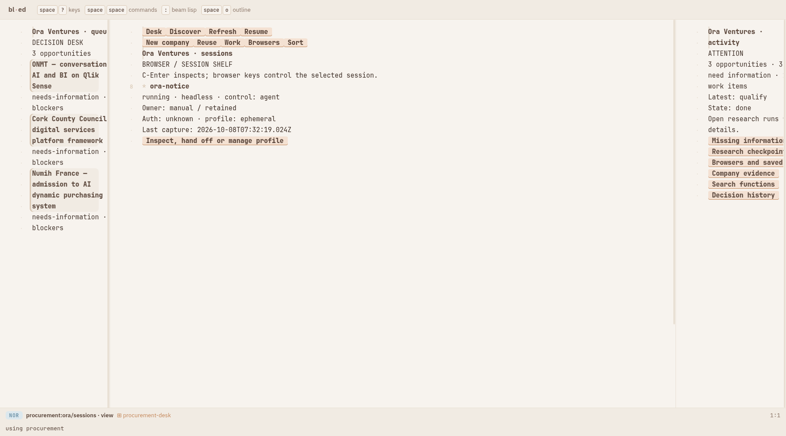
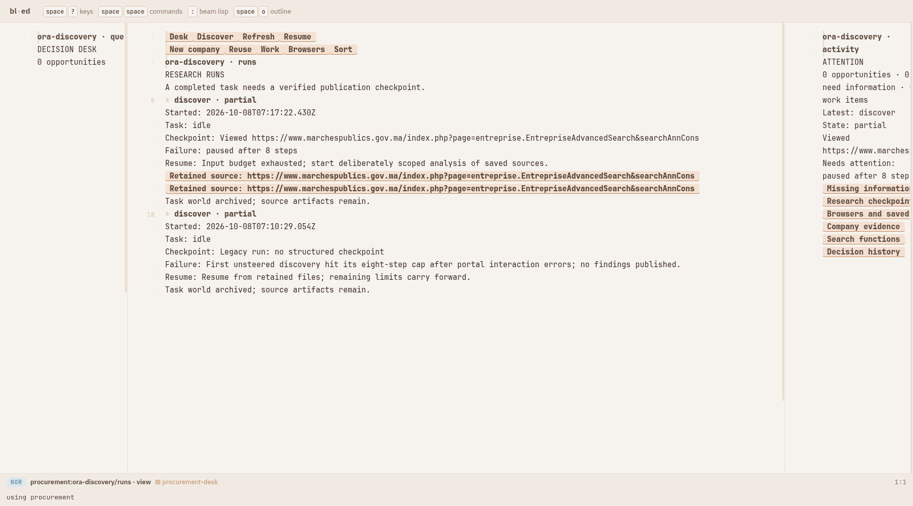
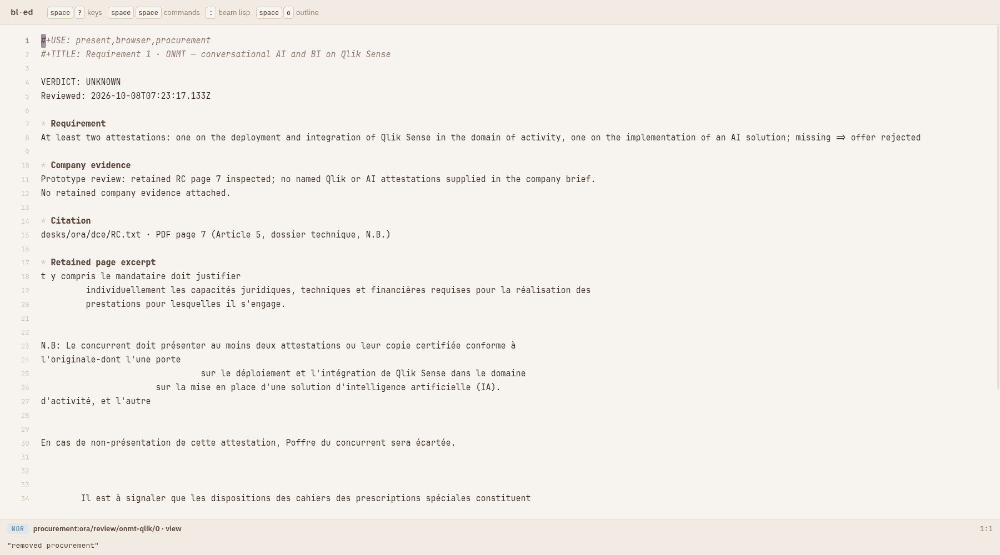

# Slice 2: an everyday procurement decision desk

The approved scope and later slices are recorded in
[the roadmap](../../NEXT-SLICES.md). This slice extends the same unloadable
`procurement` BL package; it does not add a separate application page.

## Tour

With the isolated demo running on port 8797:

- [Decision desk](http://127.0.0.1:8797/?file=desks/ora/desk.bl.org): compact
  shortlist, deadline/blocker/verification sorting, next actions and attention rail.
- [Requirement review](http://127.0.0.1:8797/?file=procurement:ora/review/onmt-qlik/0):
  requirements, company evidence and the retained original RC PDF at page 7.
- [Missing information](http://127.0.0.1:8797/?file=procurement:ora/work): owner,
  due date, evidence attachment and explicit review/resolution.
- [Browser shelf](http://127.0.0.1:8797/?file=procurement:ora/sessions): scoped
  session metadata and entry to existing browser inspection/profile controls.
- [Fresh independent discovery desk](http://127.0.0.1:8797/?file=desks/ora-discovery/desk.bl.org)
  and [its research checkpoints](http://127.0.0.1:8797/?file=procurement:ora-discovery/runs).
- [Reused workspace](http://127.0.0.1:8797/?file=desks/ora-refresh/desk.bl.org).

`New company` starts from a website; `Reuse` copies the company brief and saved
curated functions into an independent desk. Generated `.bl.org` files declare
package loading themselves. `:(ed/unuse "procurement")` removes the workspace
layout and its source-view DOM resource across panes. Domain projections,
workflow persistence, lifecycle and package-owned PDF host live in separate files.

## What was actually exercised

Editor-owned prompts recorded an explicit **unknown** review of the Qlik
attestation requirement, created a blocker owned by `Delivery lead (proposed)`
with due date 2026-10-15, and attached the existing company profile as context.
The attachment explicitly says it does not satisfy the named attestation.
The work item becomes ready for review; eligibility remains unknown. No person
was notified and no external assignment or buyer contact was made.

Source-page lookup uses the retained text's form-feed page boundaries and the
matching retained PDF; it does not fabricate a supporting excerpt. The exact
page stays available even when the portal or research world is unavailable.
Narrative qualification reports are labelled historical; current requirement
facts and review history carry the authoritative state.

## Real-model acceptance: partial, not a successful discovery

Two fresh **unsteered Omega / DeepSeek Flash** discovery runs used actual browser
calls to the Moroccan public procurement portal. Both stopped at the eight-step
cap and neither published a new opportunity. Existing three notices are retained
from the first slice, not attributed to these fresh runs.

| Run | Inclusive input (including cache reads) | Output | Explicit opens | Outcome |
| --- | ---: | ---: | ---: | --- |
| First | 61,803 | 938 | 2 | Partial; portal interaction errors, no publication |
| Second | 74,060 | 1,120 | 2 | Partial; portal search reached, no publication |

The first run exposed a retry-boundary bug: the promised alternative origin was
blocked after failures on the first portal. That was fixed before the second
run. The second run retained real URL-stamped source snapshots automatically,
which survive a world restart. The model ignored the prompt to reserve its final
two steps for publication. No operator steers repaired either acceptance run.

[Raw first proof](discovery-first.json), [raw second proof](discovery-second.json)
and [machine-readable outcomes](model-outcomes.json) preserve the discrepancy.
The autonomous-discovery acceptance criterion remains **unmet**. The next
research slice should enforce an acquisition/publication phase boundary in the
runner and evaluate compact portal-specific tools against a frozen set of
notices. Increasing the step cap alone does not establish reliability.

Resumption carries remaining input/output/page limits, accepts one continuation,
and refuses an exhausted budget. The second run has only 5,940 input tokens
remaining and therefore cannot automatically resume. Retained snapshots remain
available for deliberately scoped analysis; a partial task is never relabelled
complete just because it stopped. A completion checkpoint requires retained
files, synchronized saved functions and a published finding or sourced no-results
outcome. Browser/session credentials remain outside the served tree.

## Validation and remaining limits

See [contract tests](contracts.txt) (41 passing), [vendored editor drive tests](vendor-tests.txt) (72 passing)
and [unchanged presentation equivalence check](equivalence.txt). Screenshots
below are the real editor, not mockups. [Editor drive evidence](editor-drive.json) records the review, attachment and unload state.

The owner field remains local metadata. A retained evidence attachment is not an
automatic eligibility verdict. Remote execution, display-backed headed handoff,
authenticated portals, schedules, shared collaboration, broad coverage and bids
remain explicitly deferred in the roadmap.

