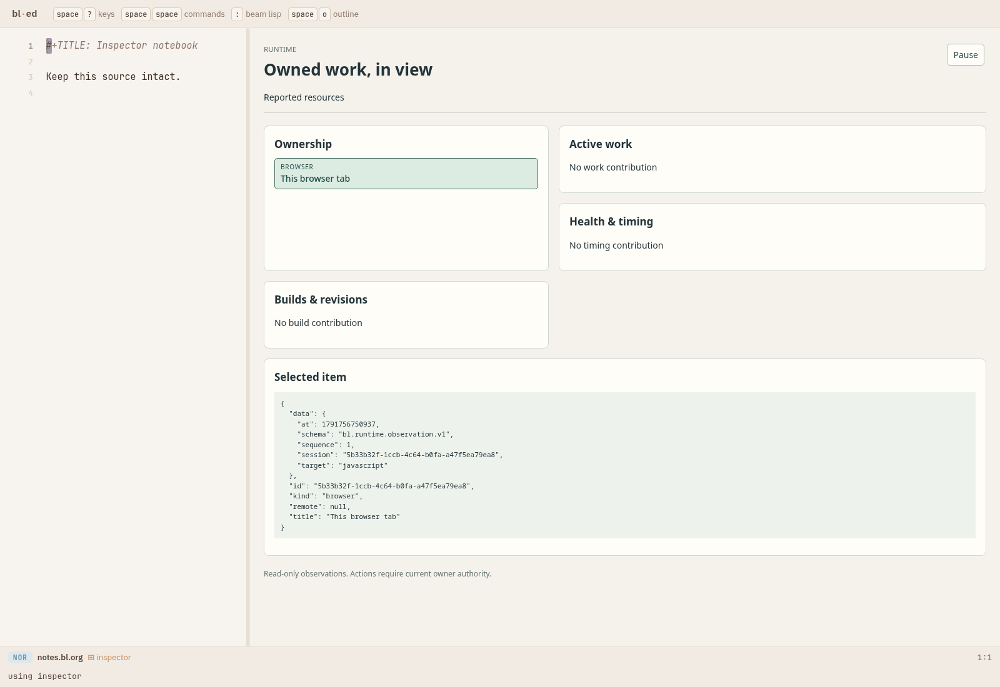
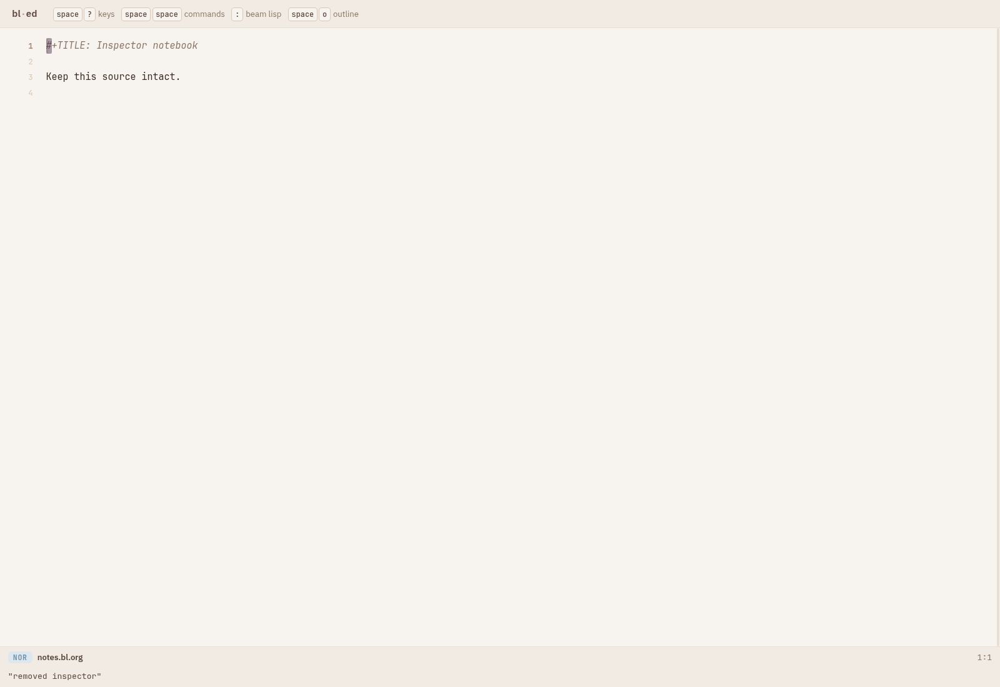

#+title: One inspector, domain contributions above it
#+status: VERIFIED

* Start with the editor
The inspector is an ordinary layered bl-ed package. It owns its layout and
package state; removing it restores the source editor. It does not start a
second editor, scheduler, resource registry or application loop.

The standalone package is named =inspector=. Omega's =runtime= package adds
project controls and Pelagic's observation contribution above the same model
and DOM host. Standalone loading requires the shared frontend containing the
package; it does not require an Omega backend provider.

* A small ownership tree
#+begin_src bl
(require '[ed.inspector :as inspector])
(inspector/tree [{:id "session" :title "Session"}
                 {:id "worker" :parent "session" :title "Preparation"}]
                #{})
#+end_src

The result adds depth, branch and ancestry fields. Collapsing an owner hides
its descendants without stopping them. Input is capped at 512 rows and parent
walks at 16 edges. Missing parents remain visible; cycles are marked instead
of looping. Selecting a resource that subsequently ends produces an unavailable
selection rather than silently selecting another resource.

* Add a domain without teaching the editor about it
=ed.inspector/model= accepts editor state, a package name, resource rows and a
pure projection function. The projection returns sections made of generic
blocks: text, headings, actions, metrics, progress, cards, details, JSON and
trees. Action events return to the editor; IO remains a host effect.

Read =rtview.presentation= for the Omega projection and
=pelagic.observations= for actual worker/actor ownership beneath a reported
Pelagic resource. These modules depend on domain vocabulary. The generic
=ed.inspector= and its DOM host have no Omega or Pelagic dependency.

* Follow the source
- =vendor/bl-ed/ed/inspector.bl=: bounded model, selection and collapse state.
- =vendor/bl-ed/web/inspector-host.mjs=: DOM/browser leaf and subscription disposal.
- =spikes/runtime/rtview/main.bl=: Omega effects, controls and package integration.
- =spikes/runtime/rtview/presentation.bl=: readable declarative domain sections.
- =spikes/pelagic/pelagic/observations.bl=: physical worker and actual actor rows.

A browser subscription observes resources; it does not own their execution.
Unloading the inspector disposes its reader and styles, preserving another
session's playback engine. Reported peer data never grants remote action
authority. Ownership rows come from runtime snapshots, not a parallel control
registry.

* Verification
The drive test checks standalone loading, exact unload, bounded/cyclic trees,
ended selection and existing Omega/Pocket restoration. The private offline
browser scenario tests both standalone and domain packages, source restoration,
real cancellation, candidate navigation, peer expiry and live engine identity.
The standard editor suite and unchanged presentation equivalence remain gates.

Recorded result: 80 editor/Runtime checks, 68 Pelagic contracts and 15 private
browser checks passed, with no browser page errors. Presentation equivalence
found no mismatches over 11 welcome and 12 Pelagic variants.

[[file:proof/inspector-report.html][Interactive recorded review]] ·
 ·

